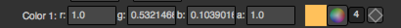

.. currentmodule:: NatronEngine
.. _ColorParam:

ColorParam
**********

**Inherits** :doc:`AnimatedParam`

Synopsis
--------

A color parameter is a RGB[A] value that can be animated throughout the time.
See :ref:`detailed<color.details>` description...

Functions
^^^^^^^^^

- def :meth:`get<NatronEngine.ColorParam.get>` ()
- def :meth:`get<NatronEngine.ColorParam.get>` (frame)
- def :meth:`getDefaultValue<NatronEngine.ColorParam.getDefaultValue>` ([dimension=0])
- def :meth:`getDisplayMaximum<NatronEngine.ColorParam.getDisplayMaximum>` (dimension)
- def :meth:`getDisplayMinimum<NatronEngine.ColorParam.getDisplayMinimum>` (dimension)
- def :meth:`getMaximum<NatronEngine.ColorParam.getMaximum>` ([dimension=0])
- def :meth:`getMinimum<NatronEngine.ColorParam.getMinimum>` ([dimension=0])
- def :meth:`getValue<NatronEngine.ColorParam.getValue>` ([dimension=0])
- def :meth:`getValueAtTime<NatronEngine.ColorParam.getValueAtTime>` (time[, dimension=0])
- def :meth:`restoreDefaultValue<NatronEngine.ColorParam.restoreDefaultValue>` ([dimension=0])
- def :meth:`set<NatronEngine.ColorParam.set>` (r, g, b, a)
- def :meth:`set<NatronEngine.ColorParam.set>` (r, g, b, a, frame)
- def :meth:`setDefaultValue<NatronEngine.ColorParam.setDefaultValue>` (value[, dimension=0])
- def :meth:`setDisplayMaximum<NatronEngine.ColorParam.setDisplayMaximum>` (maximum[, dimension=0])
- def :meth:`setDisplayMinimum<NatronEngine.ColorParam.setDisplayMinimum>` (minimum[, dimension=0])
- def :meth:`setMaximum<NatronEngine.ColorParam.setMaximum>` (maximum[, dimension=0])
- def :meth:`setMinimum<NatronEngine.ColorParam.setMinimum>` (minimum[, dimension=0])
- def :meth:`setValue<NatronEngine.ColorParam.setValue>` (value[, dimension=0])
- def :meth:`setValueAtTime<NatronEngine.ColorParam.setValueAtTime>` (value, time[, dimension=0])

.. _color.details:

Detailed Description
--------------------

A color parameter can either be of dimension 3 (RGB) or dimension 4 (RGBA). 
The user interface for this parameter looks like this:

This parameter type is very similar to a :doc:`Double3DParam` except that it can have
4 dimensions and has some more controls.

Member functions description
^^^^^^^^^^^^^^^^^^^^^^^^^^^^

.. method:: ColorParam.get(frame)

    :param frame: :class:`float`
    :rtype: :class:`ColorTuple<NatronEngine.ColorTuple>`

Returns a :doc:`ColorTuple` of the color held by the parameter at the given *frame*.

.. method:: ColorParam.get()
    :noindex:

    :rtype: :class:`ColorTuple<NatronEngine.ColorTuple>`

Returns a :doc:`ColorTuple` of the color held by the parameter at the current timeline's time.

.. method:: ColorParam.getDefaultValue([dimension=0])

    :param dimension: :class:`int`
    :rtype: :class:`float`

Returns the default value for this parameter at the given *dimension*.

.. method:: ColorParam.getDisplayMaximum(dimension)

    :param dimension: :class:`int`
    :rtype: :class:`float`

Returns the display maximum for this parameter at the given *dimension*.
The display maximum is the maximum value visible on the slider, internally the value
can exceed this range.

.. method:: ColorParam.getDisplayMinimum(dimension)

    :param dimension: :class:`int`
    :rtype: :class:`float`
    
Returns the display minimum for this parameter at the given *dimension*.
The display minimum is the minimum value visible on the slider, internally the value
can exceed this range.

.. method:: ColorParam.getMaximum([dimension=0])

    :param dimension: :class:`int`
    :rtype: :class:`float`

Returns the maximum for this parameter at the given *dimension*.
The maximum value cannot be exceeded and any higher value will be clamped to this value.

.. method:: ColorParam.getMinimum([dimension=0])

    :param dimension: :class:`int`
    :rtype: :class:`float`

Returns the minimum for this parameter at the given *dimension*.
The minimum value cannot be exceeded and any lower value will be clamped to this value.

.. method:: ColorParam.getValue([dimension=0])

    :param dimension: :class:`int`
    :rtype: :class:`float`

Returns the value of this parameter at the given *dimension* at the current timeline's time.

.. method:: ColorParam.getValueAtTime(time[, dimension=0])

    :param time: :class:`float`
    :param dimension: :class:`int`
    :rtype: :class:`float`

Returns the value of this parameter at the given *dimension* at the given *time*.

.. method:: ColorParam.restoreDefaultValue([dimension=0])

    :param dimension: :class:`int`

Removes all animation and expression set on this parameter and set the value
to be the default value.

.. method:: ColorParam.set(r, g, b, a, frame)

    :param r: :class:`float`
    :param g: :class:`float`
    :param b: :class:`float`
    :param a: :class:`float`
    :param frame: :class:`float`

Set a keyframe on each of the 4 animations curves at [r,g,b,a] for the given *frame*.
If this parameter is 3-dimensional, the *a* value is ignored.

.. method:: ColorParam.set(r, g, b, a)
    :noindex:

    :param r: :class:`float`
    :param g: :class:`float`
    :param b: :class:`float`
    :param a: :class:`float`

Set the value of this parameter to be [*r*,*g*,*b*,*a*].
If this parameter is animated (see :func:`getIsAnimated(dimension)<NatronEngine.AnimatedParam.getIsAnimated>`
then this function will automatically add a keyframe at the timeline's current time.

.. method:: ColorParam.setDefaultValue(value[, dimension=0])

    :param value: :class:`float`
    :param dimension: :class:`int`

Set the default value of this parameter at the given *dimension* to be *value*.

.. method:: ColorParam.setDisplayMaximum(maximum[, dimension=0])

    :param maximum: :class:`float`
    :param dimension: :class:`int`

Set the display maximum of the parameter to be *maximum* for the given *dimension*.
See :func:`getDisplayMaximum<Natron.ColorParam.getDisplayMaximum>`

.. method:: ColorParam.setDisplayMinimum(minimum[, dimension=0])

    :param minimum: :class:`float`
    :param dimension: :class:`int`

Set the display minimum of the parameter to be *minmum* for the given *dimension*.
See :func:`getDisplayMinimum<Natron.ColorParam.getDisplayMinimum>`

.. method:: ColorParam.setMaximum(maximum[, dimension=0])

    :param maximum: :class:`float`
    :param dimension: :class:`int`

Set the maximum of the parameter to be *maximum* for the given *dimension*.
See :func:`getMaximum<Natron.ColorParam.getMaximum>`

.. method:: ColorParam.setMinimum(minimum[, dimension=0])

    :param minimum: :class:`float`
    :param dimension: :class:`int`

Set the minimum of the parameter to be *minimum* for the given *dimension*.
See :func:`getMinimum<Natron.ColorParam.getMinimum>`

.. method:: ColorParam.setValue(value[, dimension=0])

    :param value: :class:`float`
    :param dimension: :class:`int`

Set the value of this parameter at the given *dimension* to be *value*.
If this parameter is animated (see :func:`getIsAnimated(dimension)<NatronEngine.AnimatedParam.getIsAnimated>`
then this function will automatically add a keyframe at the timeline's current time.

.. method:: ColorParam.setValueAtTime(value, time[, dimension=0])

    :param value: :class:`float`
    :param time: :class:`int`
    :param dimension: :class:`int`

Set a keyframe on each of the animation curve at the given *dimension*. The keyframe will
be at the given *time* with the given *value*.

