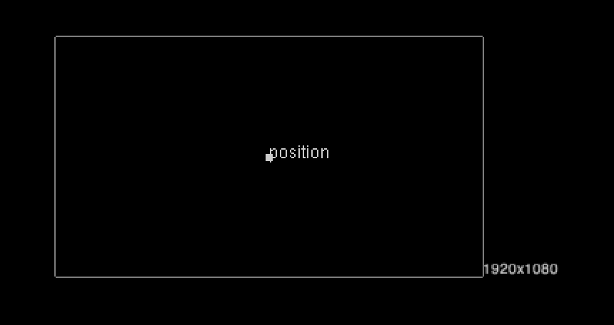

.. currentmodule:: NatronEngine
.. _Double2DParam:

Double2DParam
*************

**Inherits** :doc:`DoubleParam`

**Inherited by:** :ref:`Double3DParam`

Synopsis
--------

See :doc:`DoubleParam` for more information on this class.

Functions
^^^^^^^^^

- def :meth:`setUsePointInteract<NatronEngine.Double2DParam.setUsePointInteract>` (enabled)
- def :meth:`setCanAutoFoldDimensions<NatronEngine.Double2DParam.setCanAutoFoldDimensions>` (enabled)
- def :meth:`get<NatronEngine.Double2DParam.get>` ()
- def :meth:`get<NatronEngine.Double2DParam.get>` (frame)
- def :meth:`set<NatronEngine.Double2DParam.set>` (x, y)
- def :meth:`set<NatronEngine.Double2DParam.set>` (x, y, frame)

Member functions description
^^^^^^^^^^^^^^^^^^^^^^^^^^^^

.. method:: Double2DParam.setUsePointInteract(enabled)

    :param enabled: :class:`bool`

When called, the parameter will have its own overlay interact on the viewer as a point
that the user can select and drag.

.. method:: Double2DParam.setCanAutoFoldDimensions(enabled)

    :param enabled: :class:`bool`

Sets whether all dimensions should be presented as a single value/slider whenever they are equal.

.. method:: Double2DParam.get()

    :rtype: :class:`Double2DTuple`

Returns a :doc:`Double2DTuple` with the [x,y] values for this parameter at the current
timeline's time.

.. method:: Double2DParam.get(frame)
    :noindex:

    :param frame: :class:`float`
    :rtype: :class:`Double2DTuple`

Returns a :doc:`Double2DTuple` with the [x,y] values for this parameter at the given *frame*.

.. method:: Double2DParam.set(x, y, frame)

    :param x: :class:`float`
    :param y: :class:`float`
    :param frame: :class:`float`

Same as :func:`set(x,frame)<NatronEngine.DoubleParam.set>` but for 2-dimensional doubles.

.. method:: Double2DParam.set(x, y)
    :noindex:

    :param x: :class:`float`
    :param y: :class:`float`

Same as :func:`set(x)<NatronEngine.DoubleParam.set>` but for 2-dimensional doubles.

