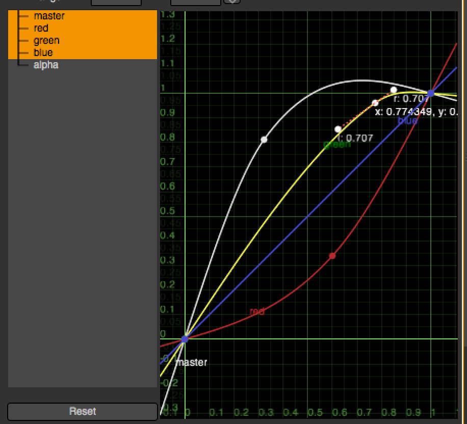

.. currentmodule:: NatronEngine
.. _ParametricParam:

ParametricParam
***************

**Inherits** :doc:`Param`

Synopsis
--------

A parametric param represents one or more parametric functions as curves.
See :ref:`detailed<parametric.details>` explanation below.

Functions
^^^^^^^^^

- def :meth:`addControlPoint<NatronEngine.ParametricParam.addControlPoint>` (dimension, key, value[,interpolation=NatronEngine.Natron.KeyframeTypeEnum.eKeyframeTypeSmooth])
- def :meth:`addControlPoint<NatronEngine.ParametricParam.addControlPoint>` (dimension, key, value, leftDerivative, rightDerivative, [,interpolation=NatronEngine.Natron.KeyframeTypeEnum.eKeyframeTypeSmooth])
- def :meth:`deleteAllControlPoints<NatronEngine.ParametricParam.deleteAllControlPoints>` (dimension)
- def :meth:`deleteControlPoint<NatronEngine.ParametricParam.deleteControlPoint>` (dimension, nthCtl)
- def :meth:`getCurveColor<NatronEngine.ParametricParam.getCurveColor>` (dimension)
- def :meth:`getNControlPoints<NatronEngine.ParametricParam.getNControlPoints>` (dimension)
- def :meth:`getNthControlPoint<NatronEngine.ParametricParam.getNthControlPoint>` (dimension, nthCtl)
- def :meth:`getValue<NatronEngine.ParametricParam.getValue>` (dimension, parametricPosition)
- def :meth:`setCurveColor<NatronEngine.ParametricParam.setCurveColor>` (dimension, r, g, b)
- def :meth:`setNthControlPoint<NatronEngine.ParametricParam.setNthControlPoint>` (dimension, nthCtl, key, value, leftDerivative, rightDerivative)
- def :meth:`setNthControlPointInterpolation<NatronEngine.ParametricParam.setNthControlPointInterpolation>` (dimension, nthCtl, interpolation)
- def :meth: `setDefaultCurvesFromCurrentCurves<NatronEngine.ParametricParam.setDefaultCurvesFromCurrentCurves>` ()

.. _parametric.details:

Detailed Description
--------------------

A parametric parameter has as many dimensions as there are curves. Currently the number of
curves is static and you may only specify the number of curves via the *nbCurves* argument
of the :func:`createParametricParam(name,label,nbCurves)<NatronEngine.UserParamHolder.createParametricParam>` function.

Parametric curves work almost the same way that animation curves do: you can add
control points and remove them.

You can peak the value of the curve at a special *parametric position*  with the :func:`getValue(dimension,parametricPosition)<NatronEngine.ParametricParam.getValue>`
function. The *parametric position* is represented by the X axis on the graphical user interface.

Member functions description
^^^^^^^^^^^^^^^^^^^^^^^^^^^^

.. method:: ParametricParam.addControlPoint(dimension, key, value[,interpolation=NatronEngine.Natron.KeyframeTypeEnum.eKeyframeTypeSmooth])

    :param dimension: :class:`int`
    :param key: :class:`float`
    :param value: :class:`float`
    :param interpolation: :class:`KeyFrameTypeEnum<NatronEngine.Natron.KeyframeTypeEnum>`
    :rtype: :attr:`StatusEnum<NatronEngine.Natron.StatusEnum>`

Attempts to add a new control point to the curve at the given *dimension*.
The new point will have the coordinate (key,value).
This function returns a NatronEngine.Natron.StatusEnum.eStatusOK upon success, otherwise
NatronEngine.Natron.StatusEnum.eStatusFailed is returned upon failure.

.. method:: ParametricParam.addControlPoint(dimension, key, value, leftDerivative, rightDerivative[,interpolation=NatronEngine.Natron.KeyframeTypeEnum.eKeyframeTypeSmooth])
    :noindex:

    :param dimension: :class:`int`
    :param key: :class:`float`
    :param value: :class:`float`
    :param leftDerivative: :class:`float`
    :param rightDerivative: :class:`float`
    :param interpolation: :class:`KeyFrameTypeEnum<NatronEngine.Natron.KeyframeTypeEnum>`
    :rtype: :attr:`StatusEnum<NatronEngine.Natron.StatusEnum>`

Attempts to add a new control point to the curve at the given *dimension*.
The new point will have the coordinate (key,value) and the derivatives (leftDerivative, rightDerivative).
This function returns a NatronEngine.Natron.StatusEnum.eStatusOK upon success, otherwise
NatronEngine.Natron.StatusEnum.eStatusFailed is returned upon failure.

.. method:: ParametricParam.deleteAllControlPoints(dimension)

    :param dimension: :class:`int`
    :rtype: :attr:`StatusEnum<NatronEngine.Natron.StatusEnum>`

Removes all control points of the curve at the given *dimension*.
This function returns a NatronEngine.Natron.StatusEnum.eStatusOK upon success, otherwise
NatronEngine.Natron.StatusEnum.eStatusFailed is returned upon failure.

.. method:: ParametricParam.deleteControlPoint(dimension, nthCtl)

    :param dimension: :class:`int`
    :param nthCtl: :class:`int`
    :rtype: :attr:`StatusEnum<NatronEngine.Natron.StatusEnum>`

Attempts to remove the *nth* control point (sorted in increasing X order) of the parametric
curve at the given *dimension*.

This function returns a NatronEngine.Natron.StatusEnum.eStatusOK upon success, otherwise
NatronEngine.Natron.StatusEnum.eStatusFailed is returned upon failure.

.. method:: ParametricParam.getCurveColor(dimension)

    :param dimension: :class:`ColorTuple`

Returns a :doc:`ColorTuple` with the [R,G,B] color of the parametric curve at the given *dimension*
on the graphical user interface.

.. method:: ParametricParam.getNControlPoints(dimension)

    :param dimension: :class:`int`
    :rtype: :class:`int`

Returns the number of control points of the curve at the given *dimension*.

.. method:: ParametricParam.getNthControlPoint(dimension, nthCtl)

    :param dimension: :class:`int`
    :param nthCtl: :class:`int`
    :rtype: :class:`tuple`

Returns a *tuple* containing information about the *nth* control point (sorted by increasing X order)
control point of the curve at the given *dimension*.
The tuple is composed of 5 members:

     [status: :class:`StatusEnum<NatronEngine.Natron.StatusEnum>`,
     key : :class:`float`,
     value: :class:`float`,
     left derivative: :class:`float`,
     right derivative: :class:`float`]

This function returns in the status a NatronEngine.Natron.StatusEnum.eStatusOK upon success, otherwise
NatronEngine.Natron.StatusEnum.eStatusFailed is returned upon failure.

.. method:: ParametricParam.getValue(dimension, parametricPosition)

    :param dimension: :class:`int`
    :param parametricPosition: :class:`float`
    :rtype: :class:`float`

Returns the Y value of the curve at the given *parametricPosition* (on the X axis) of the
curve at the given *dimension*.

.. method:: ParametricParam.setCurveColor(dimension, r, g, b)

    :param dimension: :class:`int`
    :param r: :class:`float`
    :param g: :class:`float`
    :param b: :class:`float`

Set the color of the curve at the given *dimension*.

.. method:: ParametricParam.setNthControlPoint(dimension, nthCtl, key, value, leftDerivative, rightDerivative)

    :param dimension: :class:`int`
    :param nthCtl: :class:`int`
    :param key: :class:`float`
    :param value: :class:`float`
    :param leftDerivative: :class:`float`
    :param rightDerivative: :class:`float`
    :rtype: :attr:`StatusEnum<NatronEngine.Natron.StatusEnum>`

Set the value of an existing control point on the curve at the given *dimension*.
The *nthCtl* parameter is the (zero based) index of the control point (by increasing X order).
The point will be placed at the coordinates defined by (key,value) and will have the derivatives
given by *leftDerivative* and *rightDerivatives*.

This function returns a NatronEngine.Natron.StatusEnum.eStatusOK upon success, otherwise
NatronEngine.Natron.StatusEnum.eStatusFailed is returned upon failure.

.. method:: ParametricParam.setNthControlPointInterpolation(dimension, nthCtl, interpolation)

    :param dimension: :class:`int`
    :param nthCtl: :class:`int`
    :param interpolation: :class:`KeyFrameTypeEnum<NatronEngine.Natron.KeyframeTypeEnum>`
    :rtype: :attr:`StatusEnum<NatronEngine.Natron.StatusEnum>`

Set the interpolation type of the curve surrounding the control point at the given index *nthCtl*.

.. method:: ParametricParam.setDefaultCurvesFromCurrentCurves()

Set the default curves of the parameter from the current state of the curves. The default
state will be used when the parameter is restored to default.
