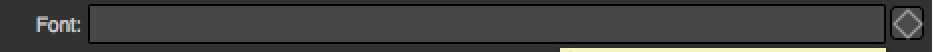
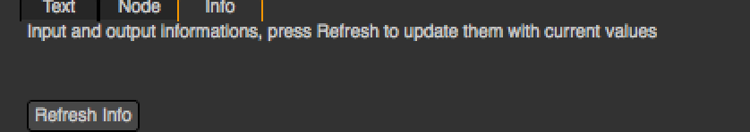
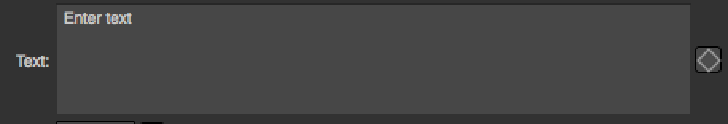
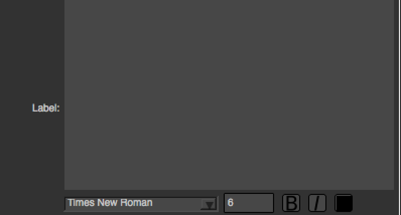

.. currentmodule:: NatronEngine
.. _StringParam:

StringParam
***********

**Inherits** :doc:`StringParamBase`

Synopsis
--------

This parameter is used to contain a string.
See :ref:`here<string.details>` for more details.

Functions
^^^^^^^^^

- def :meth:`setType<NatronEngine.StringParam.setType>` (type)

.. _string.details:

Detailed Description
--------------------

A StringParam can have several forms on the user interface, depending on its
:attr:`type<NatronEngine.StringParam.TypeEnum>`.

Here are the different types of string parameters:

   A basic string that can be edited by the user

   A non animating label string that the user cannot edit

   A multi-line string that the user can edit and animate

   A multi-line string with rich text support with a `subset of html <https://doc.qt.io/qt-6/richtext-html-subset.html>`_

String parameters that animate hold the string of a keyframe until the next keyframe
(the value steps, there is no interpolation between strings, except for the custom parameters
of OpenFX plug-ins, which hold a string and may provide an interpolation function). Before the first keyframe,
the value is the string of the first keyframe.
Keyframes can be added, deleted and moved freely: this never changes the string of the
other keyframes.
:func:`setValueAtTime()<NatronEngine.StringParamBase.setValueAtTime>`,
:func:`getValueAtTime()<NatronEngine.StringParamBase.getValueAtTime>` and
:func:`deleteValueAtTime()<NatronEngine.AnimatedParam.deleteValueAtTime>` set, read and
delete the string of the keyframe at a given time.

Member functions description
^^^^^^^^^^^^^^^^^^^^^^^^^^^^

.. attribute:: StringParam.TypeEnum

    Can have the following values:

    - eStringTypeLabel: a label shown in the user interface; it cannot be edited and does not animate
    - eStringTypeMultiLine: a multi-line plain text area
    - eStringTypeRichTextMultiLine: a multi-line text area with Qt rich text (HTML subset) support
    - eStringTypeCustom: a custom string that can hold anything; it animates but the user cannot edit it
    - eStringTypeDefault: the same as eStringTypeCustom, except that the user can edit it

    For example: ``param.setType(NatronEngine.StringParam.TypeEnum.eStringTypeMultiLine)``

.. method:: StringParam.setType(type)

    :param type: :attr:`NatronEngine.StringParam.TypeEnum`

Set the type of the StringParam. This should be called right away after creation
time.

.. warning::

    Once called, you should call :func:`refreshUserParamsGUI()<NatronEngine.UserParamHolder.refreshUserParamsGUI>`
    to update the user interface.

