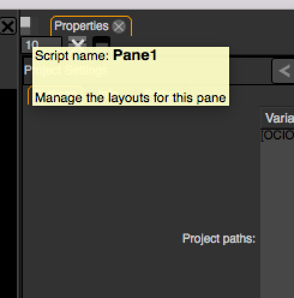

.. currentmodule:: NatronGui
.. _GuiApp:

GuiApp
*********

**Inherits** :doc:`../NatronEngine/App`

Synopsis
-------------

This class is used for GUI application instances.
See :ref:`detailed<guiApp.details>` description...

Functions
^^^^^^^^^

- def :meth:`createModalDialog<NatronGui.GuiApp.createModalDialog>` ()
- def :meth:`getFilenameDialog<NatronGui.GuiApp.getFilenameDialog>` (filters[, location=None])
- def :meth:`getSequenceDialog<NatronGui.GuiApp.getSequenceDialog>` (filters[, location=None])
- def :meth:`getDirectoryDialog<NatronGui.GuiApp.getDirectoryDialog>` ([location=None])
- def :meth:`getRGBColorDialog<NatronGui.GuiApp.getRGBColorDialog>` ()
- def :meth:`getActiveTabWidget<NatronGui.GuiApp.getActiveTabWidget>` ()
- def :meth:`getTabWidget<NatronGui.GuiApp.getTabWidget>` (scriptName)
- def :meth:`getSelectedNodes<NatronGui.GuiApp.getSelectedNodes>` ([group=None])
- def :meth:`getActiveViewer<NatronGui.GuiApp.getActiveViewer>` ()
- def :meth:`getViewer<NatronGui.GuiApp.getViewer>` (scriptName)
- def :meth:`getUserPanel<NatronGui.GuiApp.getUserPanel>` (scriptName)
- def :meth:`moveTab<NatronGui.GuiApp.moveTab>` (tabScriptName,pane)
- def :meth:`saveFilenameDialog<NatronGui.GuiApp.saveFilenameDialog>` (filters[, location=None])
- def :meth:`saveSequenceDialog<NatronGui.GuiApp.saveSequenceDialog>` (filters[, location=None])
- def :meth:`saveScreenshot<NatronGui.GuiApp.saveScreenshot>` (filePath[, scriptName=""])
- def :meth:`selectNode<NatronGui.GuiApp.selectNode>` (node,clearPreviousSelection)
- def :meth:`deselectNode<NatronGui.GuiApp.deselectNode>` (node)
- def :meth:`setSelection<NatronGui.GuiApp.setSelection>` (nodes)
- def :meth:`selectAllNodes<NatronGui.GuiApp.selectAllNodes>` ([group=None])
- def :meth:`copySelectedNodes<NatronGui.GuiApp.copySelectedNodes>` ([group=None])
- def :meth:`pasteNodes<NatronGui.GuiApp.pasteNodes>` ([group=None])
- def :meth:`clearSelection<NatronGui.GuiApp.clearSelection>` ([group=None])
- def :meth:`registerPythonPanel<NatronGui.GuiApp.registerPythonPanel>` (panel,pythonFunction)
- def :meth:`unregisterPythonPanel<NatronGui.GuiApp.unregisterPythonPanel>` (panel)
- def :meth:`renderBlocking<NatronGui.GuiApp.renderBlocking>` (effect,firstFrame,lastFrame,frameStep)
- def :meth:`renderBlocking<NatronGui.GuiApp.renderBlocking>` (tasks)

.. _guiApp.details:

Detailed Description
---------------------------

See :doc:`App<../NatronEngine/App>` for the documentation of base functionalities of this class.

To create a new :doc:`modal dialog<PyModalDialog>` , use the
:func:`createModalDialog()<NatronGui.GuiApp.createModalDialog>` function.

Several functions are made available to pop dialogs to ask the user for filename(s) or colors.
See :func:`getFilenameDialog(filters,location)<NatronGui.GuiApp.getFilenameDialog>` and
:func:`getRGBColorDialog()<NatronGui.GuiApp.getRGBColorDialog>`.

To create a new custom python panel, there are several ways to do it:

    * Sub-class the :doc:`PyPanel` class and make your own Qt widget
    * Create a :doc:`PyPanel` object and add controls using user parameters (as done for modal dialogs)

Once created, you can register the panel in the project so that it gets saved into the layout
by calling :func:`registerPythonPanel(panel,pythonFunction)<NatronGui.GuiApp.registerPythonPanel>`

Member functions description
^^^^^^^^^^^^^^^^^^^^^^^^^^^^

.. method:: GuiApp.createModalDialog()

    :rtype: :doc:`PyModalDialog<PyModalDialog>`

Creates a :doc:`modal dialog<PyModalDialog>` : the control will not be returned to the user until the dialog is not closed.
Once the dialog is created, you can enrich it with :doc:`parameters<../NatronEngine/Param>` or even
raw Qt widgets.
To show the dialog call the function :func:`exec()<>` on the dialog.

.. method:: GuiApp.getFilenameDialog(filters[, location=None])

    :param filters: :class:`sequence`
    :param location: :class:`str`
    :rtype: :class:`str`

Opens-up a file dialog to ask the user for a single filename which already exists.

*filters* is a list of  file extensions that should be displayed in the file dialog.

*location* is the initial location the dialog should display, unless it is empty in which
case the dialog will display the last location that was opened previously by a dialog.

.. method:: GuiApp.getSequenceDialog(filters[, location=None])

    :param filters: :class:`sequence`
    :param location: :class:`str`
    :rtype: :class:`str`

Same as :func:`getFilenameDialog(filters,location)<NatronGui.GuiApp.getFilenameDialog>` but
the dialog will accept sequence of files.

.. method:: GuiApp.getDirectoryDialog([location=None])

    :param location: :class:`str`
    :rtype: :class:`str`

Same as :func:`getFilenameDialog(filters,location)<NatronGui.GuiApp.getFilenameDialog>` but
the dialog will only accept directories as a result.

.. method:: GuiApp.saveFilenameDialog(filters[, location=None])

    :param filters: :class:`sequence`
    :param location: :class:`str`
    :rtype: :class:`str`

Opens-up a file dialog to ask the user for a single filename. If the file already exists,
the user will be warned about potential overriding of the file.

*filters* is a list of  file extensions that should be displayed in the file dialog.

*location* is the initial location the dialog should display, unless it is empty in which
case the dialog will display the last location that was opened previously by a dialog.

.. method:: GuiApp.saveSequenceDialog(filters[, location=None])

    :param filters: :class:`sequence`
    :param location: :class:`str`
    :rtype: :class:`str`

Same as :func:`saveFilenameDialog(filters,location)<NatronGui.GuiApp.saveFilenameDialog>` but
the dialog will accept sequence of files.

.. method:: GuiApp.saveScreenshot(filePath[, scriptName=""])

    :param filePath: :class:`str<PySide.QtCore.QString>`
    :param scriptName: :class:`str<PySide.QtCore.QString>`
    :rtype: :class:`bool<PySide.QtCore.bool>`

Saves an image of the main window, or, if *scriptName* is given, of the tab or pane with that
script name: a viewer (e.g. *"Viewer1"*), *"nodeGraph"*, *"properties"*, *"curveEditor"*,
*"dopeSheetEditor"*, *"scriptEditor"*, a Python panel, or a pane (e.g. *"pane1"*).
The image format is given by the extension of *filePath* (e.g. *.png* or *.jpg*).
Returns True on success, False if the tab or pane does not exist or is not visible, or if the
file could not be written.

Only the widgets of Natron are captured, with :meth:`QWidget.grab()`, never the screen: the
window does not need to be on top or visible on the screen. The content of the OpenGL widgets
(the viewers, the curve editor, the dope sheet...) is read from their framebuffer and pasted at
their position. Floating windows are not part of the main window: capture them with their
script name. The image has the resolution of the screen, e.g. twice the size of the window in
each direction on a HiDPI display.

It must be called from the main (GUI) thread: it returns False when called from a render
thread, e.g. from the *afterFrameRender* callback.

See :ref:`guiTesting` for an example.

.. method:: GuiApp.getRGBColorDialog()

    :rtype: :class:`ColorTuple<NatronEngine.ColorTuple>`

Opens-up a color dialog to ask the user for an RGB color.

.. method:: GuiApp.getActiveTabWidget()

    :rtype: :class:`PyTabWidget<NatronGui.PyTabWidget>`

Returns the tab-widget (pane) that the mouse last entered, or *None* if there is none.

.. method:: GuiApp.getTabWidget(scriptName)

    :param scriptName: :class:`str`
    :rtype: :class:`PyTabWidget<NatronGui.PyTabWidget>`

Returns the tab-widget with the given *scriptName*. The *scriptName* of a tab-widget can
be found in the user interface when hovering with the mouse the "Manage layout" button (in the top left-hand
corner of the pane)

.. method:: GuiApp.moveTab(tabScriptName,pane)

    :param tabScriptName: :class:`str`
    :param pane: :class:`PyTabWidget<NatronGui.PyTabWidget>`
    :rtype: :class:`bool`

Attempts to move the tab with the given *tabScriptName* into the given *pane* and make it current in the *pane*.
This function returns True upon success or False otherwise.

.. warning::

    Moving tabs that are not registered to
    the application via :func:`registerPythonPanel(panel,pythonFunction)<NatronGui.GuiApp.registerPythonPanel>`
    will not work.

.. method:: GuiApp.registerPythonPanel(panel,pythonFunction)

    :param panel: :class:`PyPanel<NatronGui.PyPanel>`
    :param scriptName: :class:`str`

Registers the *given* panel into the project. When registered, the panel will be saved
into the layout for the current project and a new entry in the "Panes" sub-menu of the
"Manage layouts" button  (in the top left-hand corner of each tab widget) will appear
for this panel.
*pythonFunction* is the name of a python-defined function that takes no argument that should
be used to re-create the panel.

.. method:: GuiApp.unregisterPythonPanel(panel)

    :param panel: :class:`PyPanel<NatronGui.PyPanel>`

Unregisters a previously registered panel.

.. method:: GuiApp.getSelectedNodes([group = None])

    :rtype: :class:`sequence`

Returns a sequence of :ref:`nodes<Effect>` currently selected in the given *group*.
You can pass the *app* object to get the top-level
NodeGraph. If passing None, the last user-selected NodeGraph will be used::

    topLevelSelection = app.getSelectedNodes()

    group = app.createNode("fr.inria.built-in.Group")

    groupSelection = app.getSelectedNodes(group)

.. method:: GuiApp.getActiveViewer()

    :rtype: :class:`PyViewer<NatronGui.PyViewer>`

Returns the active viewer (the viewer that the user last interacted with), or *None* if there is none.

.. method:: GuiApp.getViewer(scriptName)

    :param scriptName: :class:`str`

Returns the viewer with the given *scriptName* if one can be found.

.. method:: GuiApp.getUserPanel(scriptName)

    :param scriptName: :class:`str`

Returns a user panel matching the given *scriptName* if there is any.

.. method:: GuiApp.selectNode(node,clearPreviousSelection)

    :param node: :class:`Effect<NatronEngine.Effect>`
    :param clearPreviousSelection: :class:`bool`

    Select the given *node* in its containing nodegraph. If *clearPreviousSelection* is set to *True*, all
    the current selection will be wiped prior to selecting the *node*; otherwise the *node*
    will just be added to the selection.

.. method:: GuiApp.deselectNode(node)

    :param node: :class:`Effect<NatronEngine.Effect>`

    Deselect the given *node* in its containing nodegraph. If the *node* is not selected,
    this function does nothing.

.. method:: GuiApp.setSelection(nodes)

    :param nodes: :class:`sequence`

    Set all the given *nodes* selected in the nodegraph containing them and wipe
    any current selection.

    .. note::
        All nodes must be part of the same nodegraph (group), otherwise this function will fail.

.. method:: GuiApp.selectAllNodes([group=None])

    :param group: :class:`Group<NatronEngine.Group>`

    Select all nodes in the given *group*. You can pass the *app* object to get the top-level
    NodeGraph. If passing None, the last user-selected NodeGraph will be used.

.. method:: GuiApp.copySelectedNodes([group=None])

    :param group: :class:`Group<NatronEngine.Group>`

    Copy all nodes in the given *group*. You can pass the *app* object to get the top-level
    NodeGraph. If passing None, the last user-selected NodeGraph will be used.

.. method:: GuiApp.pasteNodes([group=None])

    :param group: :class:`Group<NatronEngine.Group>`

    Paste copied nodes in the given *group*. You can pass the *app* object to get the top-level
    NodeGraph. If passing None, the last user-selected NodeGraph will be used.

.. method:: GuiApp.clearSelection([group=None])

    Wipe any current selection in the given *group*. You can pass the *app* object to get the top-level
    NodeGraph. If passing None, the last user-selected NodeGraph will be used.

.. method:: GuiApp.renderBlocking(effect,firstFrame,lastFrame,frameStep)

    :param effect: :class:`Effect<NatronEngine.Effect>`

    :param firstFrame: :class:`int`

    :param lastFrame: :class:`int`

    :param frameStep: :class:`int`

Starts rendering the given *effect* on the frame-range defined by [*firstFrame*,*lastFrame*].
The *frameStep* parameter indicates how many frames the timeline should step after rendering
each frame. The value must be greater or equal to 1.
The *frameStep* parameter is optional and if not given will default to the value of the
**Frame Increment** parameter in the Write node.

For instance::

    render(effect,1,10,2)

Would render the frames 1,3,5,7,9

This is a blocking function.
A blocking render means that this function returns only when the render finishes (from failure or success).

This function should only be used to render with a Write node or DiskCache node.

.. method:: GuiApp.renderBlocking(tasks)
   :noindex:

   :param tasks: :class:`sequence`

This function takes a sequence of tuples of the form *(effect,firstFrame,lastFrame[,frameStep])*
The *frameStep* is optional in the tuple and if not set will default to the value of the
**Frame Increment** parameter in the Write node.

This is an overloaded function. Same as :func:`render(effect,firstFrame,lastFrame,frameStep)<NatronEngine.App.render>`
but all *tasks* will be rendered concurrently.

This function is called when rendering a script in background mode with
multiple writers.

This is a blocking call.

