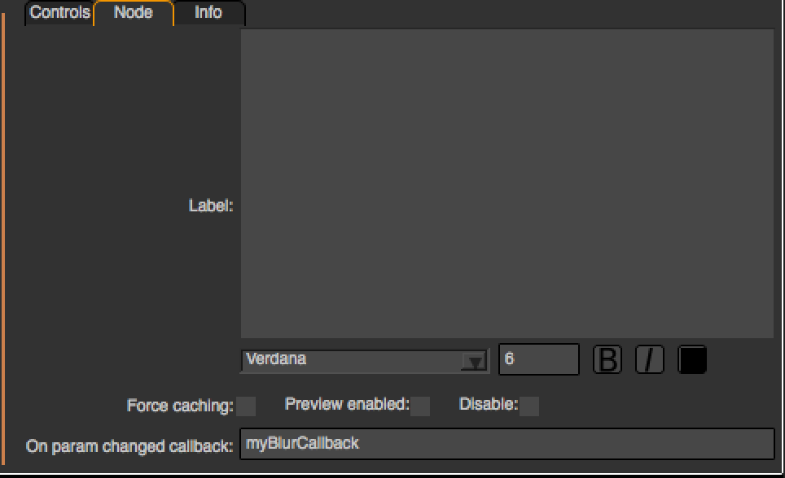
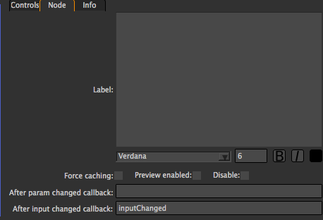
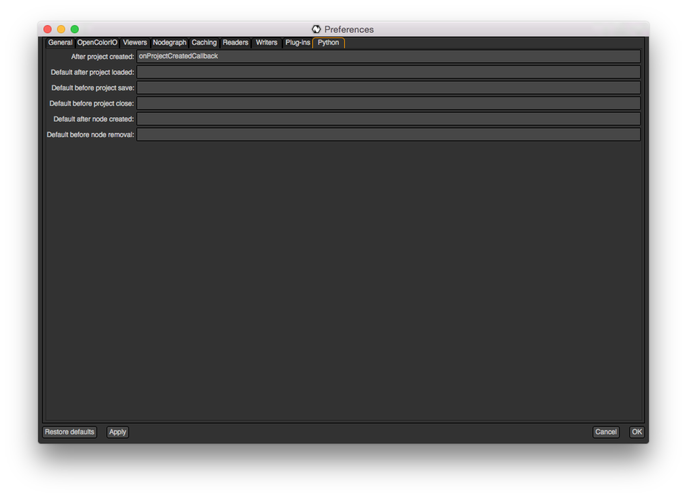
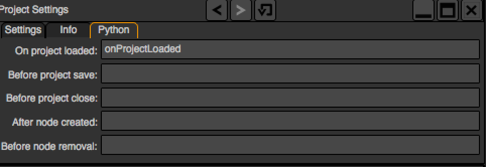
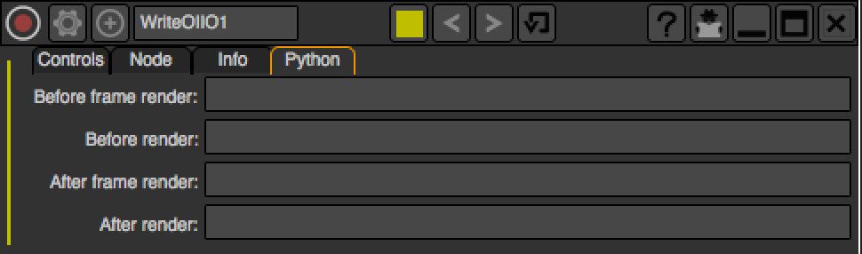

.. _callbacks:

Using Callbacks
===============

*Callbacks* are functions that are executed after or before a certain event in Natron.
They are Python-defined methods that you declare yourself and then register to Natron
in a different manner for each callback.

This document describes the signature that your different callbacks must have in order
to work for each event. Natron checks the **names** of the arguments, not only their number:
``def cb(thisParam, thisNode, thisGroup, app, userEdited)`` works as a param changed callback,
but ``def cb(p, n, g, a, u)`` is rejected, and an error is printed in the Script Editor.

.. warning::

    Note that callbacks will be called in background and GUI modes, hence you should
    wrap all GUI code by the following condition::

        if not NatronEngine.natron.isBackground():
            #...do gui stuff

.. _callbacksTable:

Summary of the callbacks
------------------------

The callbacks are string parameters that hold the name of a Python function. The table
lists, for each callback, the script name of that parameter, where it is set, and the exact
signature of the function. The sections below describe each callback.

.. list-table::
   :header-rows: 1
   :widths: 22 33 45

   * - Callback (script name)
     - Where to set it
     - Signature
   * - ``onParamChanged``
     - *Node* tab of any node
     - ``callback(thisParam, thisNode, thisGroup, app, userEdited)``
   * - ``onInputChanged``
     - *Node* tab of any node
     - ``callback(inputIndex, thisNode, thisGroup, app)``
   * - ``afterNodeCreated``
     - *Python* tab of the Project Settings; *Node* tab of a Group or PyPlug; default for new
       projects: ``defOnNodeCreated`` in the Preferences
     - ``callback(thisNode, app, userEdited)``
   * - ``beforeNodeRemoval``
     - Same as afterNodeCreated; default: ``defOnNodeDelete``
     - ``callback(thisNode, app)``
   * - ``beforeRender``
     - *Node* tab of a Write node
     - ``callback(thisNode, app)``
   * - ``beforeFrameRender``
     - *Node* tab of a Write node
     - ``callback(frame, thisNode, app)``
   * - ``afterFrameRender``
     - *Node* tab of a Write node
     - ``callback(frame, thisNode, app)``
   * - ``afterRender``
     - *Node* tab of a Write node
     - ``callback(aborted, thisNode, app)``
   * - ``afterProjectLoad``
     - *Python* tab of the Project Settings; default: ``defOnProjectLoaded``
     - ``callback(app)``
   * - ``beforeProjectSave``
     - *Python* tab of the Project Settings; default: ``defOnProjectSave``
     - ``callback(filename, app, autoSave)``, returns the file name to save to
   * - ``beforeProjectClose``
     - *Python* tab of the Project Settings; default: ``defOnProjectClose``
     - ``callback(app)``
   * - ``afterProjectCreated``
     - *Python* tab of the Preferences
     - ``callback(app)``
   * - param changed of a panel or dialog
     - ``setParamChangedCallback()`` of a :ref:`PyPanel<pypanel>` or :ref:`PyModalDialog<pyModalDialog>`
     - ``callback(paramName, app, userEdited)``

From Python, set a callback parameter like any string parameter, e.g.
``app.Blur1.onParamChanged.set("myCallback")``, ``app.afterProjectLoad.set("myCallback")`` or
``natron.getSettings().getParam("afterProjectCreated").set("myCallback")``.

An exception raised in *beforeRender*, *beforeFrameRender* or *afterFrameRender* aborts the render.
Errors in the other callbacks are printed in the Script Editor (see :ref:`debuggingPython`).

Callback persistence
--------------------

If you want your callback to persist 2 runs of Natron; it is necessary that you define it
in a script that is loaded by Natron, that is, either the **init.py** script (or **initGui.py** if you want it only available in GUI mode)
or the script of a Python group plug-in (or its extension script, see :ref:`here<pyplugWriting-ext>`).
See :ref:`this section<startupScripts>` for more infos.

Here is the list of the different callbacks:

The param changed callback
--------------------------

This function is called every times the value of a :ref:`parameter<Param>` changes.
This callback is available for all objects that can hold parameters,namely:

- :ref:`Effect<Effect>`
- :ref:`PyPanel<pypanel>`
- :ref:`PyModalDialog<pyModalDialog>`

The signature of the callback used on the :ref:`Effect<Effect>` is::

    callback(thisParam, thisNode, thisGroup, app, userEdited)

- **thisParam** : This is a :ref:`Param<Param>` pointing to the parameter which just had its value changed.
- **thisNode** : This is a :ref:`Effect<Effect>` pointing to the effect holding **thisParam**
- **thisGroup** : This is a :ref:`Effect<Effect>` pointing to the group  holding **thisNode** or **app** otherwise if the node is in the main node-graph.
- **app** : This variable will be set so it points to the correct :ref:`application instance<App>`.
- **userEdited** : This indicates whether or not the parameter change is due to user interaction (i.e: because the user changed
  the value by theirself) or due to another parameter changing the value of the parameter
  via a derivative of the :func:`setValue(value)<>` function.

The callback is called for every parameter of the node, including the buttons, and also for the
changes made by scripts and by the callback itself: test
``thisParam.getScriptName()`` first, and ``userEdited`` if only the user's changes matter. A
callback that sets the value of the parameter that triggered it is called again. It is not called
when only the current frame changes, even if the parameter is animated. For a group or a PyPlug,
the callback set on the group is called for the parameters of the group, not for those of the
nodes inside it (see :ref:`pyplugWriting-ext` for an example).

For the *parameter changed callback* of :ref:`PyPanel<pypanel>` and :ref:`PyModalDialog<pyModalDialog>`, the signature of the callback function is:

    callback(paramName, app, userEdited)

- **paramName** indicating the :ref:`script-name<autoVar>` of the parameter which just had its value changed.
- **app** : This variable will be set so it points to the correct :ref:`application instance<App>`.
- **userEdited** : This indicates whether or not the parameter change is due to user interaction (i.e: because the user changed the value by theirself) or due to another parameter changing the value of the parameter via a derivative of the :func:`setValue(value)<>` function.

.. note::

    The difference between the callbacks on  :ref:`PyPanel<pypanel>` and :ref:`PyModalDialog<pyModalDialog>` and
    :ref:`Effect<Effect>` is due to technical reasons: mainly because the parameters of the
    :ref:`PyPanel<pypanel>` class and :ref:`PyModalDialog<pyModalDialog>` are not declared
    as attributes of the object.

.. mermaid::
   :alt: When the user edits a parameter, or a script calls setValue, the parameter notifies
         its node (EffectInstance::onKnobValueChanged_public). For an OpenFX plug-in, Natron
         first sends the kOfxActionInstanceChanged action to the plug-in. Then, unless the change
         only comes from a time change, Natron reads the name of the node's onParamChanged
         function, checks the names of its arguments, and calls it with thisParam, thisNode,
         thisGroup, app and userEdited. Errors are printed in the Script Editor.
   :caption: How a parameter change reaches the onParamChanged callback.

   sequenceDiagram
       actor User
       participant Param as Parameter (knob)
       participant Node as Node (EffectInstance)
       participant Plugin as OpenFX plug-in
       participant Py as Python callback
       User->>Param: edit in the settings panel, or Param.setValue() from a script
       Param->>Node: onKnobValueChanged_public()
       Node->>Plugin: kOfxActionInstanceChanged (OpenFX nodes only)
       Note over Node: stop here if the change is only a time change
       Node->>Node: check the argument names of the onParamChanged function
       Node->>Py: cb(thisParam, thisNode, thisGroup, app, userEdited)
       Py-->>Node: errors are printed in the Script Editor

A param changed callback runs in the main thread, so it can wait for a render that it started and
read its result: see :ref:`pyplugWriting-renderReadBack` for
:meth:`app.waitForRenders()<NatronEngine.App.waitForRenders>` and the viewer functions. The
*afterFrameRender* callback runs in a render thread: these functions raise :class:`RuntimeError` there.

Registering the param changed callback
----------------------------------------

To register the param changed callback of an :ref:`Effect<Effect>`, you can do so in
the settings panel of the node, in the "Node" tab, by entering the name of your Python function:

You can also set the callback directly from the script: The callback is just another :ref:`parameter<Param>`
of the node, on which you can call :func:`setValue(value)<>` to set the name of the callback

::

    def myBlurCallback(thisParam, thisNode, thisGroup, app, userEdited):
        ...

    app.Blur1.onParamChanged.set("myBlurCallback")

.. note::

    If the callback is defined in a separate python file, such as the python script of a
    python group plug-in, then do not forget the module prefix, e.g.:

        app.MyPlugin1.Blur1.onParamChanged.set("MyPlugin.myBlurCallback")

Example
^^^^^^^^
::

    # This simple callback just prints a string when the "size" parameter of the Blur
    # node changes
    def myBlurCallback(thisParam, thisNode, thisGroup, app, userEdited):
        if thisParam == thisNode.size:
            print("The size of the blur just changed!")

    app.Blur1.onParamChanged.set("myBlurCallback")

Using the param changed callback for  :ref:`PyModalDialog<pyModalDialog>` and  :ref:`PyPanel<pypanel>`
--------------------------------------------------------------------------------------------------------------------

To register the callback to the object, use the :func:`setParamChangedCallback(pythonFunctionName)<>` function.

The following example is taken from the initGui.py script provided as example in :ref:`this section<sourcecodeEx>`.

Example
^^^^^^^^

::

    #Callback called when a parameter of the player changes
    #The variable paramName is declared by Natron; indicating the name of the parameter which just had its value changed
    def myPlayerParamChangedCallback(paramName, app, userEdited):

        viewer = app.getViewer("Viewer1")
        if viewer == None:
            return
        if paramName == "previous":
            viewer.seek(viewer.getCurrentFrame() - 1)
        elif paramName == "backward":
            viewer.startBackward()
        elif paramName == "forward":
            viewer.startForward()
        elif paramName == "next":
            viewer.seek(viewer.getCurrentFrame() + 1)
        elif paramName == "stop":
            viewer.pause()

    def createMyPlayer():
        app.player = NatronGui.PyPanel("fr.inria.myplayer","My Player",True,app)
        #...
        app.player.setParamChangedCallback("myPlayerParamChangedCallback")

The After input changed callback
----------------------------------

Similarly to the param changed callback, this function is called whenever an input connection of
the node is changed.  The signature is::

    callback(inputIndex, thisNode, thisGroup, app)

.. note::

    This function will be called even when loading a project

- **inputIndex** : This is the input which just got connected/disconnected.
  You can fetch the input at the given index with the :func:`getInput(index)<>` function of the :ref:`Effect<Effect>` class.

- **thisNode** : This is a :ref:`Effect<Effect>` holding the input which just changed

- **thisGroup** : This is a :ref:`Effect<Effect>` pointing to the group  holding **thisNode**. Note that it will be declared only if **thisNode** is part of a group.

- **app** : points to the correct :ref:`application instance<App>`.

Registering the input changed callback
----------------------------------------

To register the input changed callback of an :ref:`Effect<Effect>`, you can do so in
the settings panel of the node, in the "Node" tab, by entering the name of your Python function:

You can also set the callback directly from the script: The callback is just another :ref:`parameter<Param>`
of the node, on which you can call :func:`setValue(value)<>` to set the name of the callback

::

    def inputChangedCallback(inputIndex, thisNode, thisGroup, app):
        ...

    app.Merge1.onInputChanged.set("inputChangedCallback")

Example
^^^^^^^^
::

    # This simple callback just prints the input node name if connected or "None" otherwise
    # node changes
    def inputChangedCallback(inputIndex, thisNode, thisGroup, app):
        inp = thisNode.getInput(inputIndex)
        if not inp is None:
            print("Input ",inputIndex," is ",inp.getScriptName())
        else:
            print("Input ",inputIndex," is None")

    app.Merge1.onInputChanged.set("inputChangedCallback")

The After project created callback
-------------------------------------

This function is called whenever a new project is created, that is either when launching Natron
without loading a project, or when clicking "Create a new project" or "Close project".

.. note::

    Note that this function is never called when a project is loaded either via an auto-save
    or from user interaction.

The signature is::

    callback(app)

- **app** : points to the correct :ref:`application instance<App>` being created.

You can set the callback via the *afterProjectCreated* parameter of the settings of Natron.

This is a good place to create custom panels and/or setup the node-graph with node presets.

Example, taken from the initGui.py script provided as example in :ref:`this section<sourcecodeEx>`:

::

    def onProjectCreated(app):

        #Always create our icon viewer on project creation
        createIconViewer()

    natron.getSettings().getParam("afterProjectCreated").set("onProjectCreated")

The After project loaded callback
-------------------------------------

This function is very similar to the After project created callback but is a per-project callback,
called only when a project is loaded from an auto-save or from user interaction.
The signature is::

    callback(app)

- **app** : points to the correct :ref:`application instance<App>` being loaded.

You can set this callback in the project settings:

This is a good place to do some checks to opened projects or to setup something:

::

    def onProjectLoaded(app):

        if not natron.isBackground():
            if app.getUserPanel("fr.inria.iconviewer") is None:
                createIconViewer()

    app.afterProjectLoad.set("onProjectLoaded")

.. note::

    You can set a default After project loaded callback for all new projects in the *Preferences-->Python* tab.

The Before project save callback
----------------------------------

This function will be called prior to saving a project either via an auto-save or from
user interaction. The signature is::

    callback(filename, app, autoSave)

- **filename** : This is the file-path where the project is initially going to be saved.

- **app** :  points to the correct :ref:`application instance<App>` being created.

- **autoSave** : This indicates whether the save was originated from an auto-save or from user interaction.

.. warning::

        This function should return the filename under which the project should really be saved.

You can set the callback from the project settings:

::

    def beforeProjectSave(filename, app, autoSave):
        print("Saving project under: ",filename)
        return filename

    app.beforeProjectSave.set("beforeProjectSave")

.. note::

    You can set a default Before project save callback for all new projects in the *Preferences-->Python* tab.

The Before project close callback
---------------------------------

This function is called prior to closing a project either because the application is about
to quit or because the user closed the project. The signature is::

    callback(app)

- **app** : points to the correct :ref:`application instance<App>` being closed.

This function can be used to synchronize any other device or piece of software communicating
with Natron.

You can set the callback from the project settings:

::

    def beforeProjectClose(app):
        print("Closing project")

    app.beforeProjectClose.set("beforeProjectClose")

.. note::

    You can set a default Before project close callback for all new projects in the *Preferences-->Python* tab.

The After node created callback
---------------------------------

This function is called after creating a node in Natron. The signature is::

    callback(thisNode, app, userEdited)

- **thisNode** points to the :ref:`node<Effect>` that has been created.

- **app** points to the correct :ref:`application instance<App>`.

- **userEdited** will be *True* if the node was created
  by the user (or by a script using the :func:`createNode(pluginID,version,group)<>` function)
  or *False* if the node was created by actions such as pasting a node or when the project is
  loaded.

This is a good place to change default parameters values.

You can set the callback from the project settings:

::

    def onNodeCreated(thisNode, app, userEdited):
        print(thisNode.getScriptName()," was just created")
        if userEdited:
            print(" due to user interaction")
        else:
            print(" due to project load or node pasting")

    app.afterNodeCreated.set("onNodeCreated")

.. note::

    You can set a default After node created callback for all new projects in the *Preferences-->Python* tab.

This callback can also be set in the *Node* tab of any **Group** node (or *PyPlug*).
If set on the Group, the callback will be invoked for the *Group* node and all its direct children (not recursively).

The Before node removal callback:
---------------------------------

This function is called prior to deleting a node in Natron. The signature is::

    callback(thisNode, app)

- **thisNode** : points to the :ref:`node<Effect>` about to be deleted.

- **app** : points to the correct :ref:`application instance<App>`.

.. warning::

    This function will **NOT** be called when the project is closing

You can set the callback from the project settings:

::

    def beforeNodeDeleted(thisNode, app):
        print(thisNode.getScriptName()," is going to be destroyed")

    app.beforeNodeRemoval.set("beforeNodeDeleted")

.. note::

    You can set a default Before node removal callback for all new projects in the *Preferences-->Python* tab.

This callback can also be set in the *Node* tab of any **Group** node (or *PyPlug*).
If set on the Group, the callback will be invoked for the *Group* node and all its direct children (not recursively).

The render callbacks of a Write node are called in this order:

.. mermaid::
   :alt: When a render starts, with app.render() or the -w option, Natron calls the
         beforeRender callback with thisNode and app. Then for each frame it calls
         beforeFrameRender with frame, thisNode and app, renders the frame, and calls
         afterFrameRender with frame, thisNode and app. At the end, or when the render is
         aborted, it calls afterRender with aborted, thisNode and app. An exception in
         beforeRender, beforeFrameRender or afterFrameRender aborts the render.
   :caption: The render callbacks of a Write node.

   sequenceDiagram
       participant S as Script or command line
       participant W as Write node
       participant Py as Python callbacks
       S->>W: app.render(), or -w
       W->>Py: beforeRender(thisNode, app)
       loop each frame
           W->>Py: beforeFrameRender(frame, thisNode, app)
           W->>W: render the frame
           W->>Py: afterFrameRender(frame, thisNode, app)
       end
       W->>Py: afterRender(aborted, thisNode, app)
       Note over Py,W: an exception in beforeRender, beforeFrameRender or afterFrameRender aborts the render

The Before frame render callback:
---------------------------------

This function is called prior to rendering any frame with a Write node. The signature is::

    callback(frame, thisNode, app)

- **thisNode** : points to the :ref:`write node<Effect>`.

- **app** : points to the correct :ref:`application instance<App>`.

- **frame**: The frame that is about to be rendered

To execute code specific when in background render mode or in GUI mode, use the following condition
::

    if natron.isBackground():
        #We are in background mode

You can set the callback in the "Node" tab of the Write node settings panel.

This function can be used to communicate with external programs for example.

.. warning::

    Any exception thrown in this callback will abort the render

The After frame rendered callback:
-----------------------------------

This function is called after each frame is finished rendering with a Write node.
The signature is::

    callback(frame, thisNode, app)

- **thisNode** : points to the :ref:`write node<Effect>`.

- **app** : points to the correct :ref:`application instance<App>`.

- **frame**: The frame that was just rendered

To execute code specific when in background render mode or in GUI mode, use the following condition
::

    if natron.isBackground():
        #We are in background mode

You can set the callback in the "Node" tab of the Write node settings panel.

This function can be used to communicate with external programs for example.

.. warning::

    Any exception thrown in this callback will abort the render

The Before render callback:
---------------------------

This function is called once before starting rendering the first frame of a sequence with
the Write node.  The signature is::

    callback(thisNode, app)

- **thisNode** : points to the :ref:`write node<Effect>`.

- **app** : points to the correct :ref:`application instance<App>`.

To execute code specific when in background render mode or in GUI mode, use the following condition
::

    if natron.isBackground():
        #We are in background mode

You can set the callback in the "Node" tab of the Write node settings panel.

This function can be used to communicate with external programs for example.

.. warning::

    Any exception thrown in this callback will abort the render

.. _afterRenderCallback:

The After render callback:
---------------------------

This function is called once after the rendering of the last frame is finished with
the Write node or if the render was aborted.  The signature is::

    callback(aborted, thisNode, app)

- **aborted** :  *True* if the rendering was aborted or *False* otherwise.

- **thisNode** : points to the :ref:`write node<Effect>`.

- **app** : points to the correct :ref:`application instance<App>`.

To execute code specific when in background render mode or in GUI mode, use the following condition
::

    if natron.isBackground():
        #We are in background mode

You can set the callback in the "Node" tab of the Write node settings panel.

This function can be used to communicate with external programs for example.
