.. _groups:

Working with groups
===================

Groups in Natron are a complete sub-nodegraph into which the user can manage nodes exactly
like in the *main* nodegraph, but everything in that sub-group will be referenced as 1
node in the hierarchy above, e.g.:

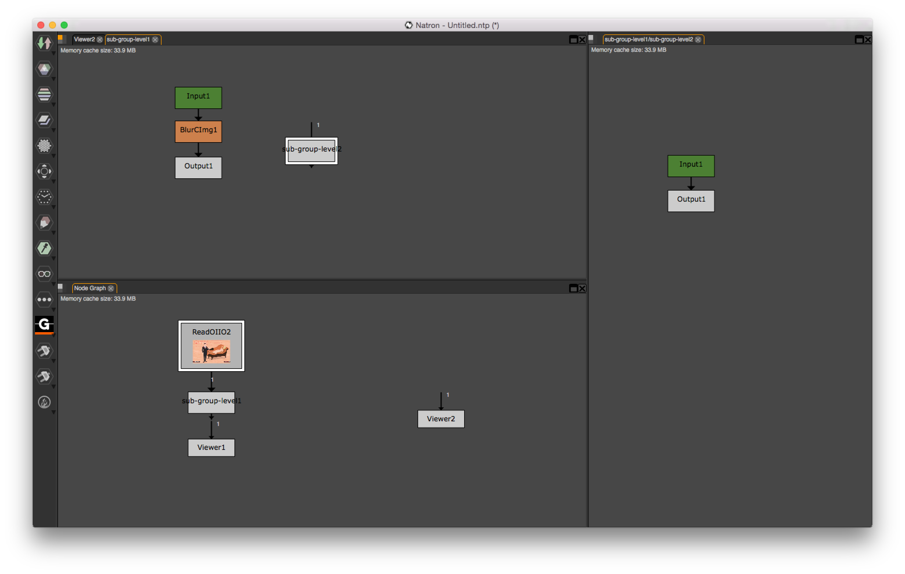

A group can be created like any other node in Natron and by default embeds already 2 nodes:
The **Output** node and one **Input** node.

The **Output** node is used to reference what would be the output of the internal graph of
the group.
In Natron, **a node has necessarily a single output**, hence if you add several *Output* nodes
to a group, **only the first Output node will be taken into account**.

Note that you can also add *Output* nodes to the top-level graph of Natron (the main Node Graph).
They are useful if you need to export your project as a group.

When used in the top-level graph, there can be multiple *Output* nodes, which can then be
used when launching Natron from the command-line to render the script, e.g.:

    NatronRenderer -o1 /FastDisk/Pictures/sequence###.exr -o2 /FastDisk/Pictures/test###.exr 1-100 /Users/Me/MyNatronScripts/MyScript.py

Where each argument *o1*, *o2* expand respectively the nodes *Output1* and *Output2*.

.. warning::

        You should never attempt to change the script name of output nodes, otherwise Natron has
        no way to match the given command line arguments to the output nodes. In fact Natron
        will completely ignore your request if you explicitly try to set the script name of an *Output* node.

The **Input** node is not necessarily unique and represents 1 input arrow of the group node.
You can also specify in the settings panel of the *Input* node whether this input should be
considered as a mask or whether it should be optional.

.. note::
    Note that the OpenFX standard specifies that Mask inputs must be optionals so when checking
    the mask parameter, this will automatically check the *optional* parameter.

You can freely rename an **Input** node, effectively changing the label attached to the arrow
on the group node.

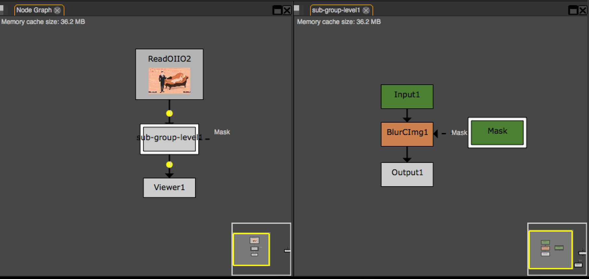

Parameters expressions and groups
---------------------------------

A common task is to add parameters to the group node itself which directly interact to nodes
parameters used internally by this group.

You can add a new parameter to the group node by clicking the "Settings and presets" button
and clicking "Manage user parameters...":

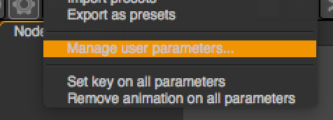

A dialog will popup on which you can manage all the parameters that you added. By default
a page is added automatically that will contain user parameters.

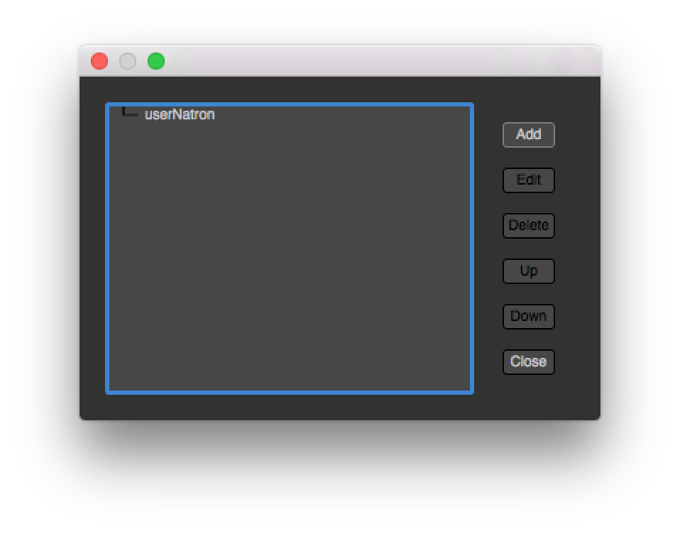

To create a new parameter, click the add button, this brings up a new dialog:

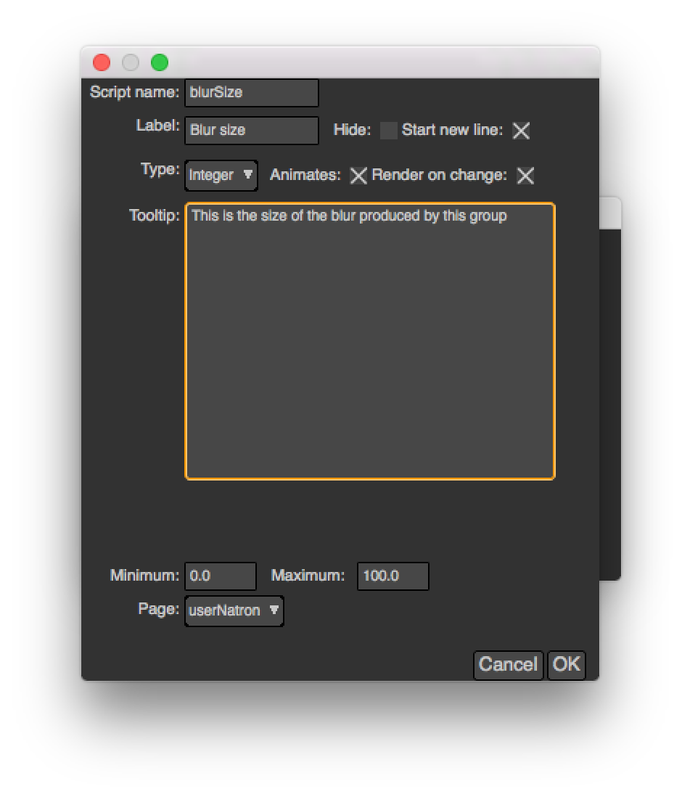

In this dialog you can configure all the properties of the parameter exactly like you would do using
the :ref:`Python API<Param>`.

Once created, the new parameter can be found in the "User" page of the settings panel:

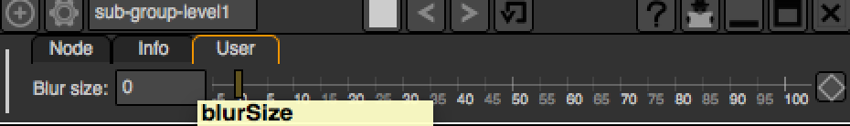

We can then set for instance an expression on the internal blur size parameter to copy the value
of the blur size parameter we just added to the group node:

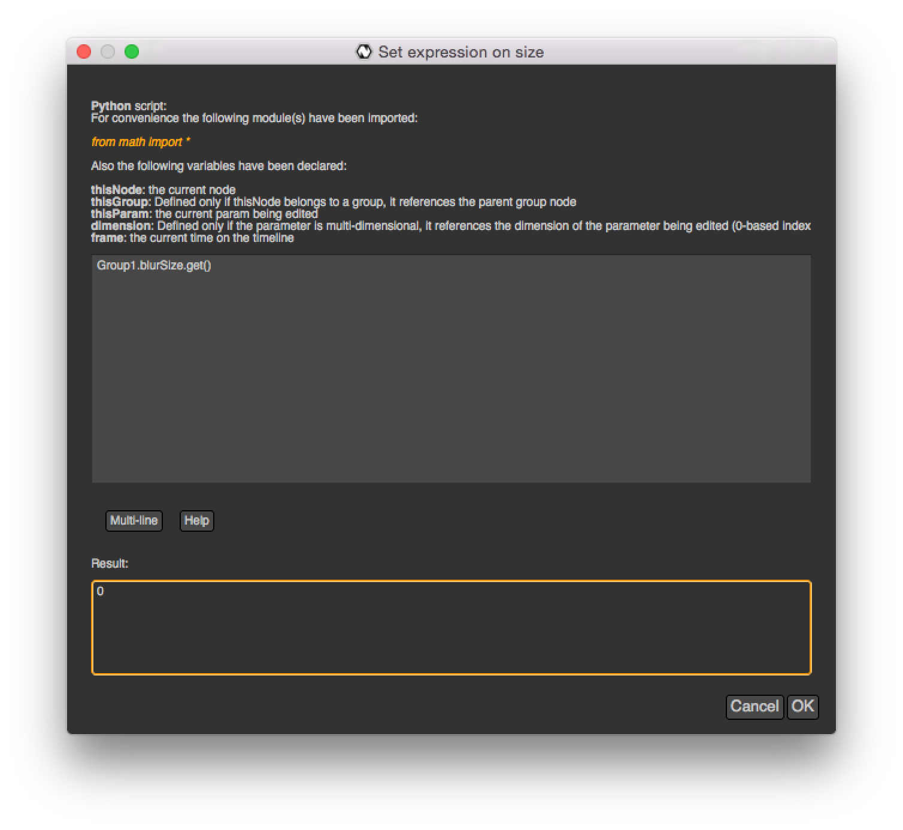

The expression is now visible in a green-ish color on the parameter in the settings panel
and the node on the node-graph has a green "E" indicator.

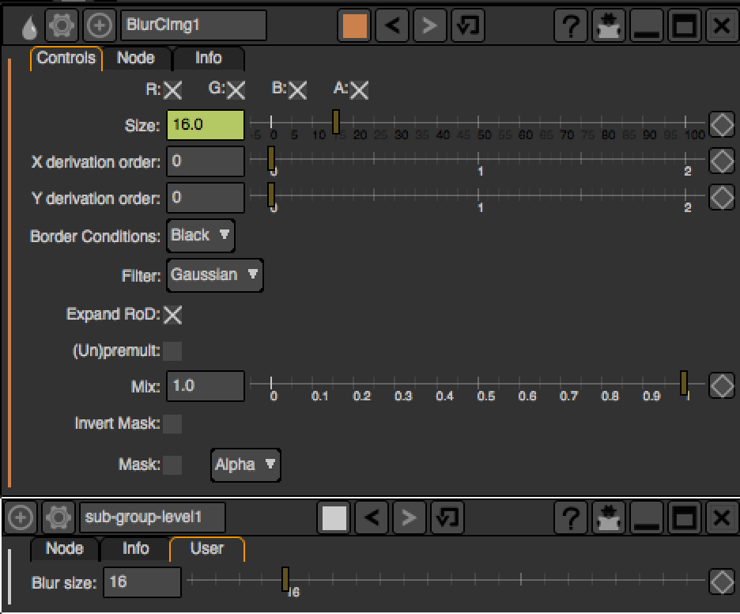

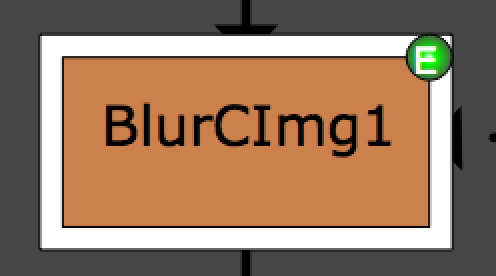

Exporting a group
------------------

Once your group is setup correctly, you can *export* it as a Python script that Natron will
generate automatically. We call them *PyPlugs*.

To do so, click the **Export as PyPlug** button in the "Node" page of the settings panel
of the Group node.

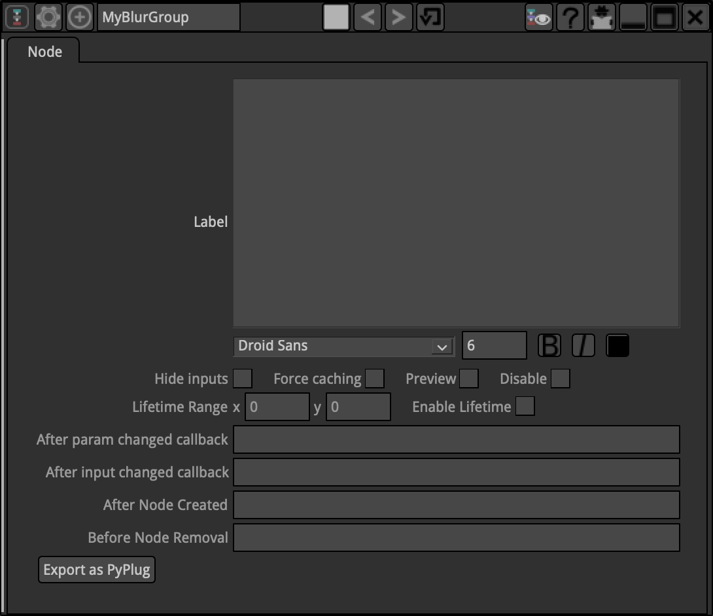

Exporting a group as a plug-in, means that it will create a Python script that will be able
to re-create the group entirely and that will be loaded on startup like any other plug-in.
That means that the group will also appear in the left toolbar of Natron and can potentially
have an icon too.

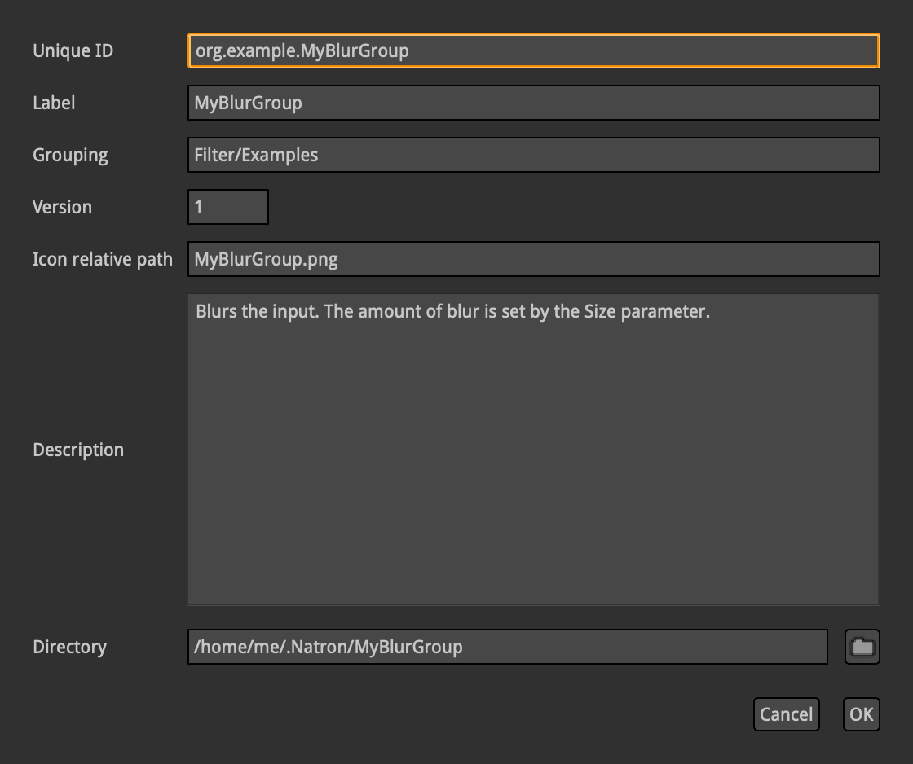

The *Label* is the name of the plug-in as it will appear in the user interface. It should not
contain spaces or non Python friendly characters as it is going to be used as variable names
in several places.

The *Grouping* is the tool-button under which the plug-in should appear. It accepts
sub-menus notation like this: "Inria/StereoGroups"

The *Icon relative path* is the filepath to an image which should be used as icon for the plug-in.
Note that it is a relative path to the location of the python script.

The *directory* is the location where the script should be written to.
For the plug-in to be loaded by Natron, it should be in its :ref:`search-paths<natronPath>`
hence if you select a directory that is not yet in the search-paths, it will prompt you
to add it.

.. note::

    A re-launch of Natron is required to re-scan the plug-ins and build the tool menus

Once restarted, the plug-in should now appear in the user interface

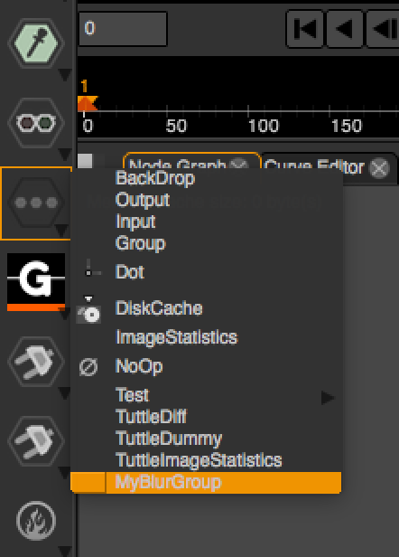

and even in the tab menu of the node-graph:

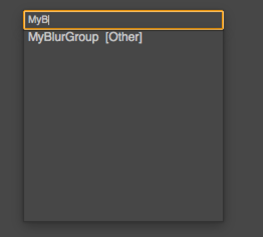

.. note::

    The plug-in ID of the group is the *Unique ID* that you entered in the export dialog:
    the exported script returns it from its *getPluginID()* function. To create a node using
    the group from a Python script, pass that ID to createNode, e.g.::

        app.createNode("fr.inria.groups.MyBlurGroup")

    If several plug-ins have the same *pluginID*, Natron will then sort plug-ins by version.

The version of a plug-in by default when exporting it via Natron is 1.

.. warning::

    If 2 plug-ins happen to have the same pluginID and version, Natron will then load the first one
    found in the search paths.

To change the **pluginID** and **version** of your group plug-in, you must implement the 2
following functions in the python script of the group::

    # This function should return an int specifying the version of the plug-in
    # If not implemented, Natron will use 1 by default
    def getVersion():
        return VERSION

    # This function should return a string specifying the ID of the plug-in, for example
    # "fr.inria.groups.customBlur"
    # If not implemented, Natron will use the label as a pluginID
    def getPluginID():
        return UNIQUE_ID

Exporting a project as group
----------------------------

Similarly, Natron allows you to export the top-level node-graph as a Python group plug-in.
From the "File" menu, select "Export project as group".

.. warning::

    To be exportable, your project should at least contain 1 output node.

.. note::

    While this functionality is made for convenience, you should be cautious, as
    exporting a project containing Readers will probably not work very well in another project
    or computer because of file-paths no longer pointing to a valid location.

.. warning::

    If you were to write a group plug-in and then want to have your expressions persist when
    your group will be instantiated, it is important to prefix the name of the nodes you reference
    in your expression by the **thisGroup.** prefix. Without it, Natron thinks you're referencing
    a top-level node, i.e: a node which belongs to the main node-graph, however, since you're using
    a group, all your nodes are no longer top-level and the expression will fail.

Moving nodes between groups
----------------------------

You can create a group from the selection in Natron by holding CTRL+SHIFT+G.
This will effectively move all nodes selected into a new sub-group

You can also copy/cut/paste in-between groups and projects.

Creating a group by hand
------------------------

You can also write a PyPlug by hand with the :ref:`Python API<apiReference>` of Natron.
:ref:`pyplugWriting` describes the functions that a PyPlug must define, with a complete example.

.. _pyPlugHandWritten:

Adding hand-written code (callbacks, etc...)
--------------------------------------------

Exporting a Group again overwrites its Python script. Put hand-written code, such as callbacks,
in a separate ``<Label>Ext.py`` file: see :ref:`pyplugWriting-ext`.

Starting Natron with a script in command line
----------------------------------------------

A PyPlug, or any other Python script, can be passed to Natron or NatronRenderer on the command
line, to build a graph and render it: see :ref:`cl-python-scripts`.

Toolsets
--------

Toolsets are PyPlugs that add a set of nodes to the node graph instead of creating a Group node:
see :ref:`pyplugWriting-toolsets`.
