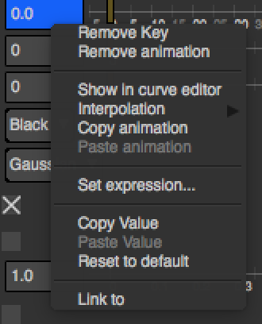
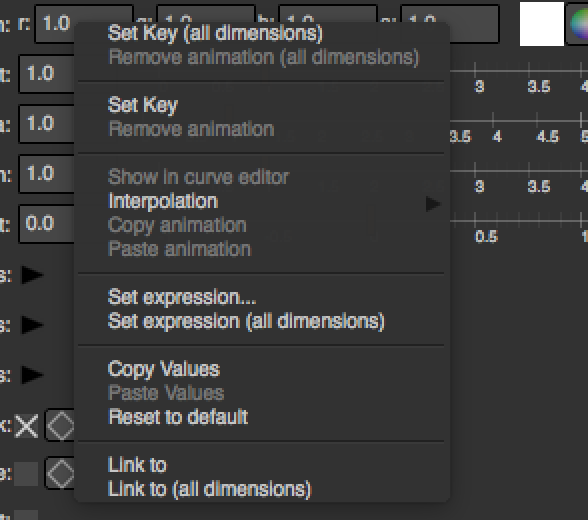
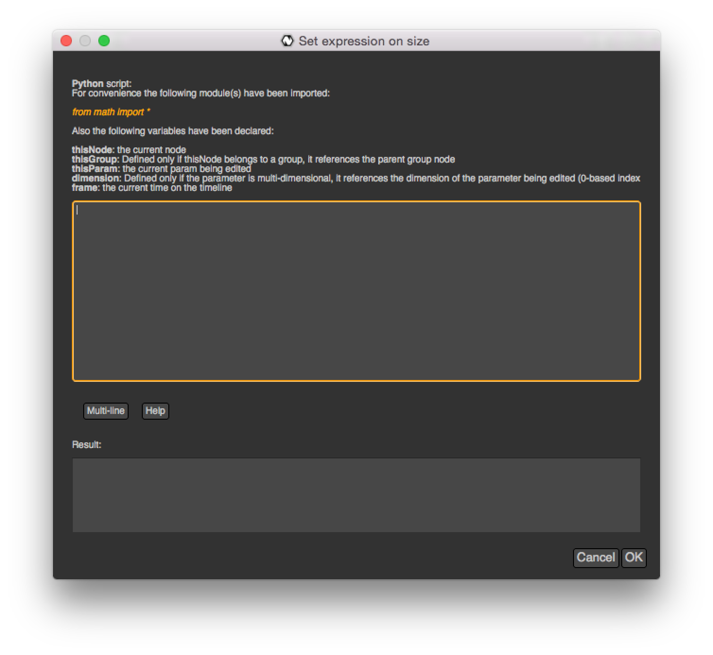
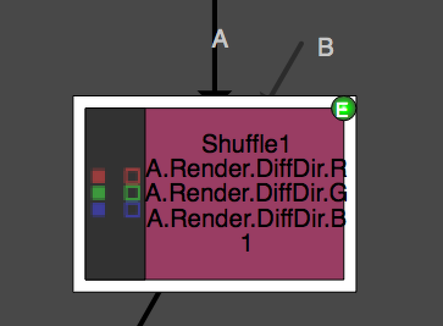
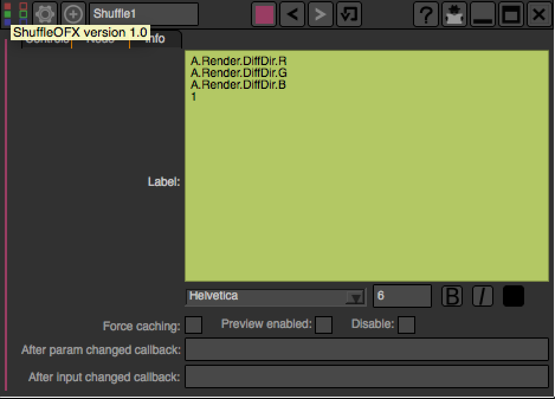
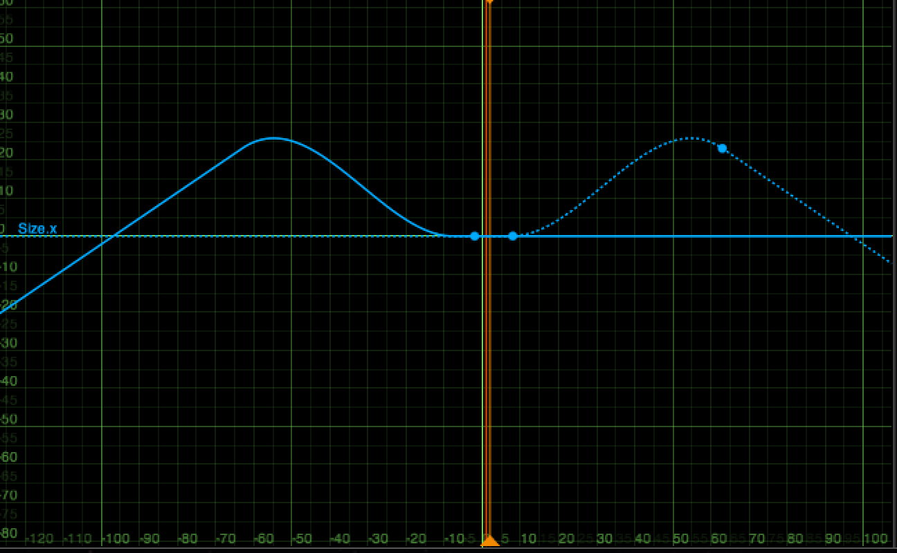
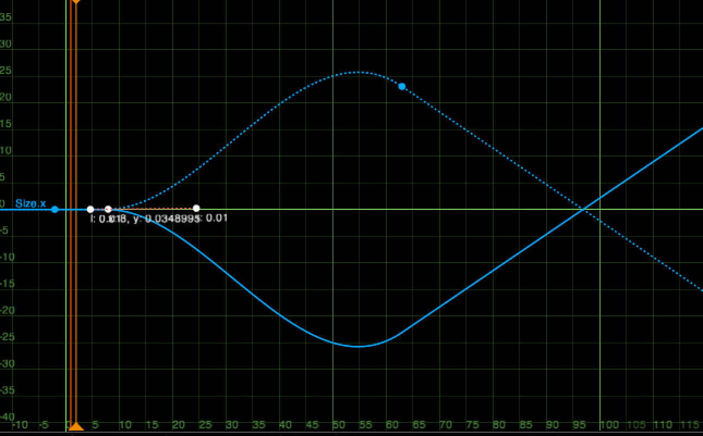
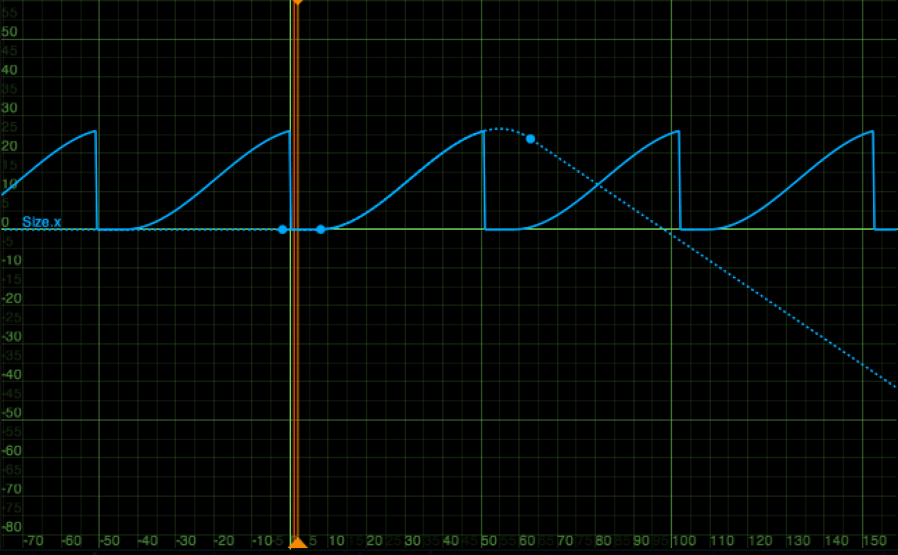

.. _paramExpr:

Parameters expressions
======================

The value of a :doc:`parameter<PythonReference/NatronEngine/Param>` can be set by
Python expressions. An expression is a line of code that can either reference the value
of other parameters or apply mathematical functions to the current value.

The expression will be executed every times the value of the parameter is fetched from a call
to :func:`getValue(dimension)<>` or :func:`get()<>`.

.. warning::

    Note that when an expression is active, all animation is ignored
    and only the result of the expression will be used to return the value of the parameter.

When executing an expression, the expression itself has a **scope**.
The **scope** of the expression defines all nodes and parameters that are possible to use
in the expression in order to produce the output value.

Any node in the *scope* can has a variable declared corresponding to its script-name::

    Blur1

You would then access a parameter of Blur1 also by its script-name::

    Blur1.size

    Group1.Blur1.size

.. warning::

    Referencing the value of the same parameter which expression is being edited can lead
    to an infinite recursion which Python should warn you about

In fact this is exactly like referencing :ref:`auto-declared<autoVar>` nodes via the *Script Editor*
except that the *app* prefix was removed for nodes in the scope.

See :ref:`this section<nodeScriptName>` to learn how to determine the *script-name* of a node.

See :ref:`this section<paramScriptName>` to learn how to determine the *script-name* of a parameter.

By default a parameter's expression can only refer to parameters of nodes belonging to the
same Group, or to parameters belonging to the parent :doc:`PythonReference/NatronEngine/Group` node.

Parameters of a Group node are also granted in the scope the parameters contained within that group.

For instance if your graph hierarchy looks like this::

    Read1
    Blur1
    Group1/
        Input1
        Blur1
        Convolve1
        Roto1
        Output1
    Viewer1

A parameter of *Read1* would be able to reference any parameter of *Read1*, *Blur1*, *Group1*, *Viewer1*
but could not reference any parameter of the nodes within *Group1*.

Similarly, a parameter of *Group1.Blur1* would be able to reference any parameter of
*Group1*, *Group1.Input1* , *Group1.Blur1* , *Group1.Convolve1* , *Group1.Roto1* , *Group1.Output1* but
would not be able to reference any top-level node (*Read1*, *Blur1*, *Viewer1*) except the
*Group1* node.

A parameter of *Group1* would on the other hand be able to reference any parameter in
top-level nodes and in the nodes of *Group1*.

The *scope* was introduced to deal with problems where the user would write expressions
referencing parameters that would probably no longer be referable when loading the script
again in another project.

.. warning::

    You can reach any node or parameter in the project with the *app1* prefix (or *app*
    in command-line mode), as in ``app1.Blur1.size``, but avoid it: such expressions
    are not portable, because they break when the project is opened as another instance
    (``app2``...) or when the nodes are copied into a group. Use plain node names (``Blur1.size``)
    or the ``thisGroup.`` prefix (``thisGroup.Blur1.size``) instead.

All functions available in the Python API are made available to expressions. Also for
convenience the **math** Python module has been made available by default to expressions.

.. _settingExpr:

Setting an expression:
-----------------------

To create an expression from the user interface, right click a parameter and choose *Set Expression...*

Note that for multi-dimensional parameters such as :doc:`PythonReference/NatronEngine/ColorParam`, the
*Set Expression...* entry will **only set an expression for the right-clicked dimension**.

The *Set Expression (all dimensions)* entry will on the other hand set the same expression on all
dimensions of the parameter at once.

A dialog will open where you can write the expression:

By default you do not have to assign any variable as the result of the expression, Natron
will do it by itself::

    #Expression for Blur1.size

    Transform1.translate.get()[0]

    #Will be expanded automatically by Natron to

    ret = Transform1.translate.get()[0]

However if you were to write an expression that spans over multiple lines you would need
to specifically set the **ret** variable yourself and toggle-on the *multi-line* button::

    a = acos(Transform1.translate.get()[0])
    b = sin(Transform1.rotate.get())
    ret = (tan(a * b) / pi) + Group1.customParam.get()

You can also set an expression from a script using the :func:`setExpression(expr,hasRetVariable,dimension)<NatronEngine.AnimatedParam.setExpression>` function
of :doc:`PythonReference/NatronEngine/AnimatedParam`.

.. warning::

    :func:`setExpression()<NatronEngine.AnimatedParam.setExpression>` does not raise an exception
    if the expression is invalid (for example a syntax error or a misspelled node name): it
    returns **False** and doesn't store the expression, so the parameter keeps its own value or
    animation curve. Always check the return value::

        if not app1.Blur1.size.setExpression("Transform1.translate.get()[0]", False, 0):
            print("invalid expression")

Writing an expression:
----------------------

For convenience the following variables have been declared to Python when executing the expression:

    * **thisNode**: It references the node holding the parameter being edited

    * **thisGroup**: It references the group containing *thisNode*

    * **thisParam**: It references the param being edited

    * **dimension**: The dimension (0-based index) of the parameter on which the expression has effect.
      It is defined in all expressions, and it is 0 for 1-dimensional parameters.

    * **frame**: It references the frame at which the parameter is evaluated: during a render, the frame being
      rendered (which differs from the frame of the render when time is remapped upstream, e.g. by a TimeOffset,
      a FrameHold, a Retime or motion blur), otherwise the current frame of the timeline

    * The **app** variable will be set so it points to the correct :ref:`application instance<App>`.

To reference the value of another parameter use the :func:`get()<>` function which retrieves the value
of the parameter at the frame of the render during a render, and at the current frame of the timeline
otherwise. If the parameter is multi-dimensional, you need to use
the subscript operator to retrieve the value of a particular dimension.

The :func:`getValue(dimension)<>` does the same thing but takes a *dimension* parameter to retrieve
the value of the parameter at a specific *dimension*. The following is equivalent::

    ColorCorrect1.MasterSaturation.get()[dimension]

    ColorCorrect1.MasterSaturation.getValue(dimension)

Note that for 1-dimensional parameter, the :func:`get()<>` function cannot be used with subscript, e.g.:

    Blur1.size.get()

To retrieve the value of the parameter at a specific *frame* because the parameter is animated,
you can use the :func:`get(frame)<>` function.

Again the :func:`getValueAtTime(frame,dimension)<>` does the same thing but takes a *dimension* parameter to retrieve
the value of the parameter at a specific *dimension*. The following lines are equivalent to
the 2 lines above::

    ColorCorrect1.MasterSaturation.get(frame)[dimension]

    ColorCorrect1.MasterSaturation.getValueAtTime(frame,dimension)

We ask for the value of the *MasterSaturation* parameter of the *ColorCorrect1* node its value
at the current *frame* and at the current *dimension*. This is usually the same as calling the :func:`get()<>`
function without a *frame* in parameter, but not when time is remapped (by a TimeOffset, a FrameHold, a Retime or
motion blur): then *frame* is the frame at which this parameter is evaluated, while :func:`get()<>` reads the other
parameter at the frame of the render. Use :func:`get(frame)<>` when the exact frame matters.

Copying another parameter through expressions:
----------------------------------------------

If we want the value of the parameter **size** of the node *Blur1*  to copy the
parameter **mix** of the node *Dilate1*, we would set the following expression on the
**size** parameter of the node *Blur1* (see :ref:`setting an expression<settingExpr>`)::

     Dilate1.mix.get()

If mix has an animation and we wanted to get the value of the mix at the previous *frame*,
the following code would work::

     Dilate1.mix.get(frame - 1)

Natron can also link parameters without an expression:

- **Ctrl+drag** (**Cmd+drag** on macOS) a parameter onto another parameter of the same type
  creates a *hard link*: the target parameter takes the value of the source.
- **Ctrl+Shift+drag** (**Cmd+Shift+drag** on macOS) writes an expression for you on the target,
  of the form ``app1.Node1.param.getValue() * curve(frame,0)`` for a node of the main node graph,
  or ``thisGroup.Node1.param.getValue() * curve(frame,0)`` for a node inside a group (the
  dimension passed to ``curve`` is the target dimension, or ``dimension`` when all dimensions are linked).
- Right-click a parameter, choose :menuselection:`Copy --> Copy Link`, then right-click the target and choose
  :guilabel:`Paste Link`.
- From Python, use :func:`slaveTo(otherParam,thisDimension,otherDimension)<NatronEngine.Param.slaveTo>`
  and :func:`unslave(dimension)<NatronEngine.Param.unslave>`.

Using random in expressions:
-----------------------------

Sometimes it might be useful to add a random generator to produce noise on a value.
However the noise produced must be reproducible such that when rendering multiple times the same
frame or when loading the project again it would use the same value.

We had to add a specific random function in Natron that takes into account the state of the
node and its inputs and the frame as a seed function to random.

.. warning::

    We advise against using the functions provided by the module random.py of the Python
    standard library, as the values produced by these functions will not be reproducible
    between 2 runs of Natron for the same project.

The Natron specific random functions are exposed in the :ref:`Param<Param>` class.

When executing an expression, Natron pre-declares the **random()** function so that you do not
have to do stuff like::

    thisParam.random()

Instead you can just type the following in your expression::

    myOtherNode.myOtherNodeParam.get() * random()

The :func:`random(min = 0.,max = 1.)<>` function also takes 2 optional arguments indicating
the range into which the return value should fall in. The range is defined by \[min,max\[.

    #Returns a random floating point value in the range [1., 10.[
    random(1.,10.)

Without a frame, ``random()`` returns the next value of a sequence that belongs to the parameter.
Each evaluation of the expression of the parameter starts that sequence again from the frame, the
dimension and the state of the node and its inputs, so in the expression of the parameter itself,
the values are the same each time a frame is computed. Elsewhere, e.g. ``Blur1.size.random()`` called from the
expression of another parameter or from a script, the value depends on the calls made before, and
is not reproducible.

The functions that take a frame and a seed only depend on them and on the state of the node and
its inputs: they return the same value anywhere, and each seed gives an independent value. They
do not depend on the parameter nor on the dimension, so give each parameter and each dimension
its own seed, else they all get the same value (e.g. a position that only moves along the
diagonal)::

    #Returns a random floating point value in the range [1., 10.[, the same for a given frame,
    #and different for each dimension of the parameter
    random(1.,10.,frame,dimension)

    #On another parameter of the same node, use other seeds
    random(1.,10.,frame,10 + dimension)

With both forms, the values change after any edit of a parameter of the node or of a node
upstream (an undo does not bring the previous values back), and two identical new nodes give
different values. They only stay the same for a saved project that is not modified.

For integers, use the :func:`randomInt(min,max)<>` function instead::

    #Returns a random integer in the range [1,100[
    randomInt(1,100)

    #Using the randomInt function with a given seed
    seed = 5
    randomInt(1,100,frame,seed)

Advanced expressions:
----------------------

To write more advanced expressions based on fractal noise or perlin noise you may use
the functions available in the :ref:`ExprUtils<ExprUtils>` class.

Expressions persistence
------------------------

If you were to write a group plug-in and then want to have your expressions persist when
your group will be instantiated, it is important to prefix the name of the nodes you reference
in your expression by the **thisGroup.** prefix. Without it, Natron thinks you're referencing
a top-level node, i.e: a node which belongs to the main node-graph, however, since you're using
a group, all your nodes are no longer top-level and the expression will fail.

Examples
----------

Setting the label of a Node so it displays the value of a parameter on the node-graph:
^^^^^^^^^^^^^^^^^^^^^^^^^^^^^^^^^^^^^^^^^^^^^^^^^^^^^^^^^^^^^^^^^^^^^^^^^^^^^^^^^^^^^^^

For instance, we may want to have on the shuffle node, the values of the output RGBA channels
so we don't have to open the settings panel to understand what the node is doing.

To do so, we set an expression on the "Label" parameter located in the "Node" tab of the
settings panel.

Set the following expression on the parameter
::

    thisNode.outputR.getOption(thisNode.outputR.get()) + "\n" + thisNode.outputG.getOption(thisNode.outputG.get()) + "\n" + thisNode.outputB.getOption(thisNode.outputB.get()) + "\n" + thisNode.outputA.getOption(thisNode.outputA.get())

Generating custom animation for motion editing:
^^^^^^^^^^^^^^^^^^^^^^^^^^^^^^^^^^^^^^^^^^^^^^^^

In this example we will demonstrate how to perform Loop,Negate and Reverse effects
on an animation even though this is already available as a preset in Natron.

To do be able to do this we make use of the :func:`curve(frame,dimension)<NatronEngine.Param.curve>`
function of the :ref:`Param<Param>` class. This function returns the value of the animation
curve (of the given dimension) at the given time.

If we were to write the following expression::

    curve(frame)

The result would be exactly the animation curve of the parameter.

On the other hand if we write::

    curve(-frame)

We have just reversed the curve, meaning that the actual result at the frame F will be in fact
the value of the curve at the frame -F.

In the same way we can apply a negate effect::

    -curve(frame)

The loop effect is a bit more complicated and needs to have a frame-range in parameter::

    firstFrame = 0
    lastFrame = 10
    curve(((frame - firstFrame) % (lastFrame - firstFrame + 1)) + firstFrame)

