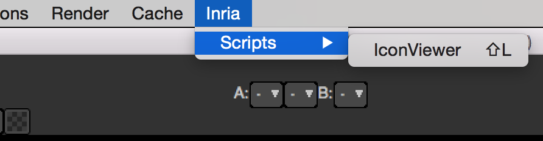

.. _userCommands:

User menu commands
===================

In Natron you can add multiple menu commands that will then be available to the user via
the menu. You can also assign it a shortcut and the user will be able to modify it
via the shortcuts editor.

Project-wide menu commands:
---------------------------

To add a project-wide menu command to the application's menu-bar, you need to use the
:func:`addMenuCommand(grouping,function,key,modifiers)<NatronGui.PyGuiApplication.addMenuCommand>` function of the :ref:`PyGuiApplication<PyGuiApplication>` class
to register it::

    def createIconViewer():
        ...

    #Add a custom menu entry with a shortcut to create our icon viewer
    NatronGui.natron.addMenuCommand("Inria/Scripts/IconViewer","createIconViewer",QtCore.Qt.Key.Key_L,QtCore.Qt.KeyboardModifier.ShiftModifier)

Note that this function is to be called on the whole **application** via the **natron** variable
and is not *per-project* unlike most functions that are generally called on the **app** object.

.. warning::

    Call this function from a startup script, preferably **initGui.py** (it is a NatronGui
    function, so it only exists in GUI mode). The menu entries are created when the main window is
    built, so calling it later, for example from the Script Editor, has no effect: it does not
    create menu entries on the fly.

When the user triggers the menu entry, Natron sets the *app* variable to the current
:ref:`application instance<App>` and then calls the function, which takes no argument.

