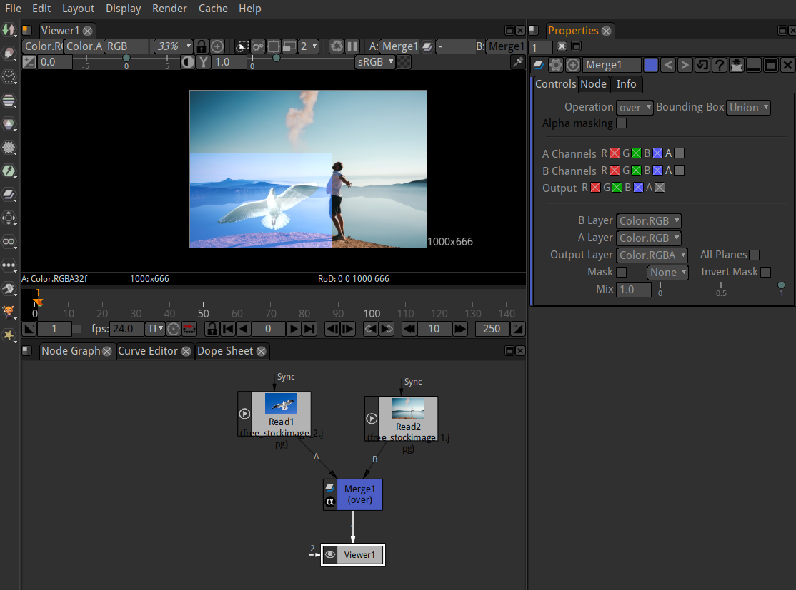
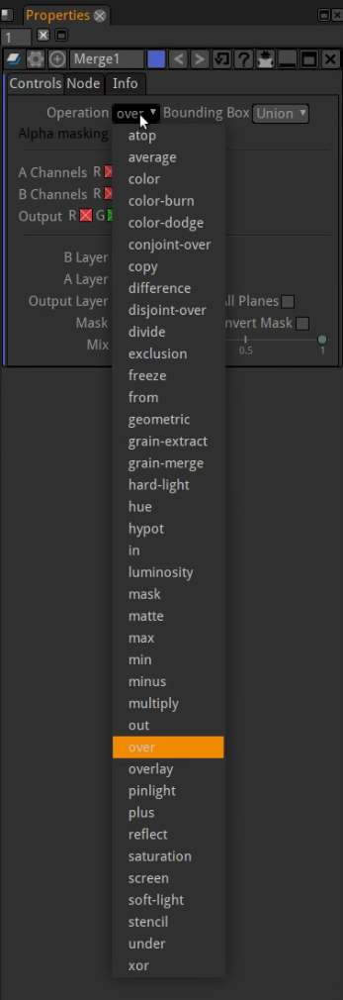
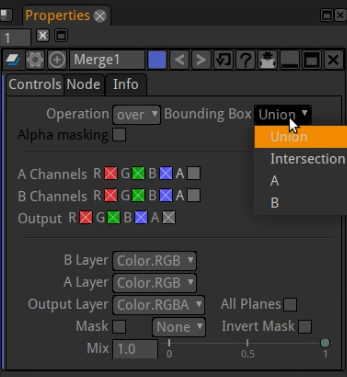

.. for help on writing/extending this file, see the reStructuredText cheatsheet
   http://github.com/ralsina/rst-cheatsheet/raw/master/rst-cheatsheet.pdf

Merging images
==============

The Merge node combines images. Input **A** is the foreground and input **B**
is the background.

Layering Images Together with the Merge Node
############################################

1. Select the node whose output is the background, then choose
   **Merge > Merge** in the toolbar, or press :kbd:`M` in the Node Graph.
   This adds a Merge node.
2. Connect the images to the Merge node's **A** and **B** inputs. When **A**
   is connected, an **A2** input appears, then **A3**, and so on: each extra
   A input is merged over the result of the previous ones.
3. Connect a Viewer to the output of the Merge node to see the result.

4. In the Merge node's properties, choose the **Operation**. The default,
   **over**, puts input **A** over input **B**, using the alpha of **A**.
   The menu describes each operation, and the :ref:`Merge node reference
   <net.sf.openfx.MergePlugin>` gives their formulas.

5. Choose the **Bounding Box** of the output:

* **Union**: the union of the bounding boxes of all inputs (the default).
* **Intersection**: only the area where the bounding boxes of the inputs
  overlap.
* **A** or **B**: the bounding box of that input.

6. The **R**, **G**, **B** and **A** checkboxes on the **A Channels** and
   **B Channels** rows select which channels of each input are used, and
   those on the **Output** row select which channels the node writes. For
   example, uncheck the **A** checkbox on the **A Channels** row to ignore
   the alpha of input **A**.

7. **Mix** blends between input **B** (at 0) and the merge result (at 1).

The optional **Mask** input limits the effect of the merge to the area
covered by the mask.

.. note:: An input that has no alpha channel (RGB only) is treated as opaque.
   Natron works with premultiplied images: see :doc:`thenodes-merge-merge`.
