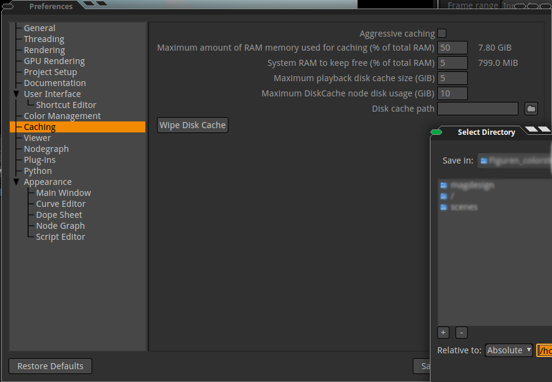

.. for help on writing/extending this file, see the reStructuredText cheatsheet
   http://github.com/ralsina/rst-cheatsheet/raw/master/rst-cheatsheet.pdf

.. _compositing-caching:

Caching, memory and performance
===============================

Natron does not store the result of every node. When the Viewer needs a frame,
it asks the node connected to it for that frame, and that node asks its own
inputs for the images it needs, up to the Read nodes. Only the region shown in
the Viewer is computed, at the zoom level of the Viewer. This keeps memory use
low, but it would mean computing the same images again and again. Natron
avoids that by keeping images in **caches**: an image that was already
computed with the same parameters is taken from the cache instead of being
rendered again.

This page explains the caches, the settings that control their size, and what
you can do to keep a large script fast.

The caches
----------

Natron uses three caches. They are shared by all the projects open in the same
Natron session.

Per-node RAM cache
~~~~~~~~~~~~~~~~~~

This cache keeps images produced by the nodes of the Node Graph, in RAM only.
Natron does not cache the output of every node, because that would fill the
memory very quickly. A node's output is cached when it is likely to be needed
again, for example when:

- the node is connected to several other nodes, or it is the active input of a
  Viewer;
- the Properties panel of the node below it is open (you are probably
  editing that node, so its input is requested many times);
- the node has a preview in the Node Graph;
- the node's output does not change over time, or the node reads several
  frames of its input (a time blur, a retimer...);
- **Force caching** is checked in the **Node** tab of the node's Properties
  panel. On a Group node, this caches the output of the group;
- **Aggressive caching** is checked in the preferences (see below): then every
  node is cached.

When the cache is full, the images that were used least recently are removed
first.

Playback cache
~~~~~~~~~~~~~~

This cache keeps the frames displayed by the Viewer, so that playing a frame
range a second time is fast. It is stored in files in the disk cache folder
(see `Preferences`_ below), and the frames that are in use are also kept in
RAM.

The timeline under the Viewer shows which frames are in the playback cache:

- a **light green** line marks the frames that are cached in RAM;
- a **dark green** line marks the frames that are cached on disk only.

These colors can be changed in **Edit > Preferences > Appearance > Main
Window** (**Cached frame** and **Disk cached frame**).

A cached frame is only valid for what the Viewer showed when it was computed:
the node connected to the Viewer, the parameters of the nodes above it, the
zoom level, proxy mode and the other Viewer settings. When one of them
changes, the frames are computed again. The frames cached with the previous
settings stay in the cache until it is full, so going back to them is fast.

The playback cache is saved when Natron quits and restored the next time it
starts.

DiskCache node
~~~~~~~~~~~~~~

The :ref:`DiskCache <fr.inria.built-in.DiskCache>` node (in the **Other** menu of the
:doc:`toolbar <getstarted-environment-toolbar>`) stores the images coming from its input in the disk cache folder, in
full 32-bit floating point. When an image is found in the cache, the nodes
above the DiskCache are not computed. Like the playback cache, it is kept from
one session to the next.

Use it in a large script to "freeze" a branch you have finished working on:

1. Insert a DiskCache node below the last node of that branch.

   .. image:: _images/compositing-projects-caching_03.png

2. In its **Controls** tab, choose the **Frame range** to cache: the frame
   range of the input, the project frame range, or a manual range.
3. Click **Pre-cache**. The frames are rendered at full resolution (zoom
   100%), and the progress is shown in the Progress panel:

   .. image:: _images/compositing-projects-caching_02.png

Without **Pre-cache**, the DiskCache node only stores the images that go
through it, at the zoom level at which they were requested.

.. note:: The DiskCache node must stay in the Node Graph: the cached images
   are only used when they are requested through it. If you change a node
   above the DiskCache, the images that depend on it are computed again.

Make sure that the disk holding the disk cache folder has enough free space
for both the playback cache and the DiskCache nodes (see the size limits
below). A fast disk, such as an SSD, is recommended.

Preferences
-----------

The cache settings are in **Edit > Preferences > Caching**:

**Aggressive caching**
   Cache the output of every node, as if **Force caching** were checked on all
   of them. Interactive work becomes faster, but it needs a lot of RAM: at
   least 8 GiB, and 16 GiB or more is recommended. Off by default.

**Maximum amount of RAM memory used for caching (% of total RAM)**
   The size of the per-node RAM cache, as a percentage of the total RAM of the
   computer. The size in bytes is shown next to the field. Default: 50%.

**System RAM to keep free (% of total RAM)**
   The amount of RAM that Natron leaves to the system and to the other
   applications. When the free RAM goes under this limit, Natron removes
   images from its RAM cache instead of using more memory, even if the cache
   has not reached its maximum size. A value that is too low can make the
   whole computer slow. Default: 20%.

**Maximum playback disk cache size (GiB)**
   The maximum size of the playback cache. Default: 5 GiB.

**Maximum DiskCache node disk usage (GiB)**
   The maximum size of the images stored by all the DiskCache nodes.
   Default: 10 GiB.

**Disk cache path**
   The folder where the playback cache and the DiskCache nodes store their
   files. Choose your fastest disk. The ``NATRON_DISK_CACHE_PATH``
   environment variable, if it is set, takes precedence over this field (see
   :doc:`../_environment`). When neither is set, a default folder is used
   (its path is shown in the tooltip of the parameter). Changing this setting
   requires restarting Natron.

   All the Natron processes that use the same folder (for example Natron and
   a background render) share the caches. A Natron that starts while another
   one uses them starts with empty caches: it doesn't restore the cached
   images of the other one, nor delete its files, and **Wipe Disk Cache**
   only removes its own cache files. Each process applies the size limits
   to its own files, so with N processes the caches can take up to N times
   the limits on disk. The cached images are restored by the next Natron
   started alone, from the list of cache files written by the process that
   wrote it last (each process writes it when it saves a project and when it
   exits); the files of the other processes are then deleted.

**Wipe Disk Cache**
   Clears all the caches and deletes all the cache files in the disk cache
   folder. Use it if the disk cache seems to take more space than expected, or
   if Natron seems to show old images. Like **Clear All Caches** (see
   `The Cache menu`_), it also deletes all the auto-save files in the
   auto-save folder, including the crash-recovery files left by earlier
   sessions: save your projects first, and recover any crashed project
   before using it.

The full list of preferences is in the Reference Guide: :doc:`../_prefs`.

Threading
~~~~~~~~~

The settings in **Edit > Preferences > Threading** control how many processor
cores Natron uses:

**Number of render threads (0="guess")**
   The number of threads used to render. With 0 (the default), Natron uses one
   thread per processor core, but no more than one thread per 3.5 GiB of RAM,
   so that rendering does not run out of memory. -1 disables multithreading,
   which is only useful to investigate a problem.

**Number of parallel renders (0="guess")**
   How many frames are rendered at the same time during playback and when
   rendering to disk. Leave it at 0, so that Natron chooses it from the current
   CPU usage.

**Effects use the thread-pool**
   On by default. Uncheck it if a third-party plug-in crashes Natron (this is
   known to happen with The Foundry's Furnace plug-ins).

**Max threads usable per effect (0="guess")**
   The maximum number of threads that a single node may use. Leave it at 0.

The Cache menu
--------------

The **Cache** menu of the main window empties the caches. You don't need it
in normal use: Natron stops using cached images that are no longer valid by
itself. It helps to free memory or disk space, or to check whether a problem
comes from the cache.

**Clear Disk Cache**
   Empties the playback cache (in RAM and on disk) and the DiskCache node
   cache.

**Clear Playback Cache**
   Empties the part of the playback cache that is in RAM. The frames that
   were only in RAM are lost and are computed again when needed; the frames
   stored on disk are kept.

**Clear Per-Node Cache**
   Empties the per-node RAM cache and the internal caches of the OpenFX
   plug-ins.

**Clear All Caches** (:kbd:`Ctrl+Shift+K`, :kbd:`Cmd+Shift+K` on macOS)
   Stops the Viewers, empties all the caches above, then renders the Viewers
   again. It also deletes all the auto-save files in the auto-save folder,
   including the crash-recovery files left by earlier sessions: save your
   projects first, and recover any crashed project before using it.

**Clear Plug-ins Load Cache**
   Natron keeps a list of the OpenFX plug-ins it found, so that it starts
   faster. This entry clears that list: the plug-ins are scanned again the
   next time Natron starts. Use it after installing or updating a plug-in
   that does not show up, or that shows an old version.

Only **Clear All Caches** has a default shortcut. You can give one to the
other entries in the Shortcut Editor
(**Edit > Preferences > User Interface > Shortcut Editor**).

To see how much memory and disk the caches use, right-click in the Node Graph
and check **View > Display Cache Memory Consumption**. The Node Graph then
shows the size of the memory caches and of the disk caches in its top left
corner.

Keeping a large script fast
---------------------------

- **Work in proxy mode.** Proxy mode (:kbd:`Ctrl+P` in the Viewer) renders
  images at a lower resolution, which is much faster and uses less memory.
  See :doc:`compositing-projects-proxy`. Zooming out in the Viewer also helps:
  Natron renders only what is needed at the current zoom level.
- **Read image sequences rather than video files.** Decoding a video file can
  be slow, especially with codecs that compress several frames together
  (H.264, H.265). See :doc:`compositing-projects-readers` for the reasons.
- **Freeze finished branches with a DiskCache node** (see above).
- **Limit the node previews.** Each preview in the Node Graph is a separate
  render. Uncheck **Preview** in the **Node** tab of the nodes whose preview
  you don't need (or select them and press :kbd:`Alt+P` in the Node Graph),
  or uncheck **View > Toggle Auto Previews** in the Node Graph
  right-click menu so that previews are not refreshed after every change.
- **Close the Properties panels** you don't use: the panel of an edited node
  makes Natron cache the images around that node.
- **Don't carry images larger than needed.** A node whose output is much
  larger than the project format (a large blur, a transform that moves the
  image outside the frame) makes the nodes below it work on more pixels. A
  Crop or a Reformat early in the tree can help. See
  :doc:`compositing-reformat`.
- **Give Natron enough RAM, but not all of it.** If the computer becomes slow
  when Natron renders, raise **System RAM to keep free**. If you have a lot of
  RAM and a complex script, try **Aggressive caching**.
- **Find the slow nodes.** With **Render > Enable Render Statistics**
  (:kbd:`F2`) on, the **Render statistics** window shows how long each node
  took to render the frame shown in the Viewer.
- **GPU rendering.** Some plug-ins can render with OpenGL. Two settings must
  allow it: **Edit > Preferences > GPU Rendering > OpenGL Rendering** (only
  shown when an OpenGL renderer is available), and **GPU Rendering** in the
  **Settings** tab of the project settings, which can enable it, disable it,
  or disable it only when rendering with NatronRenderer. It only helps with
  the plug-ins that support it.
