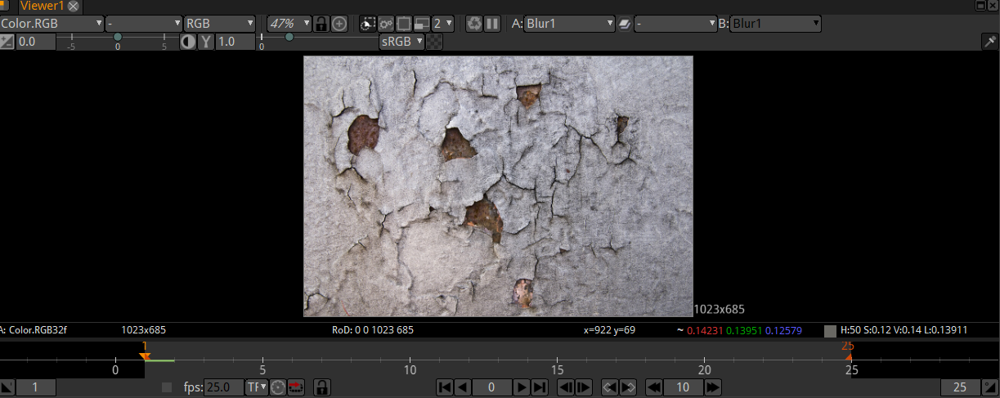

.. for help on writing/extending this file, see the reStructuredText cheatsheet
   http://github.com/ralsina/rst-cheatsheet/raw/master/rst-cheatsheet.pdf

Proxy Mode
==========

Proxy mode renders the images in the Viewer at a lower resolution, which makes
the whole graph render faster while you work.

To turn it on, click the **Proxy mode** button in the Viewer's top toolbar
(the icon with two squares), or press :kbd:`Ctrl+P` (:kbd:`Cmd+P` on macOS)
with the mouse over the Viewer. The menu to the right of the button sets the
scale-down factor: 2, 4, 8, 16 or 32 (shortcuts :kbd:`Alt+1` to :kbd:`Alt+5`).

Instead of letting Natron scale the images down, a Read node can read
lower-resolution files: set them in its **Proxy File** parameter. They are used
when the proxy scale is lower than or equal to the Read node's
**Proxy threshold**, which is computed from the file headers by default.
