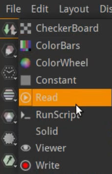
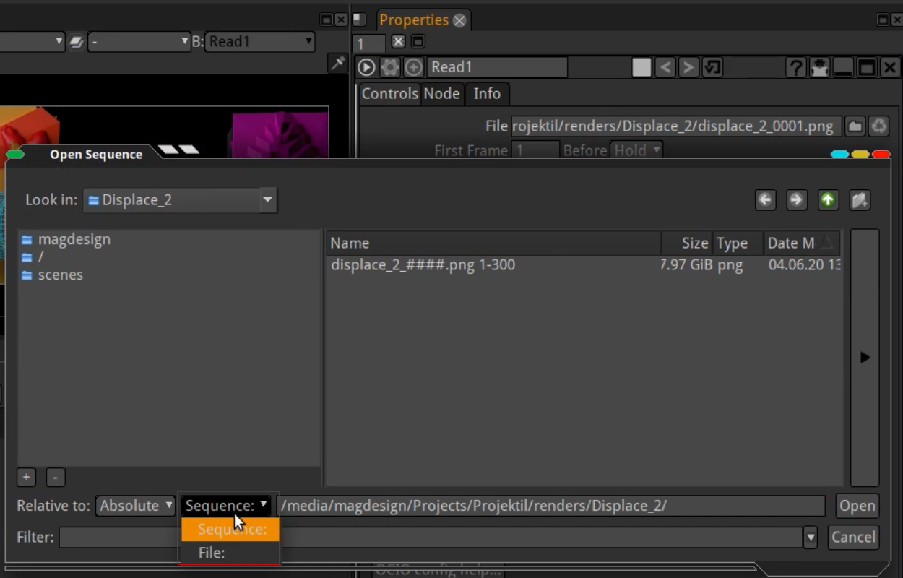
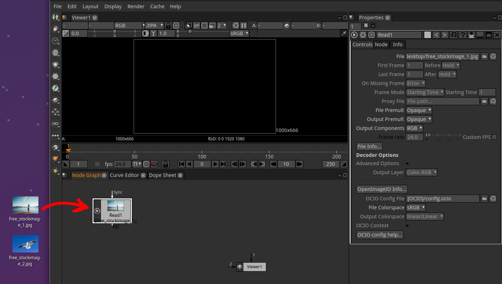
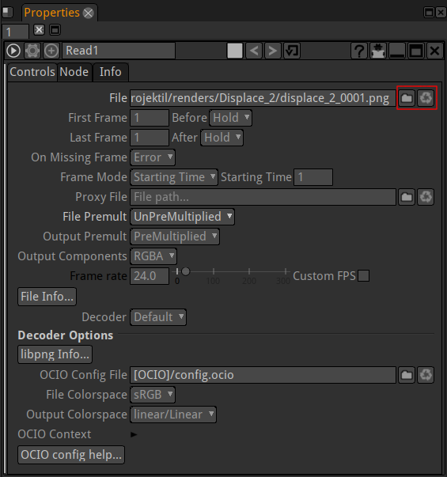

.. for help on writing/extending this file, see the reStructuredText cheatsheet
   http://github.com/ralsina/rst-cheatsheet/raw/master/rst-cheatsheet.pdf

.. _compositing-projects-readers:

Reading and writing files
=========================

Images enter a Natron project through **Read** nodes and leave it through
**Write** nodes. This page explains how to load footage, how Natron picks the
plug-in that decodes or encodes a file, which file formats are supported, and
how image sequences, views and missing frames are handled.

.. _compositing-projects-readers-sequences-first:

Use image sequences rather than videos
--------------------------------------

The preferred way to bring footage into Natron is an **image sequence**: one
file per frame (for example ``shot010.0001.exr``, ``shot010.0002.exr``, ...).

- Natron can read any frame of a sequence directly, in any order, and several
  frames at the same time. Compositing does this all the time: scrubbing
  the timeline, rendering on several threads, or a node that needs
  neighbouring frames.
- A damaged or missing frame only affects that frame.
- A render that stops half-way can be resumed: the frames already written stay
  valid.

Video files can be read and written (see :ref:`compositing-projects-readers-video`),
but most video codecs compress several frames together, so getting one frame
means decoding others first. This is slow, and some files do not seek
accurately. Avoid using videos with inter-frame compression as input, which
includes H.264 (AVC) and H.265 (HEVC) as produced by most cameras and phones.
Intra-frame codecs such as ProRes or DNxHR work, but are slower to read than
image files.

If your footage is a video, convert it to an image sequence first: DPX, EXR,
TIFF, PNG or JPEG, depending on the quality and bit depth of the source. See the
tutorial :doc:`How To Convert Videos To Image Sequences <tutorials-imagesequence>`.

Loading footage
---------------

There are three ways to load footage into Natron:

- Add a Read node from the :doc:`toolbar <getstarted-environment-toolbar>`
  (**Image > Read**) and select your media:

- In the Node Graph, press :kbd:`R` and select your media:

- Drag'n'drop your media to the Node Graph:

.. note:: To see the imported footage in the Viewer, select the Read node in the Node Graph and press :kbd:`1`.

In the file dialog, the files of an image sequence are shown as a single item,
with the frame range next to the name. Selecting that item loads the whole
sequence in one Read node.

In the Properties panel on the right side you can make several adjustments to your Read node:

See :doc:`The Reader node <thenodes-image-read>` section for more information.

How Natron chooses a decoder or an encoder
------------------------------------------

The Read and Write nodes do not decode or encode files themselves. Each of them
holds a file-format plug-in (a *decoder* or an *encoder*), which is chosen from
the extension of the file name. For example, a ``.png`` file is read by
:ref:`ReadPNG <fr.inria.openfx.ReadPNG>`, a ``.exr`` file by
:ref:`ReadOIIO <fr.inria.openfx.ReadOIIO>` and a ``.mov`` file by
:ref:`ReadFFmpeg <fr.inria.openfx.ReadFFmpeg>`. The parameters of that plug-in
appear in the Properties panel of the Read or Write node, which is why the
parameters change when you change the file type.

Several plug-ins can often handle the same extension. Each one declares a
score for the formats it supports, and by default Natron uses the plug-in with
the highest score. To use another one for a single node, change the **Decoder**
parameter of the Read node or the **Encoder** parameter of the Write node: the
menu lists the plug-ins that can handle the extension of the current file,
best first. **Default** means "the plug-in with the highest score".

If no installed plug-in supports an extension, the Read or Write node reports
that it could not find a decoder or an encoder for that file format.

You can see what the decoder found in a file (resolution, channels, bit depth,
frame range, metadata) with the **File Info...** button of the Read node.

All the plug-ins convert the pixels to 32-bit floating point when reading, and
from 32-bit floating point when writing. Inside the Node Graph, the bit depth of
the file does not matter: it only matters for what is written to disk.

Supported file formats
----------------------

The table lists the formats that the plug-ins bundled with Natron can read and
write, and which plug-in is used by default. The exact list depends on how the
libraries were compiled: ReadOIIO and WriteOIIO only offer the formats that
their OpenImageIO library was built with, so some formats (marked "depends on
the build" below) are missing from some Natron builds. See also
:ref:`compositing-projects-readers-gpl`. Plug-ins installed separately can add
more formats.

.. list-table::
   :header-rows: 1
   :widths: 16 22 20 20 22

   * - Format
     - Extensions
     - Read by
     - Written by
     - Notes
   * - OpenEXR
     - ``exr``
     - :ref:`ReadOIIO <fr.inria.openfx.ReadOIIO>`
     - :ref:`WriteOIIO <fr.inria.openfx.WriteOIIO>`
     - 16-bit or 32-bit float. The only format that stores several layers and
       several views in one file. Recommended for intermediate and final
       renders.
   * - DPX
     - ``dpx``
     - ReadOIIO
     - WriteOIIO
     - 8 to 16-bit integer. Common for film scans and digital intermediates.
   * - Cineon
     - ``cin``
     - ReadOIIO
     - (none)
     - 10-bit log film scans. Read only.
   * - TIFF
     - ``tif``, ``tiff``, ``tx``, ``env``, ``sm``, ``vsm``
     - ReadOIIO
     - WriteOIIO
     - 8 or 16-bit integer, or float; alpha.
   * - PNG
     - ``png``
     - :ref:`ReadPNG <fr.inria.openfx.ReadPNG>`
     - :ref:`WritePNG <fr.inria.openfx.WritePNG>`
     - 8 or 16-bit integer; alpha. ReadOIIO and WriteOIIO can also be selected.
   * - JPEG
     - ``jpg``, ``jpeg``, ``jpe``, ``jif``, ``jfif``, ``jfi``
     - ReadOIIO
     - WriteOIIO
     - 8-bit, lossy, no alpha.
   * - JPEG 2000
     - ``jp2``, ``j2k``
     - ReadOIIO
     - WriteOIIO
     -
   * - Targa
     - ``tga``, ``tpic``
     - ReadOIIO
     - WriteOIIO
     - 8-bit; alpha.
   * - SGI
     - ``sgi``, ``rgb``, ``rgba``, ``bw``, ``int``, ``inta``
     - ReadOIIO
     - WriteOIIO
     -
   * - BMP
     - ``bmp``
     - :ref:`ReadMisc <fr.inria.openfx.ReadMisc>`
     - WriteOIIO
     - ReadOIIO does not read BMP files.
   * - Radiance HDR
     - ``hdr``
     - ReadOIIO
     - WriteOIIO
     - 32-bit float RGB, no alpha.
   * - PFM
     - ``pfm``
     - :ref:`ReadPFM <fr.inria.openfx.ReadPFM>`
     - WriteOIIO
     - 32-bit float. :ref:`WritePFM <fr.inria.openfx.WritePFM>` can also be
       selected as the Encoder.
   * - Netpbm
     - ``pbm``, ``pgm``, ``ppm``
     - ReadOIIO
     - WriteOIIO
     -
   * - HEIF
     - ``heic``, ``heif``
     - ReadOIIO
     - WriteOIIO
     - Depends on the build (HEIF support in OpenImageIO).
   * - JPEG XL
     - ``jxl``
     - ReadOIIO
     - WriteOIIO
     - Depends on the build (JPEG XL support in OpenImageIO).
   * - WebP
     - ``webp``
     - ReadOIIO
     - WriteOIIO
     - Depends on the build (WebP support in OpenImageIO). The macOS builds
       do not have it.
   * - GIF
     - ``gif``
     - ReadFFmpeg
     - WriteFFmpeg
     - Read and written as a video, including animated GIFs. ReadOIIO does
       not read GIF files.
   * - Photoshop
     - ``psd`` (also ``psb``, ``pdd``)
     - :ref:`ReadPSD <net.fxarena.openfx.ReadPSD>` (``psd``), ReadOIIO
       (``psb``, ``pdd``)
     - (none)
     - Read only. ReadPSD gives access to the layers of the file, and can use the
       embedded ICC color profile.
   * - GIMP
     - ``xcf``
     - ReadPSD
     - (none)
     - Layers.
   * - Krita
     - ``kra``
     - :ref:`ReadKrita <fr.inria.openfx.ReadKrita>`
     - (none)
     -
   * - OpenRaster
     - ``ora``
     - :ref:`OpenRaster <fr.inria.openfx.OpenRaster>`
     - (none)
     - Layers.
   * - SVG
     - ``svg``, ``svgz``
     - :ref:`ReadSVG <net.fxarena.openfx.ReadSVG>`
     - (none)
     - Vector image, rendered at the resolution set by the DPI parameter.
       Layers.
   * - PDF
     - ``pdf``
     - :ref:`ReadPDF <fr.inria.openfx.ReadPDF>`
     - (none)
     - Each page is a layer.
   * - CorelDRAW
     - ``cdr``
     - :ref:`ReadCDR <fr.inria.openfx.ReadCDR>`
     - (none)
     -
   * - Camera raw
     - ``crw``, ``cr2``, ``nef``, ``raf``, ``dng`` and others
     - ReadOIIO (with LibRaw)
     - (none)
     - Demosaicing options are in the RAW group of the Read node.
   * - Other OpenImageIO formats
     - ``dds``, ``fits``, ``ico``, ``iff``, ``ptex``, ``rla``, ``pic``,
       ``zfile``
     - ReadOIIO
     - WriteOIIO (except ``dds`` and ``pic``, which are read only)
     - Ptex depends on the build; the macOS builds do not have it.
   * - Other ImageMagick formats
     - ``pcx``, ``xpm``, ``miff``
     - ReadMisc
     - (none)
     -
   * - Video
     - ``mov``, ``mp4``, ``mkv``, ``avi``, ``webm``, ``mxf``, ``mpg``,
       ``ts``, ``m2ts``, ``mts``, ``ogv``, ``flv``, and the other containers
       of FFmpeg
     - :ref:`ReadFFmpeg <fr.inria.openfx.ReadFFmpeg>`
     - :ref:`WriteFFmpeg <fr.inria.openfx.WriteFFmpeg>`
     - See :ref:`compositing-projects-readers-video`.

The reference pages of :ref:`ReadOIIO <fr.inria.openfx.ReadOIIO>`,
:ref:`WriteOIIO <fr.inria.openfx.WriteOIIO>` and the other plug-ins list
their extensions. In ReadOIIO and WriteOIIO, the **OpenImageIO Info...**
button lists the formats of the OpenImageIO library that your build uses.

Bit depth when writing
~~~~~~~~~~~~~~~~~~~~~~

WriteOIIO has a **Bit Depth** parameter. When it is set to **auto**, the bit
depth depends on the format: 16-bit float for EXR, 32-bit float for HDR, 8-bit
for JPEG, PNG, Targa, BMP and the other 8-bit formats, and 16-bit integer for
the others (DPX, TIFF, JPEG 2000, ...). Set it explicitly when you need, for
example, 10-bit DPX or 32-bit float EXR.

Layers and alpha
~~~~~~~~~~~~~~~~

When a file contains several layers (EXR, TIFF, PSD, XCF, SVG, PDF, ...), the
**Output Layer** parameter of the Read node selects the layer that goes to the
main color channels. All the layers are also available downstream, for example
with a :ref:`Shuffle <net.sf.openfx.ShufflePlugin>` node. See
:doc:`compositing-channels`.

To write several layers in one file, check **All Planes** in WriteOIIO and
write to OpenEXR.

Colorspace and premultiplication
~~~~~~~~~~~~~~~~~~~~~~~~~~~~~~~~

Natron works with linear, premultiplied images: the Read node converts the
file from its **File Colorspace** and **File Premult**, and the Write node
converts back to its **File Colorspace** using its **Input Premult**. These
parameters are guessed from the file type, so check them with log footage and
with files that do not follow the usual conventions (see
:ref:`fr.inria.built-in.Read` and :ref:`fr.inria.built-in.Write`).

.. _compositing-projects-readers-patterns:

Image sequences and file name patterns
--------------------------------------

The file name of a Read or Write node can contain patterns, which Natron
replaces with the frame number and the view name:

``#``
    One ``#`` per digit of the frame number: ``shot.####.exr`` is
    ``shot.0001.exr``, ``shot.0002.exr``, ... For Write nodes, the frame number
    is padded with zeros to that number of digits.

``%04d``
    The same in ``printf`` notation: ``shot.%04d.exr`` is the same as
    ``shot.####.exr``. ``%d`` gives frame numbers without padding.

``%V``
    The full name of the view, as defined in the project settings (for
    example ``Left`` and ``Right``).

``%v``
    The first letter of the view name, in upper case (``L`` and ``R``).

When the file name of a Write node has no frame number pattern, every frame is
written to the same file, and each one replaces the previous one. This is only
useful for a single frame, or for a video file.

Views
~~~~~

The view patterns are used in stereo and multi-view projects. A Write node with
``%V`` or ``%v`` in its file name writes one file per view. Without a view
pattern, all the views must go to a single file, which only OpenEXR supports
(see the **Views** and **Parts** parameters of WriteOIIO). A Read node with a
view pattern in its file name reads one file per view, and a Read node on a
multi-view EXR file gives all its views. See :doc:`compositing-stereo`, and the
:ref:`JoinViews <fr.inria.built-in.JoinViews>` and
:ref:`OneView <fr.inria.built-in.OneView>` nodes.

Frame range and missing frames
~~~~~~~~~~~~~~~~~~~~~~~~~~~~~~

The Read node gets the frame range of the sequence from the files on disk. The
**First Frame** and **Last Frame** parameters can restrict it, and
**Starting Time** or **Time Offset** (selected by **Frame Mode**) move the clip
on the timeline.

**Before** and **After** set what the node outputs outside of that range:
**Hold** the first or last frame (the default), **Loop**, **Bounce**, a **Black**
image, or an **Error**.

**On Missing Frame** sets what happens when a frame inside the range is missing
on disk. The default, **Error**, reports an error, so that a missing frame is
not silently replaced in the output. **Hold previous**, **Load next** and
**Load nearest** use another frame of the sequence instead, and **Black**
outputs a black image.

Proxy files
~~~~~~~~~~~

The **Proxy File** parameter of the Read node can point to a lower-resolution
version of the same footage. Natron reads it instead of the full-resolution
files when the proxy mode of the Viewer is on. See :doc:`compositing-projects-proxy`.

.. _compositing-projects-readers-video:

Video files
-----------

Videos are read by :ref:`ReadFFmpeg <fr.inria.openfx.ReadFFmpeg>` and written by
:ref:`WriteFFmpeg <fr.inria.openfx.WriteFFmpeg>`, which use the
`FFmpeg <https://ffmpeg.org>`_ libraries. Most containers and codecs that FFmpeg
supports can be read, but see
:ref:`compositing-projects-readers-sequences-first` for the limitations. Some
combinations, such as an AVI file containing H.264 or MPEG-2 video, have no
timestamps and cannot be read frame by frame: move the video to another
container (for example MOV) with the ``ffmpeg`` command-line tool first.

To write a video, choose the container with the file extension (or the
**Container** parameter) and the **Codec**. The Codec menu says which
containers each codec is compatible with. The default codec, Apple ProRes 4444,
is a good choice for a high-quality master that other applications can read.
For distribution files, render an image sequence or a high-quality master
first, then convert it with ``ffmpeg``: this gives access to all the options of
the encoders, and to audio. WriteFFmpeg does not write audio. See
:doc:`tutorials-ffmpeg`.

.. _compositing-projects-readers-gpl:

Formats and codecs that depend on the build
-------------------------------------------

Some libraries that the file-format plug-ins use are distributed under the GPL
license. They are only included in builds of Natron made under the GPL. Builds
made under a non-GPL license (the ``COMMERCIAL`` setting of the Natron build
scripts) do not have them:

- **WriteFFmpeg**: the H.264 encoders ``libx264`` and ``libx264rgb``, the
  H.265/HEVC encoder ``libx265``, and the MPEG-4 part 2 encoder ``libxvid``.
  Without them, H.264 can still be written with ``libopenh264`` if FFmpeg was
  built with it, and MPEG-4 part 2 with FFmpeg's own ``mpeg4`` encoder. Reading
  H.264 and H.265 videos does not depend on the license.
- **ReadOIIO**, camera raw files: the demosaicing algorithms AHD-Mod, AFD, VCD,
  Mixed and LMMSE come from the GPL2 demosaic pack of LibRaw, and AMaZE from
  the GPL3 pack. The Natron build scripts only enable the GPL2 pack, so AMaZE
  is usually not available either. When an algorithm is not available, the
  **Demosaic** parameter falls back to AHD.

On Windows, there are no non-GPL builds of Natron yet. The build scripts
already use a LibRaw without the demosaic packs for them, but the bundled
libheif still depends on the GPL x264 encoder (see
`issue #1177 <https://github.com/NatronGitHub/Natron/issues/1177>`_).

The menus of WriteFFmpeg only show the codecs and containers of the FFmpeg
libraries that Natron uses, so a codec that is missing from the **Codec** menu
is not available in your build.

See also
--------

- :ref:`tutorials-svgworkflow`: preparing an SVG file in Inkscape and using
  its layers in Natron.
- :ref:`tutorials-ffmpeg-di`: producing digital intermediates, and converting
  them back to images.
