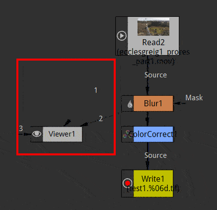

.. for help on writing/extending this file, see the reStructuredText cheatsheet
   http://github.com/ralsina/rst-cheatsheet/raw/master/rst-cheatsheet.pdf

Preview and rendering
=====================

Natron produces images in two ways. The **Viewer** computes the frames you look
at while you work, and keeps them in the playback cache. A **Write** node
renders the result of the node tree to files on disk: this is the final
render. Both use the same node tree, so the Viewer shows what the Write node
will write, unless proxy mode is on in the Viewer.

Previewing in the Viewer
------------------------

To look at the output of a node, connect it to a Viewer input:

- drag the input arrow of the Viewer node onto the node, or
- select the node and press a number key, :kbd:`1` to :kbd:`9` and :kbd:`0`, to
  connect it to that Viewer input.

When you play the timeline, each frame is rendered once and kept in the
playback cache, so the next loop plays back in real time. The frames that are
already cached are marked on the timeline. To go faster while you work, turn
on proxy mode (:kbd:`Ctrl+P`, :kbd:`Cmd+P` on macOS) and choose its scale
factor (:doc:`compositing-projects-proxy`).

See :doc:`getstarted-environment-viewer` for the Viewer controls, and
:doc:`compositing-projects-caching` for the caches and their size limits.

Rendering with a Write node
---------------------------

To write the result to disk:

1. Select the last node of the tree and create a Write node: press :kbd:`W` in
   the Node Graph, or use **Image > Write** in the toolbar. By default, a file
   dialog asks for the output file name (this can be turned off with
   **Edit > Preferences > User Interface > Prompt with file dialog when
   creating Write node**; on macOS, the Preferences are in the **Natron**
   menu).

   .. image:: _images/TheNodes-Image/node_image_write_nodetree.jpg

2. In the Properties panel of the Write node, check the **File** name, the options of the
   file format, and the colorspaces.
3. Choose the frames to render with **Frame Range**:

   - **Project frame range** (the default): the frame range set in the
     project settings (:doc:`compositing-projects-framerange`);
   - **Union of input ranges**: from the first to the last frame that the
     inputs can produce;
   - **Manual**: from **First Frame** to **Last Frame**.

   **Frame Increment** renders one frame out of N (1 renders every frame).
4. Click **Render** in the Properties panel of the Write node.

   .. image:: _images/TheNodes-Image/node_image_write_render.gif

The file name decides how frames are numbered, for example
``render_####.exr`` writes ``render_0001.exr``, ``render_0002.exr`` and so
on. A file name without a frame number, as for a video file, is written once.
The patterns (frame numbers and views) are described in
:doc:`compositing-projects-readers`.

Once the files are written, check **Read back file** to make the Write node
output the images read from disk instead of its input: this is a quick way to
look at the rendered files in the Viewer.

See :ref:`fr.inria.built-in.Write` for all the parameters of the Write node,
and :doc:`thenodes-image-write` for an overview.

The Render menu
---------------

The **Render** menu starts several renders at once:

- **Render All Writers** (:kbd:`F5`) renders every Write node of the project,
  including the ones inside groups. Disabled Write nodes are skipped.
- **Render Selected Writers** (:kbd:`F7`) renders the Write nodes selected in
  the Node Graph.
- **Enable Render Statistics** (:kbd:`F2`) is a toggle, and opens the
  **Render statistics** window. While it is on, the window shows, for the
  frame displayed in the Viewer, the render time and the cache use of every
  node. Renders started while it is on also write, next to each rendered
  frame, a text file with the same information, named after the frame file
  without its extension followed by ``-stats.txt`` (``render_0001.exr`` gives
  ``render_0001-stats.txt``). Use them to find the nodes that slow down a
  project.

Each Write node renders its own **Frame Range** with its own **Frame
Increment**. On macOS, the function keys may need :kbd:`Fn` (for example
:kbd:`Fn+F5`), unless the keyboard is set to use them as standard function
keys.

To get the statistics of a single frame in the Viewer, without opening the
Render menu, use **Refresh Image and Show Render Statistics**
(:kbd:`Ctrl+Shift+U` in the Viewer, :kbd:`Cmd+Shift+U` on macOS): it
re-renders the current frame and shows its statistics.

Following and controlling renders
---------------------------------

Every render appears as a task in the **Progress** panel, with the name of the
node, a progress bar, its status (Queued, Running, Paused, Finished,
Canceled, Failed), the estimated time remaining and the frame range. Each
task has buttons to pause, restart and cancel it. Renders to video files
cannot be paused: cancel them and start them again instead. See also
:doc:`getstarted-environment-progressbar`.

Two check boxes at the top of the panel change how renders run:

- **Queue Renders**: a new render waits until the previous ones are
  finished, instead of running at the same time. This is the same setting as
  **Edit > Preferences > Threading > Append new renders to queue**.
- **Remove Finished Tasks**: finished tasks leave the list. When it is off,
  they stay in the list, and the ones that can be paused can be restarted
  (renders to video files cannot).

Rendering in a separate process
~~~~~~~~~~~~~~~~~~~~~~~~~~~~~~~

With **Edit > Preferences > Threading > Render in a separate process**
checked (**Natron > Preferences** on macOS), Natron saves a copy of the
project when a render starts, and renders that copy with a second Natron process that runs in the background. If the
main window crashes, the render goes on. Right-click such a task in the
Progress panel and choose **Show Process Log** to see the output of that
process.

The other Threading preferences (number of render threads, number of
parallel renders) are described in :doc:`compositing-projects-caching` and
in :doc:`/_prefs`.

Rendering from the command line
-------------------------------

A saved project can be rendered without opening the user interface, with
``NatronRenderer`` (or ``Natron -b``). This is how a project is rendered on a
server or on a render farm. ``NatronRenderer`` is installed next to the
``Natron`` program, which is usually not on the ``PATH``: on macOS it is
``Natron.app/Contents/MacOS/NatronRenderer``, and on Windows
``bin\NatronRenderer.exe`` in the Natron folder. For example, to render the
Write node named ``Write1`` from frame 1 to frame 100::

    NatronRenderer -w Write1 /path/to/project.ntp 1-100

- ``-w`` takes the *script name* of the Write node (hover the node name at the
  top of its Properties panel to see it), and can be given several times.
  Without ``-w``, all the Write nodes of the project are rendered.
- After the Write node name, an absolute output file name can be given to
  replace the one saved in the project, for example
  ``-w Write1 /renders/shot010_'####'.exr``. The quotes are for the shells of
  Linux and macOS; in the Windows command prompt, leave them out, since it
  would pass them to Natron.
- The frame ranges are optional, and go after the project file: without them,
  each Write node renders its own **Frame Range**. Several ranges and single
  frames can be given, separated by commas, and a step can follow a colon, for
  example ``1-10,20,30-50:2``. Up to Natron 2.5, put the frame ranges after
  the project file rather than right after ``-w <Write node>``: there, a range
  with a step was taken as an output file name
  (`issue #1263 <https://github.com/NatronGitHub/Natron/issues/1263>`_).
- ``-s`` writes the ``-stats.txt`` render statistics described above. It
  does not work when writing video files.

Since the frames to render are given on the command line, a render farm can
split a shot into chunks of frames and render each chunk on a different
machine. ``NatronRenderer`` can also run Python scripts, which can create,
change and render a project. All the options are described in
:ref:`natronExec`, in the Developers Guide.
