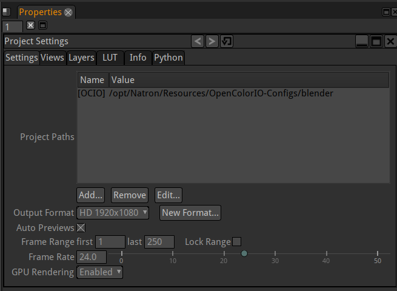

.. for help on writing/extending this file, see the reStructuredText cheatsheet
   http://github.com/ralsina/rst-cheatsheet/raw/master/rst-cheatsheet.pdf

.. _compositing-projects-setup:

Project setup
=============

To open the Project Settings, choose **Display > Show Project Settings...**, or
press :kbd:`S` with the mouse over the Node Graph.

The settings are on the **Settings**, **Views**, **Layers**, **LUT**, **Info**
and **Python** tabs. This page covers the **Settings** tab. See
:doc:`compositing-stereo` for the **Views** tab.

Natron fills in some settings from the first media you read, with a Read node
or by dragging files onto the Node Graph:

- the **Project Format** is set to the format of the first image or video read,
  if **First image read set project format** is checked in
  **Preferences > Project Setup** (the default);
- the **Frame Range** is set to the range of the first sequence or video, and
  then grows to include the range of each new Read node, unless **Lock Range**
  is checked.

Project Format
~~~~~~~~~~~~~~

The project format is the default size of the viewers, of the generators (for
example Constant or CheckerBoard) and of the Write nodes. It should usually
match the resolution of your plates. Choose it from the **Project Format**
menu.

If the format you need is not in the menu:

1. Click **New Format...**.
2. Either choose a viewer and click **Copy from** to copy the format of the
   image it shows, or type the width and height in the **w** and **h** fields,
   and the **pixel aspect** ratio.
3. Type a **Name** for the format.
4. Click **OK**. The new format is selected, and is added to the
   **Project Format** menu.

Frame Range and Frame Rate
~~~~~~~~~~~~~~~~~~~~~~~~~~

- **Frame Range** sets the first and last frames of the project. New viewers
  use this range, and it is the default range of the Write nodes. Check
  **Lock Range** to stop Read nodes from changing it. See
  :doc:`compositing-projects-framerange`.
- **Frame Rate** is the default frame rate, in frames per second, of the
  nodes that do not get one from their inputs (generators, for example).

GPU Rendering
~~~~~~~~~~~~~

**GPU Rendering** sets when plug-ins that support it may render on the GPU
with OpenGL:

- **Enabled**: when the plug-in supports it and the GPU resources are
  available.
- **Disabled**: never.
- **Disabled if background**: not when rendering from the command line with
  NatronRenderer, but enabled in the GUI.

If **OpenGL Rendering** is disabled in **Preferences > GPU Rendering**, GPU
rendering is never used, whatever this setting.
