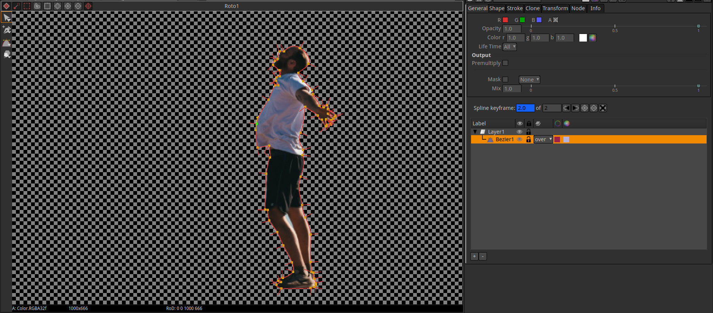
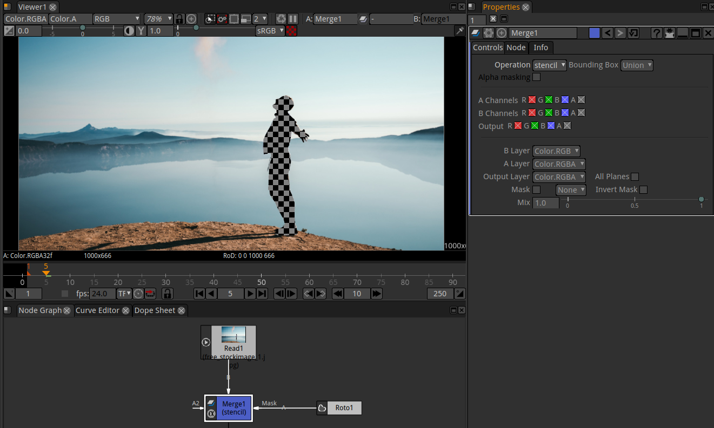

.. for help on writing/extending this file, see the reStructuredText cheatsheet
   http://github.com/ralsina/rst-cheatsheet/raw/master/rst-cheatsheet.pdf

Using Roto / Rotopaint
======================

Natron has two vector-based nodes for rotoscoping, rig removal, garbage mattes
and dust-busting: :ref:`Roto <fr.inria.built-in.Roto>` and
:ref:`RotoPaint <fr.inria.built-in.RotoPaint>`. You draw Bezier shapes, ellipses,
rectangles and paint strokes directly in the Viewer. Each shape has its own
color, opacity, feather, life time and 2D transform, shapes can be grouped in
layers, and every point can be animated.

Roto or RotoPaint?
******************

Both nodes share the same shapes, parameters and Viewer controls. The
differences are:

- **RotoPaint** adds the clone, reveal, blur, smear, dodge and burn brushes.
  Its default tool is the paint brush, and by default it draws into the R, G,
  B and A channels.
- **Roto** is meant for mattes. Its default tool is the Bezier tool, and by
  default it only draws into the alpha channel.

Both nodes have four optional inputs: **Bg** (the image the shapes are drawn
over) and **Bg2** to **Bg4**, which the clone and reveal brushes can use as
sources. In the Node Graph, press :kbd:`O` to create a Roto node and :kbd:`P`
to create a RotoPaint node.

The tools only show in the Viewer while the node's Properties panel is open.

Roto (Mask)
***********

You can use Roto to mask things, as with the mask tools of other VFX software.
In the following example we mask the person in the picture:

1. Insert a Merge node.
2. Insert a Roto node.
3. Connect the B input of the Merge node to the footage.
4. Connect the A input to the Roto node.
5. Double-click the Merge node. In the Properties panel, set **Operation** to
   **mask** and make sure that all A channels are checked (this is the first
   thing to check if the result is not as expected).

.. image:: _images/compositing-rotopaint_01.png

6. Double-click the Roto node. A toolbar appears on the left side of the Viewer:
   select the Bezier tool.
7. Draw the Bezier directly in the Viewer. Click to add a sharp (cusp) point, or
   click and drag to add a smooth point and pull out its tangents.
8. Close the Bezier by clicking its first point or by pressing :kbd:`Enter`:

9. To feather some parts, drag the feather points (see `Feather`_). To feather
   everything, raise the shape's **Feather** parameter, or add a Blur node
   between Roto and Merge.
10. To animate the mask, move to another frame in the Timeline and move the
    points: with auto-keying on (the default), a keyframe is set automatically.

Roto (Stencil)
**************

To invert the mask, change the **Operation** of the Merge node to **stencil**:

The Viewer toolbar
******************

The toolbar on the left side of the Viewer groups the tools by role. Click a
button to use its current tool, or click and hold it to choose another tool of
the same group. Each group has a keyboard shortcut, active while the mouse is
over the Viewer: the first press selects the group, the next presses cycle
through its tools.

.. list-table::
   :header-rows: 1
   :widths: 20 10 70

   * - Group
     - Key
     - Tools
   * - Selection
     - :kbd:`Q`
     - **Select All** (points, tangents, feather and shapes), **Select Points**
       (only the points of the shape itself), **Select Shapes**, **Select
       Feather Points**.
   * - Points edition
     - :kbd:`D`
     - **Add Points** (click a selected shape to insert a point), **Remove
       Points**, **Cusp Points** (remove the tangents), **Smooth Points**,
       **Open/Close Shape**, **Remove Feather** (click a point).
   * - Shapes drawing
     - :kbd:`V`
     - **Bezier**, **Ellipse**, **Rectangle**.
   * - Paint brush
     - :kbd:`N`
     - **Solid** paint brush, **Pencil** (draws an open Bezier curve, painted
       like a stroke, that you can edit point by point later), **Eraser**.
   * - Clone (RotoPaint only)
     - :kbd:`C`
     - **Clone**, **Reveal**.
   * - Effect (RotoPaint only)
     - :kbd:`X`
     - **Blur**, **Smear** (blurs and drags the image along the pen
       direction).
   * - Merging (RotoPaint only)
     - :kbd:`E`
     - **Dodge** (brightens the image), **Burn** (darkens it).

When you use the eraser end of a graphics tablet pen in RotoPaint, the Eraser
tool is selected automatically.

Drawing shapes
--------------

- **Bezier**: click to add points, click and drag to set the tangents of the
  new point. Click the first point, or press :kbd:`Enter` or :kbd:`Esc`, to
  close the shape. Selecting another tool also closes it.
- **Ellipse** and **Rectangle**: click and drag. Hold :kbd:`Shift` to draw a
  circle or a square, and :kbd:`Ctrl` (:kbd:`Cmd` on macOS) to draw from the
  center.

Editing shapes
--------------

With a selection tool, click a point or a shape to select it, or drag a
rectangle to select several points. The selected points get a bounding box
with handles to move and scale them. Press :kbd:`Ctrl` (:kbd:`Cmd` on macOS)
to switch the handles to rotate and skew, and press it again to switch back.
These shortcuts work while the mouse is over the Viewer, and most of them are
also in the right-click menu of the Viewer:

.. list-table::
   :header-rows: 1
   :widths: 30 70

   * - Key
     - Action
   * - :kbd:`Ctrl+A`
     - Select all
   * - :kbd:`Backspace`
     - Remove the selected points or shapes
   * - :kbd:`Z` / :kbd:`Shift+Z`
     - Smooth / cusp the selected points
   * - :kbd:`Shift+E`
     - Remove the feather of the selected points
   * - :kbd:`Enter`
     - Open or close the selected shape
   * - :kbd:`Shift+L`
     - Lock the selected shapes
   * - keypad :kbd:`4` :kbd:`6` :kbd:`8` :kbd:`2`
     - Nudge the selection left, right, up, down
   * - :kbd:`T`
     - Show or hide the transform handle of the selected shapes

All these shortcuts can be changed in the Shortcut Editor of the Preferences
(**Edit > Preferences**).

The buttons above the Viewer
----------------------------

While a selection, points edition or shapes drawing tool is active, a row of
buttons above the Viewer controls how editing works:

- **Enable Auto-Keying** (on by default): any change to a point sets a
  keyframe at the current frame.
- **Enable Feather-Link** (on by default): moving a point also moves its
  feather point.
- **Display Feather**: show the feather curve, so that it can be edited.
- **Enable Sticky Selection**: clicking outside of any shape does not clear the
  selection.
- **Enable Sticky Bounding Box**: clicking anywhere inside the bounding box of
  the selected points moves them. When off, drag its center cross instead.
- **Enable Ripple Edit**: moving a point moves it by the same amount at all its
  keyframes.
- **Add Keyframe** / **Remove Keyframe**: for the selected shapes, at the
  current frame.
- **Show Transform Handle**.

Painting with RotoPaint
***********************

When a paint tool is active, the buttons above the Viewer set the brush for the
**next** stroke. A stroke you have already painted keeps its own settings,
which you can change later in the **Stroke** tab of the Properties panel.

- **Stroke Color**, **Blending Mode** (how the stroke is merged; it changes
  with the tool, e.g. *over* for the solid brush, *color-dodge* for Dodge),
  **Opacity**, **Brush Size** and **Brush Hardness**.
- **Pressure Affects Opacity / Size / Hardness**: with a graphics tablet, the
  pen pressure changes these values along the stroke.
- **Build-Up**: the stroke builds up where it paints over itself.
- **Effect Strength** (Blur tool only).
- **Multi-Stroke**: successive strokes painted with the same tool are added to
  the same item of the list. Select another tool to start a new item.
- **Auto-connect Viewer**: connect the Viewer directly to the RotoPaint node
  when a paint tool is used.

In the Viewer, the brush is drawn as a circle around the cursor. Hold
:kbd:`Shift` and drag to change the brush size, and :kbd:`Ctrl+Shift`
(:kbd:`Cmd+Shift` on macOS) and drag to change the opacity.

Cloning and revealing
---------------------

The **Clone** tool copies pixels from another place of a source image, the
**Reveal** tool copies them from the same place of another image (for example
a clean plate connected to **Bg2**). With these tools, the buttons above the
Viewer also show:

- **Source**: *foreground* (the painted result of the items below the stroke),
  *background* (the image connected to **Bg**, unpainted), or *background 2* and
  up (**Bg2**, **Bg3**, ...). Choosing the Clone tool selects *background*, the
  Reveal tool *background 2*.
- To set the clone offset, hold :kbd:`Ctrl` (:kbd:`Cmd` on macOS) and drag in
  the Viewer. The source is drawn as a second circle with a cross. **Reset
  Transform** sets the offset back to zero. After painting, the offset of each
  stroke can be edited (translate, rotate, scale, skew) in its **Clone** tab.
- **Time Offset** and **Time Offset Mode**: clone from another frame, either
  at an absolute frame number or relative to the current frame.

.. note:: In Natron 2.6, the *foreground* source gives the same result as
   *background*, so a clone stroke cannot copy what other strokes have
   painted (`issue #629 <https://github.com/NatronGitHub/Natron/issues/629>`_).

Strokes last one frame by default
---------------------------------

A new stroke only exists at the frame where it was painted: its **Life Time**
is **Single**, and its **Frame** is the current frame. This is what you want
when you paint out dust or scratches frame by frame. To keep a stroke on all
frames (for example to paint out a fixed object in a locked-off shot), set
its **Life Time** to **All** in the Properties panel (see `Life time`_).

The shapes and strokes list
***************************

The bottom of the Properties panel lists all the items of the node: layers,
shapes and strokes. Selecting an item there selects it in the Viewer, and the
parameters above the list (**Shape**, **Stroke**, **Clone** and **Transform**
tabs) apply to the selected items.

- Items are rendered from the bottom of the list to the top: the first item of
  the list is drawn last, over all the others. Drag and drop items to reorder
  them or to move them to another layer.
- The columns show, for each item: its **Label** (double-click to rename), a
  visibility toggle, a lock (a locked item cannot be edited in the Viewer), the
  compositing **Operator** (how the item is merged with the items below it,
  e.g. *over*), the overlay color (the color of the curve in the Viewer, which
  does not change the output) and the shape **Color**.
- The **+** and **-** buttons under the list add a layer and remove the
  selected items. Right-click an item to add a layer, delete, cut, copy, paste
  or duplicate items.
- The **Spline keyframe** row above the list shows the keyframes of the
  selected shapes, with buttons to go to the previous or next keyframe, to add
  or remove a keyframe at the current frame, and to remove all the animation of
  the selected shapes.

Shape parameters
****************

Feather
-------

The **feather** of a shape is a soft edge, which fades from the shape color
to transparent. It can be set in two ways:

- The **Feather** parameter adds the same distance (in pixels, 1.5 by
  default) all around the selected shapes. **Feather fall-off** controls how
  fast the edge fades.
- Each point of a Bezier also has a feather point. With **Display Feather**
  on, drag the feather points, or the feather bars that connect them to the
  shape, to make the feather wider in some places. **Remove Feather** (in the
  points edition tools, or :kbd:`Shift+E`) puts the feather points back on the
  shape.

Life time
---------

**Life Time** sets the frames where an item is rendered: **All**, **Single**
(only at **Frame**), **From start** (up to **Frame**), **To end** (from
**Frame**), or **Custom**, which uses the animation of the **Activated**
parameter. New shapes are rendered on all frames, new strokes on a single
frame.

Transform
---------

The **Transform** tab moves, rotates, scales and skews the selected items
without changing their points. Since the transform can be animated, it can be
linked to a Tracker (see :doc:`compositing-tracking`) to make a shape follow an
object.

Merging with the background
***************************

The node first draws all its items over a black and transparent image, from
the bottom of the list to the top, each with its own color, opacity and
operator. The result is then merged over the **Bg** input, if it is connected.

- The **R**, **G**, **B** and **A** checkboxes at the top of the **General**
  tab choose the channels the node draws into. Roto only draws into alpha by
  default, so its shapes do not change the colors of the image.
- **Premultiply** multiplies the red, green and blue output by the alpha, so
  that the image is black and transparent outside the shapes and strokes. Use
  it only if **Bg** is opaque or unpremultiplied, and only alpha is drawn.

To use a Roto shape as a mask for another node, connect the Roto node to the
**Mask** input of that node, or merge it as shown in `Roto (Mask)`_. See also
:doc:`compositing-merge` and :doc:`compositing-channels`.

.. note:: Natron 2.6 does not render motion blur on Roto shapes, and it has
   no B-spline shapes and no per-shape "invert" switch. To invert a matte, use
   the **stencil** or **out** operation of a
   :ref:`Merge <net.sf.openfx.MergePlugin>` node, or an
   :ref:`Invert <net.sf.openfx.Invert>` node.
