.. for help on writing/extending this file, see the reStructuredText cheatsheet
   http://github.com/ralsina/rst-cheatsheet/raw/master/rst-cheatsheet.pdf
   
Stereoscopic compositing
========================

Importing stereoscopic sequences
--------------------------------

When creating a new project in Natron, by default there is a single view present. It is called the “Main” view.

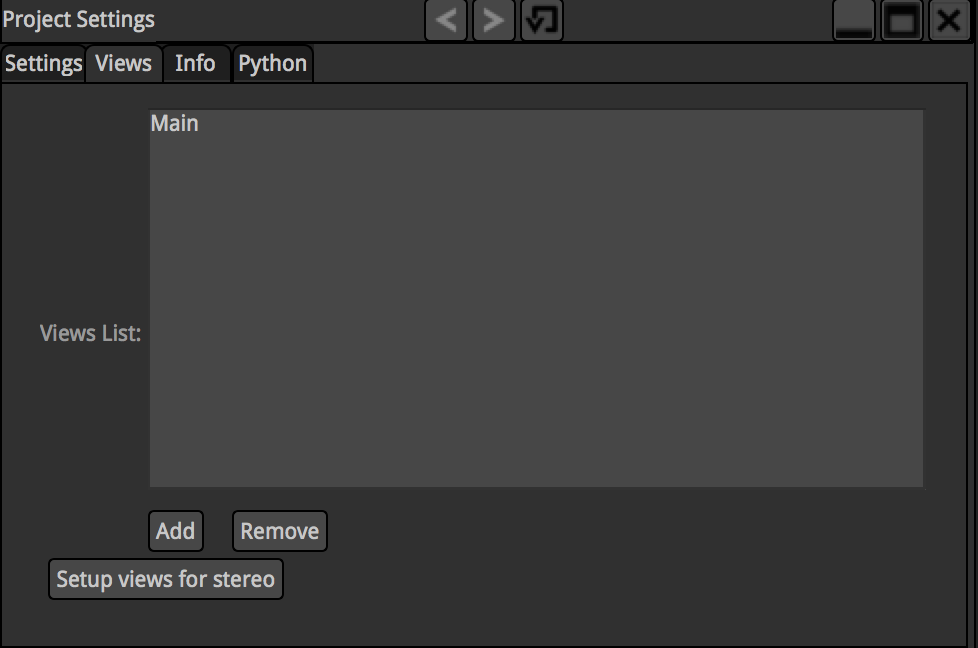

You can add, remove and rename views as desired. Clicking the “Setup views for stereo” button will make exactly 2 views named “Left” and “Right”.

Upon importing an EXR file containing multiple views within the file, Natron will prompt you to create the appropriate views in the project:

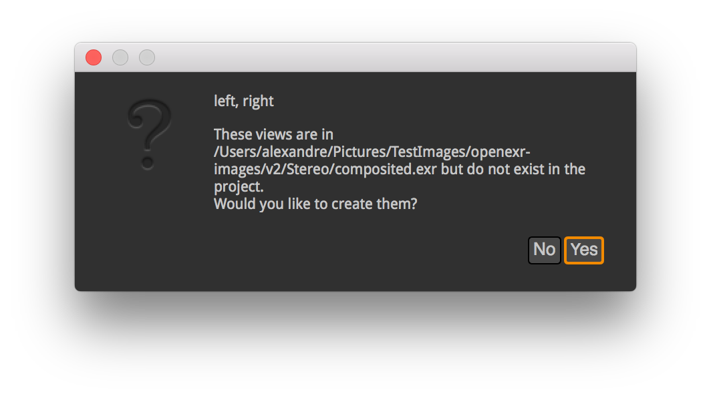

If clicking yes,  Natron will create the missing views in the project:

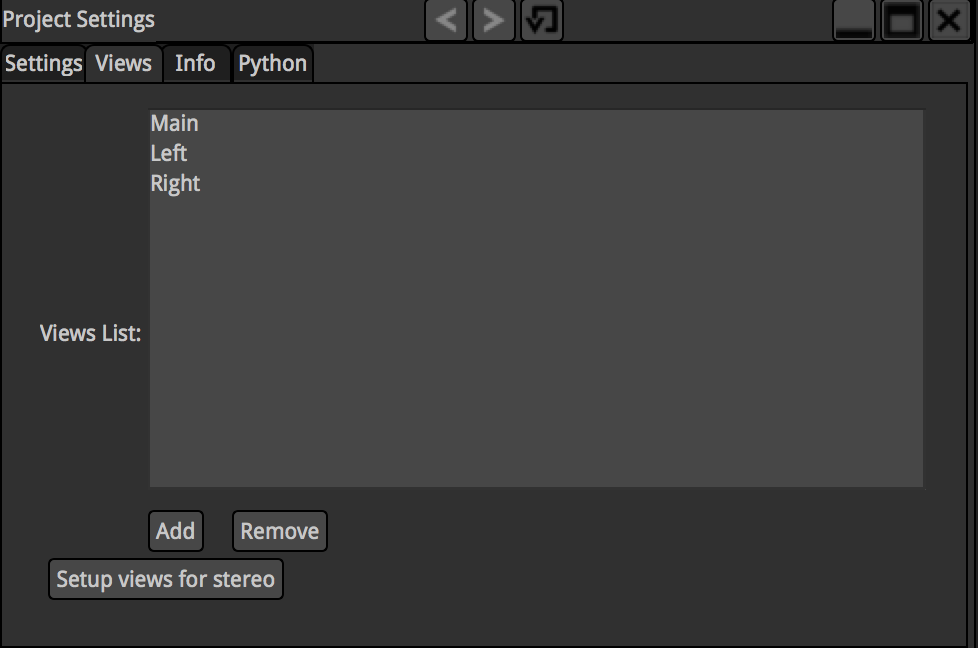

You can remove the “Main” view if needed (in our case it does not make sense to leave it in the project). You can do so by clicking either Remove and selecting the “Main” view or clicking “Setup views for stereo”: 

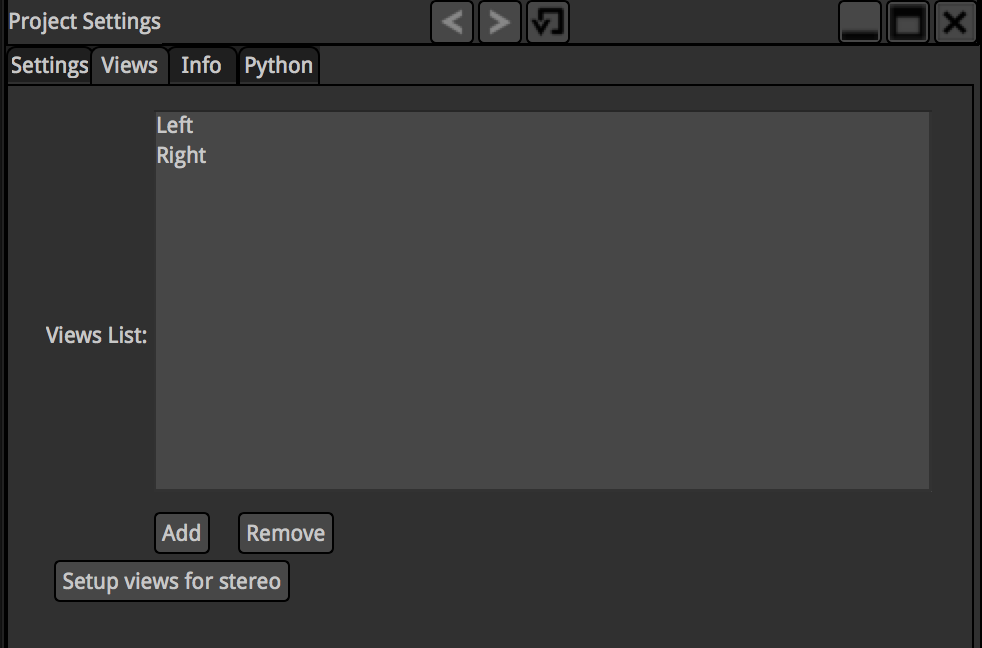

The Read node will have a special “V” mark on its top-left corner, indicating that it has multiple views available. When hovering the “V” indicator with the mouse, more information is available regarding which views are present in this Read node

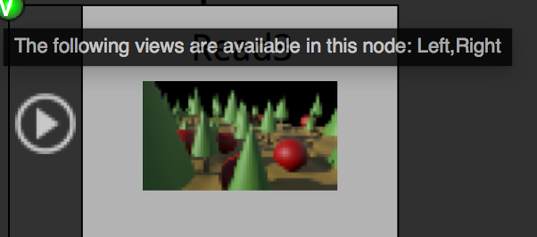

Hovering over an entry of the **Output Layer** menu shows in which views that layer is present:

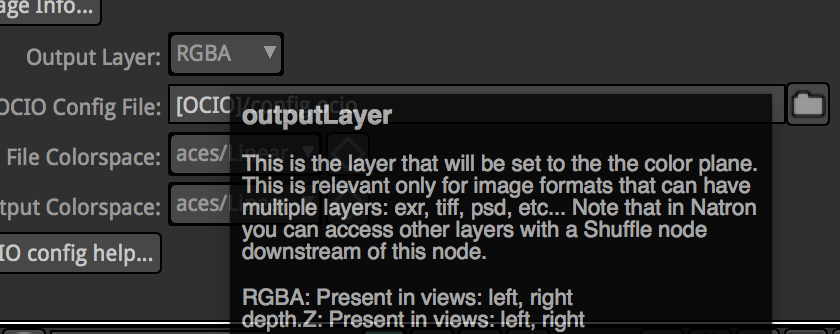

When the project has more than one view, each Viewer has a menu to choose the view to display:

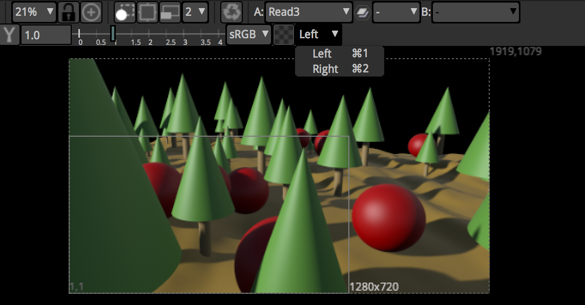

If we take a look at our Read node's properties, you can see that we have 2 layers in this file: RGBA and depth. Layers may sometimes not be present in all views in the file, but the Read node will show the union of all layers available across all views:

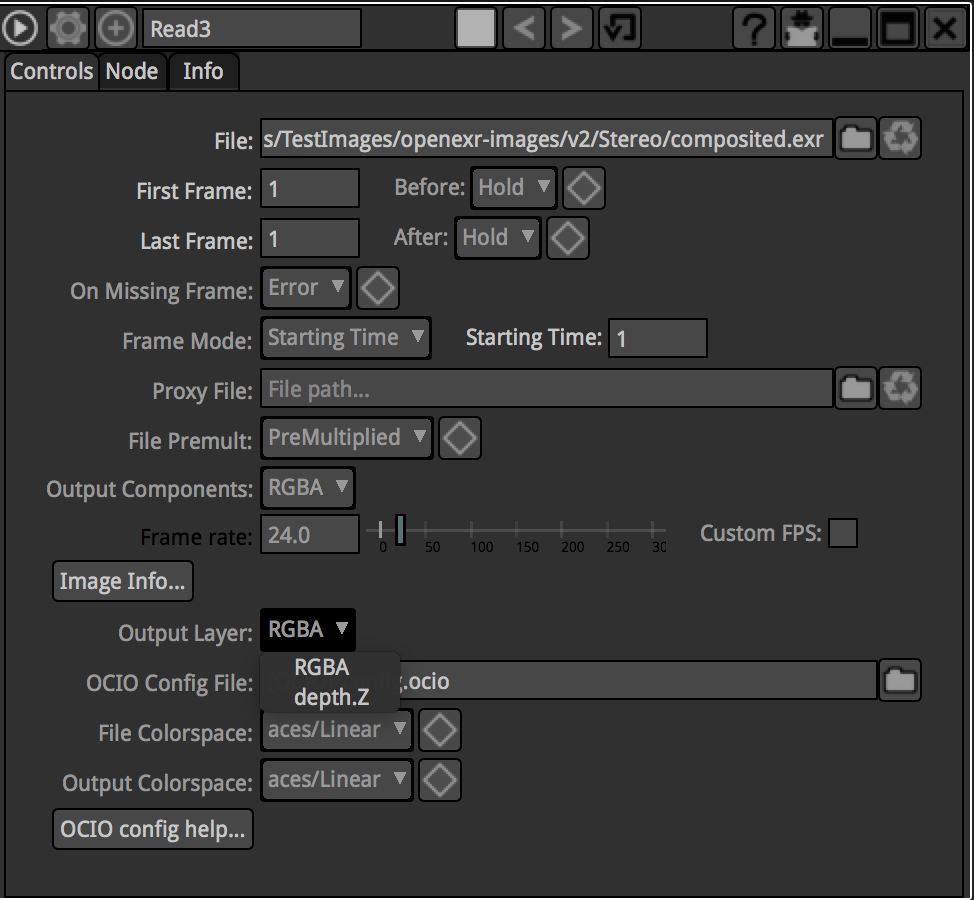

Joining separate views
----------------------

To join single-view clips into one multi-view stream, use the JoinViews node (**Views > JoinViews**). It has one input per view of the project, labelled with the view name:

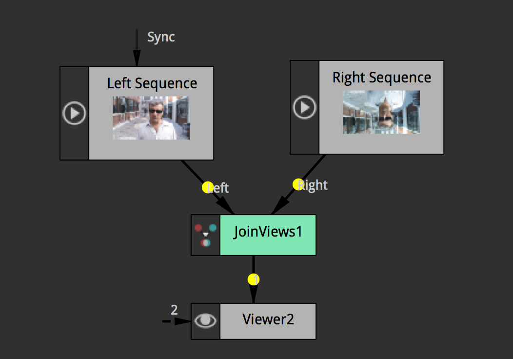

Exporting stereoscopic sequences
--------------------------------

You can write each view to a separate file, or all views to the same file. Only the EXR format can store several views in one file.
When writing to EXR, the Write node has a **Views** parameter, set to **All** by default:

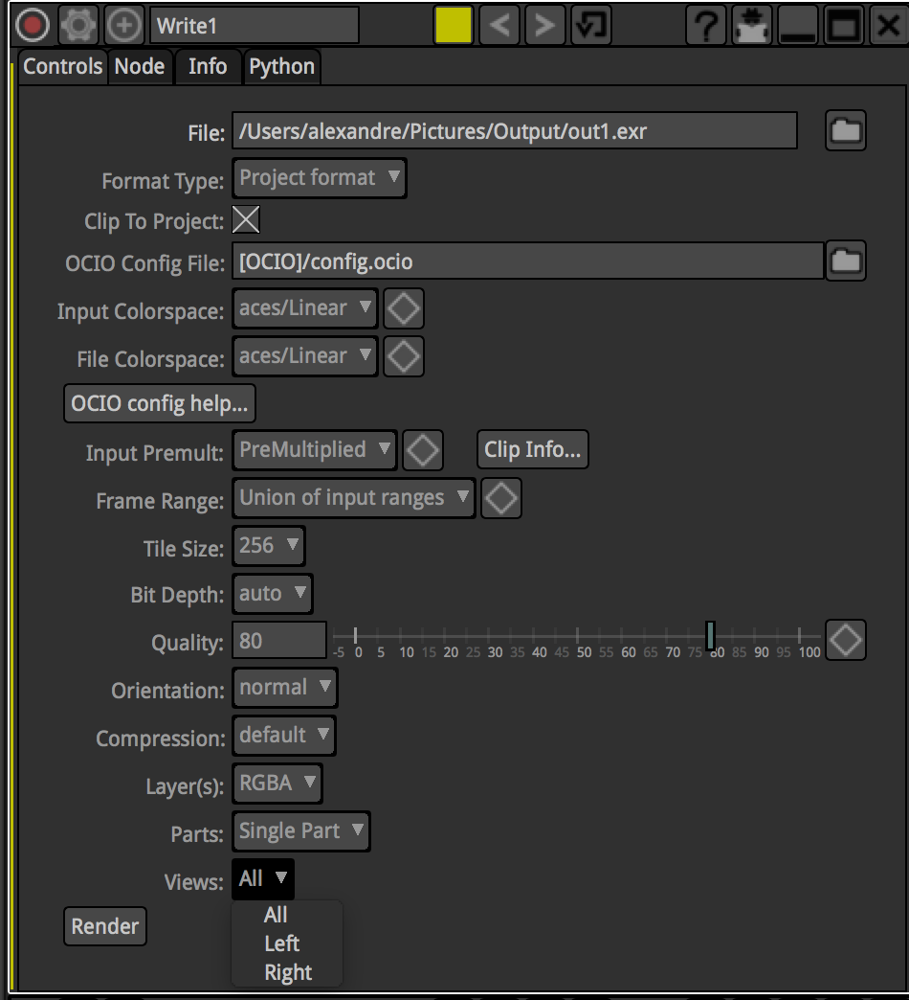

It selects the views to write.

The **Layer(s)** menu selects the layer to write. To write all the layers of the input, check **All Planes**. Only formats that can store several layers in one file, such as EXR, can hold them all.

The **Parts** parameter controls how views and layers are stored in an EXR file. Its default is **Split Views,Layers**:

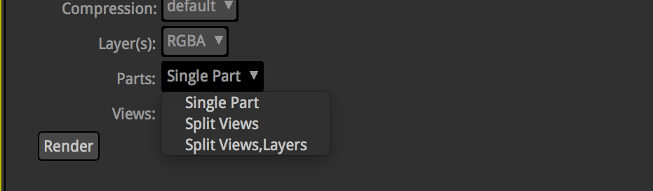

With **Single Part**, all the views are written to a single “part” of the file. OpenEXR 1.x applications write single-part files, so choose **Single Part** for applications that do not support OpenEXR 2.

With **Split Views**, each view is written to a separate part of the file. The file is smaller, but only applications that support OpenEXR 2 can read it. If **All Planes** is checked, all the layers of a view are stored in the part of that view.

With **Split Views,Layers**, each layer of each view is written to a separate part. The file is faster to decode, but larger.

Writing to separate files
-------------------------

To write each view to a separate file, add ``%v`` or ``%V`` to the output file name. ``%v`` expands to the first letter of the view name, in uppercase (for example ``L`` or ``R``), and ``%V`` to the view name as written in the project (for example ``Left`` or ``Right``):

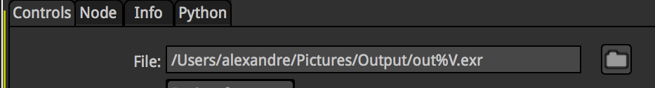

The **Views** parameter is then hidden. Use this to write several views to a format other than EXR.

Formats other than EXR cannot store several views in one file: if the file name contains neither ``%v`` nor ``%V``, Natron warns you and writes only the first view of the project. Video writers (WriteFFmpeg) always write only the first view.
To write one specific view, put a OneView node (**Views > OneView**) before the Write node, and choose the view in its **View** parameter:

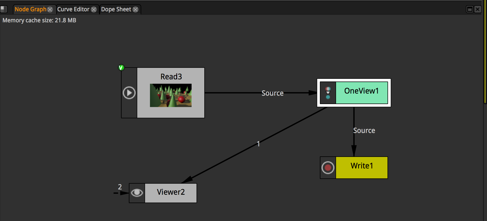

