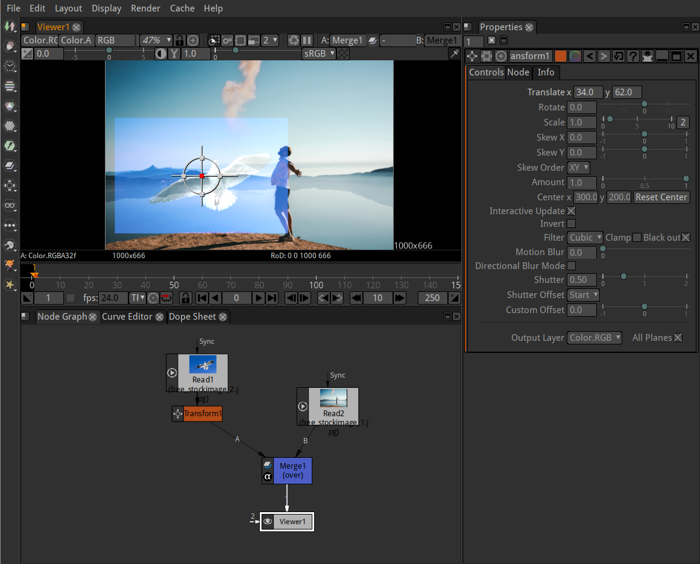
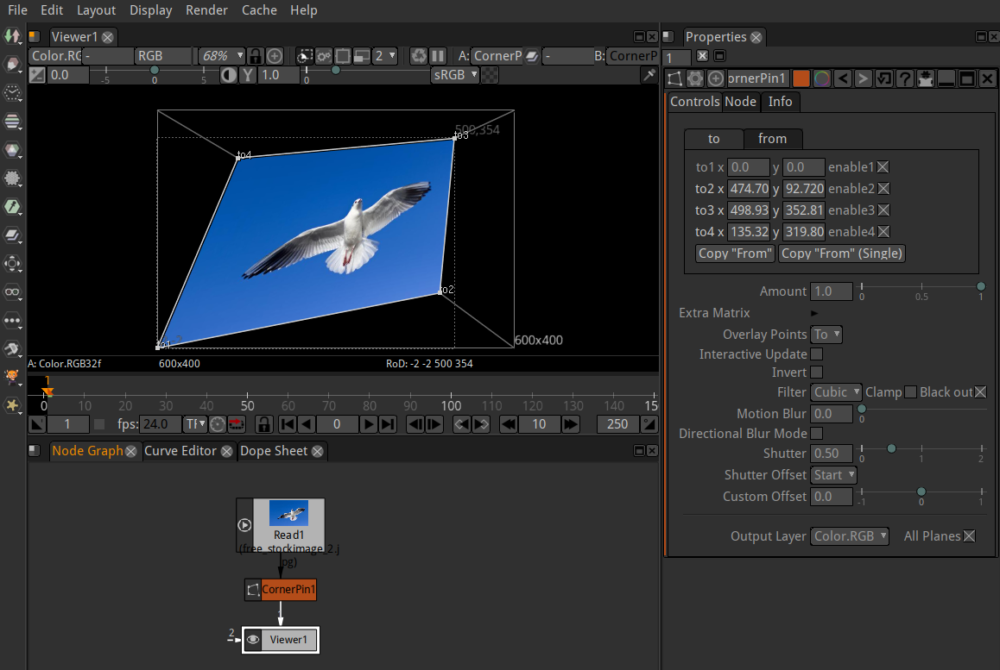

.. for help on writing/extending this file, see the reStructuredText cheatsheet
   http://github.com/ralsina/rst-cheatsheet/raw/master/rst-cheatsheet.pdf

Transforming elements
=====================

The Transform node translates, rotates, scales and skews an image. The
CornerPin node maps the four corners of an image to four new positions.

Transforming Images
###################

1. Select the node to transform, then choose **Transform > Transform** in the
   toolbar, or press :kbd:`T` in the Node Graph.
2. While the node's properties are open, the Viewer shows its handle: a
   circle with a cross at its center. Hover over a part of the handle to
   highlight it, then drag it: the center moves the image, the circle scales
   it, the four points on the circle scale it horizontally or vertically, the
   rotation bar rotates it, and the lines of the cross skew it.
3. You can also type values in the properties panel, drag a slider, or hover
   over a value and turn the mouse wheel. Hold :kbd:`Ctrl` while dragging a
   slider for 10 times finer steps, or :kbd:`Ctrl+Shift` for 100 times finer
   steps.

Corner Pin Images
#################

1. Choose **Transform > CornerPin** to add a CornerPin node.
2. Drag the four corner points in the Viewer, or type their positions in the
   **To** group of parameters. The **From** group holds the original
   positions of the points; **Set to input rod** sets them to the corners of
   the input image.

See the :ref:`Transform <net.sf.openfx.TransformPlugin>` and
:ref:`CornerPin <net.sf.openfx.CornerPinPlugin>` references for all the
parameters.
