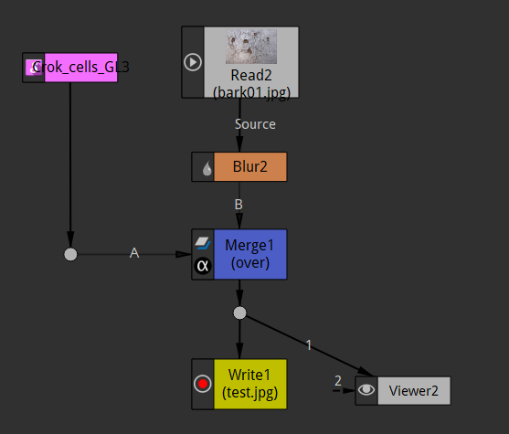
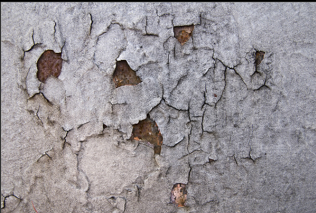
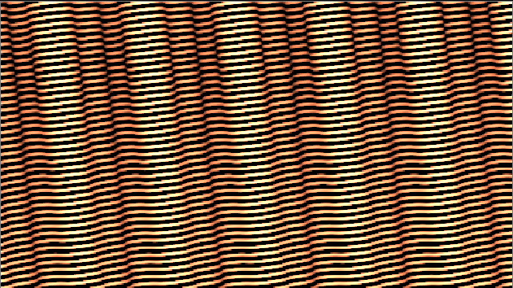
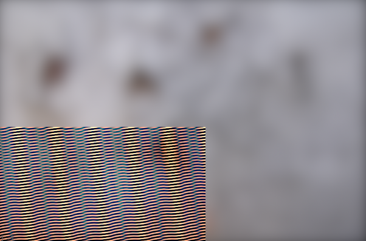

.. for help on writing/extending this file, see the reStructuredText cheatsheet
   http://github.com/ralsina/rst-cheatsheet/raw/master/rst-cheatsheet.pdf

Main Concepts
=============

Generic Description
###################
Natron processes images and videos with elementary effects called *nodes*.

Image Layers and Channels
#########################

In Natron, an image is a stack of grayscale images called *channels*, and channels are grouped in *layers*.
The base layer is the Color layer, with the channels R, G, B and A.
R, G and B hold the red, green and blue components of each pixel.
A, the alpha channel, holds its opacity: the pixel is transparent when A=0 and opaque when A=1.
An image can have any number of other layers, for example motion vectors or depth.

.. note::  Natron has no layer stack like Photoshop or After Effects. Instead, different branches of the node graph are combined with Merge nodes.

Image Flow
##########
The image goes through the nodes one after the other. Links between the nodes define the order of the processing.
The connected nodes form the *node graph*.

.. note::  If you place the nodes from top to bottom, the processing is like water flowing down pipes and collected in the last node of the graph.

Here is what happens in the node graph shown above.

A Read node (gray) reads an image.

A Blur node (orange) blurs it.

Another node creates a repetitive texture.

Such *generator* nodes create images from scratch, so they need no input.

A Merge node (blue) combines both images. Merge nodes can have several inputs.

To see the result, the output of the Merge node is connected to a Viewer node.

To save the result to disk, the output is also connected to a Write node (yellow).
The file is written only when you start the render, with the "Render" button in the properties of the Write node or with the Render menu.
A node has a single output image, but several nodes can use it: here, both the Write node and the Viewer.
A Dot node makes this branching easier to see.

Parameters
############

Each node has parameters that control its effect, such as the size of the blur in the Blur node. They can be changed in several places:

Properties pane:
  Move the sliders or type values.
  
  .. image:: _images/properties_01.png
    :width: 600px
Curve editor:
  Animated parameters are displayed as curves, which can be edited.
  
  .. image:: _images/curve_editor_01.png
    :width: 600px

Dope sheet:
  Each keyframe is displayed as a small block that can be moved in time (left or right). This retimes an animation without changing its values.
  
  .. image:: _images/dopesheet_01.png
    :width: 600px

.. note::  Unlike in a paint program, you rarely paint directly on the image: strokes painted frame by frame on a video would jitter.

Non destructive workflow
########################

Natron project files (``.ntp``) contain no pixels, only the description of the node graph.

To display an image, Natron reads the source files, processes each node in turn, and displays the result.

This has several implications:

- Natron never modifies your source files, unless a Write node overwrites them (never do that).
- You can always change your mind: any node can be changed or removed later. Undo and redo are also available in the Edit menu.
- Keep your source files, because they are not stored in the project. If you move them, update the paths in Natron. To move a project to another computer, copy its source files too.
- Images must be processed again and again. To keep Natron responsive, it caches the results to avoid recomputing them. The cache uses a lot of memory: the Cache menu and the Caching page of the preferences control it.
