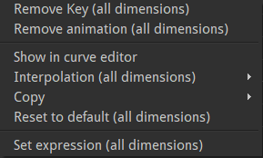
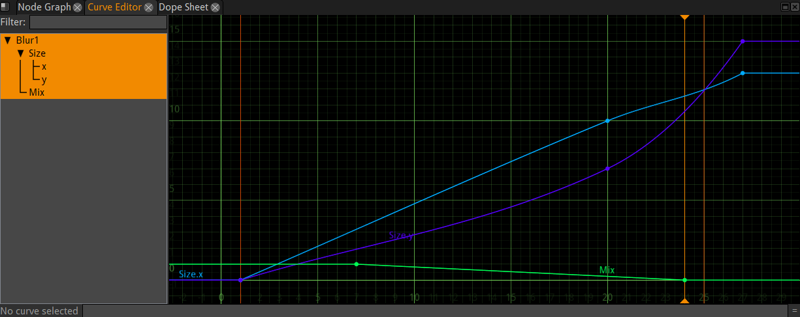
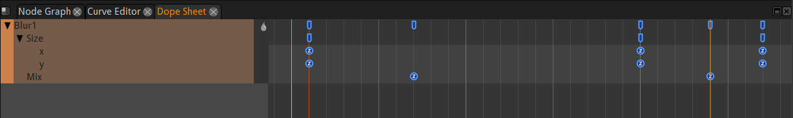

.. for help on writing/extending this file, see the reStructuredText cheatsheet
   http://github.com/ralsina/rst-cheatsheet/raw/master/rst-cheatsheet.pdf

.. _getstarted-environment-anim:

Animating parameters
====================

Most parameters of a node can change over time. Natron offers three ways to
make a parameter vary:

- **Keyframes**: you set the value of the parameter at some frames, and
  Natron interpolates the value between these frames.
- **Expressions**: a short Python formula computes the value at each frame,
  for example from the value of another parameter.
  See :doc:`compositing-exprs`.
- **Links**: the parameter takes its value from another parameter of the same
  type.

This page explains keyframes and links, and how to edit animation in the
Curve Editor and in the Dope Sheet.

In the shortcuts below, **Ctrl** is the **Cmd** key on macOS.
Most shortcuts can be changed in the *Shortcut Editor* section of the
:doc:`Preferences <../_prefs>`.

Setting keyframes
-----------------

A parameter is not animated until it has at least one keyframe. To set a
keyframe:

1. Move the timeline to the frame where you want the keyframe.
2. Right-click the parameter in the properties panel, and choose
   **Set Key**.

As soon as a parameter has a keyframe, every change you make to its value
(by typing a value, dragging its slider, or moving its handle in the viewer)
creates or updates a keyframe at the current frame. This works per
dimension: only the animated dimensions of a parameter get new keyframes. So, to animate a
parameter, set a first keyframe, then move to another frame and change the
value: a second keyframe is created there.

The background color of a parameter field shows its animation state:

- default background: the parameter is not animated;
- bright blue: the parameter is animated, and there is a keyframe at the
  current frame;
- greyish blue: the parameter is animated, and the value at the current frame is
  interpolated between keyframes;
- green: the value comes from an expression (see :doc:`compositing-exprs`).

These colors can be changed in the Preferences, in the *Appearance* section
(the *Interpolated value*, *Keyframe* and *Expression* colors).

While the properties panel of a node is open, the timeline under the viewer
shows a mark at each frame where one of its parameters has a keyframe. Use
**Ctrl+Shift+Left** and **Ctrl+Shift+Right** to jump to the previous or next
keyframe.

Parameters with several dimensions
~~~~~~~~~~~~~~~~~~~~~~~~~~~~~~~~~~

Some parameters have several values, called *dimensions*: for example the x
and y of a position, or the r, g, b and a of a color. Each dimension has its
own animation curve.

Right-clicking such a parameter gives two kinds of entries:

- entries ending with **(all dimensions)** act on all the values of the
  parameter at once. Right-click the label of the parameter to get only
  these entries;
- the other entries only act on one dimension. They appear when you
  right-click the value field of that dimension.

Some parameters, such as colors, show a single value for all their
dimensions. Click the button showing the number of dimensions, next to the
parameter, to show and edit each value separately.

The animation menu
------------------

Right-click a parameter to open its animation menu.

   The animation menu of a parameter with several dimensions, at a frame
   where it has a keyframe.

The entries in the menu depend on the parameter and on its state:

Set Key / Remove Key
    Add a keyframe at the current frame, or remove the keyframe at the
    current frame if there is one.

Remove animation
    Remove all the keyframes. The parameter keeps its value at the current
    frame.

Show in curve editor
    Open the Curve Editor and show the curves of this parameter. This entry is
    only present when the parameter is animated.

Interpolation
    Set the interpolation of all the keyframes of the parameter (see
    `Interpolation`_ below). This entry is only present when the parameter
    is animated.

Copy
    Copy the value, the animation, or a link to this parameter. You can then
    right-click another parameter of the same type and choose **Paste Value**,
    **Paste Animation** or **Paste Link**.

Reset to default
    Set the parameter back to its default value.

Set expression... / Edit expression... / Clear expression
    Add, edit or remove an expression. See :doc:`compositing-exprs`.

Unlink from ...
    Only present when the parameter is linked to another parameter (see
    `Linking parameters`_). It removes the link.

Create alias on group
    Only present for nodes inside a group. It creates a copy of the parameter
    on the group node, linked to the original one, so that the parameter can
    be controlled from the properties panel of the group.

Interpolation
-------------

The interpolation of a keyframe defines the shape of the curve around that
keyframe, and so how the value goes from one keyframe to the next.

Constant
    The value stays the same until the next keyframe, then jumps to the
    value of that keyframe.

Linear
    The value changes at a constant rate between keyframes: the curve is
    made of straight lines.

Smooth
    The curve is smooth and never goes beyond the values of the neighboring
    keyframes (it does not *overshoot*). At a keyframe that is higher or lower
    than both its neighbors, the curve is flat. This is the default for
    real-valued parameters.

Catmull-Rom
    The curve is smooth, and its slope at a keyframe is computed from the
    previous and next keyframes. It may go beyond the values of the
    keyframes.

Cubic
    The curve is smooth, and its curvature is also continuous at the
    keyframes. It may go beyond the values of the keyframes.

Horizontal
    The curve is flat at the keyframe, which gives an *ease in / ease out*
    effect.

Two more interpolation types appear when you edit the tangents of a keyframe
in the Curve Editor:

Free
    The slope at the keyframe was set by hand. The tangents on the left and
    on the right of the keyframe stay aligned.

Break
    The tangents on the left and on the right of the keyframe can be moved
    separately, which makes a corner in the curve.

Boolean, choice (menu) and text parameters can only use **Constant**
interpolation. New keyframes on integer parameters also use Constant
interpolation, but you can change it.

Before the first keyframe and after the last one, the value usually stays
constant. When the first or last keyframe uses Catmull-Rom or Cubic
interpolation, or when its outer tangent (the left one on the first keyframe,
the right one on the last keyframe) was edited by hand, the curve continues
along that slope instead.

The Curve Editor
----------------

The Curve Editor shows the animation of parameters as curves: time is on the
horizontal axis, and the value of the parameter is on the vertical axis. In
the default layout, it is a tab next to the Node Graph.

   The Curve Editor.

The list on the left shows the nodes whose properties panel is open, and
their animated parameters. Type in the **Filter** field to only show the
nodes whose name contains that text. Select a node or a parameter in the
list to show its curves. Double-click it to bring the properties panel of
the node to the top of the properties bin.

Navigating
~~~~~~~~~~

- **Mouse wheel**: zoom in and out, around the mouse pointer.
- **Ctrl+wheel**: zoom on the time axis only.
- **Ctrl+Shift+wheel**: zoom on the value axis only.
- **Middle-drag**: move the view.
- **A**: frame all the curves.
- **F**: frame the selected curve.
- Drag the vertical line of the current frame to move in time.

Editing keyframes
~~~~~~~~~~~~~~~~~

- **Double-click** a curve, away from its keyframes, to add a keyframe at that
  point. **Ctrl+Alt+click** on a curve does the same.
- **Click** a keyframe to select it, **Ctrl+click** to add it to the
  selection, or drag a rectangle to select several keyframes.
- **Drag** the selected keyframes to move them in time and value.
- When several keyframes are selected, a box is drawn around them. Drag the
  handles of that box to scale the selection in time or in value.
- Selecting a keyframe shows its tangents. Drag the end of a tangent to change
  the slope of the curve at that keyframe. This sets the keyframe
  interpolation to *Free*, or keeps it as *Break* if the keyframe was already
  broken. On the first or last keyframe, it sets *Break* instead, unless the
  keyframe uses Catmull-Rom, Cubic or Free interpolation.
- When a single keyframe is selected, its frame, value and slopes are
  written next to it. Double-click that text to type new values.
- **Backspace** deletes the selected keyframes.
- **Ctrl+A** selects all keyframes; **Ctrl+C** and **Ctrl+V** copy the selected
  keyframes and paste them on the selected curve.

To change the interpolation of the selected keyframes, use the
**Interpolation** submenu of the right-click menu, or these keys:
**K** (Constant), **L** (Linear), **Z** (Smooth), **R** (Catmull-Rom),
**C** (Cubic), **H** (Horizontal), **X** (Break).

The right-click menu also has:

- **File**: export curves to a text (ASCII) file, or import them from one,
  with one column per curve.
- **Predefined**: **Loop**, **Reverse** and **Negate**. These set an
  expression on the selected curve, based on ``curve()``. The keyframes are
  not changed, and clearing the expression restores the original animation.

  - **Loop** asks for a first and a last frame, and repeats the animation
    between these frames.
  - **Reverse** writes ``curve(-frame, 0)`` (with the dimension number of
    the curve): it mirrors the animation
    around frame 0, so frame 10 gets the value of frame -10. It does not play
    an animation backwards over its own frame range: with keyframes at
    frames 1 to 21 only, the result is flat. To reverse the animation between
    a first and a last frame, edit the expression to
    ``curve(first + last - frame, dimension)``, for example
    ``curve(22 - frame, dimension)`` for frames 1 to 21.
  - **Negate** writes ``-curve(frame, 0)`` (with the dimension number of the
    curve), which inverts the values.
- **Options** > **Update on mouse release only**: when checked, the image
  is only rendered again when you release the mouse, instead of while you
  drag keyframes.

Under the curves, a text field shows the expression of the selected curve, if
any, and its value at the current frame. You can type an expression there.
When a parameter has an expression, the Curve Editor also draws the values
produced by the expression.

The Dope Sheet
--------------

The Dope Sheet shows *when* the keyframes are, without their values. Use it
to change the timing of an animation, or to move many keyframes of several
nodes at once. In the default layout, it is a tab next to the Node Graph.

   The Dope Sheet.

The list on the left shows the nodes whose properties panel is open, with
their animated parameters and their dimensions. Each row on the right shows
the keyframes of that node, parameter or dimension. The row of a node or of a
parameter shows the keyframes of all its children, so moving a keyframe in
that row moves the keyframes of all its children at that frame.

- **Click** a keyframe to select it, **Shift+click** to add to the
  selection, or drag a rectangle to select several keyframes.
- **Drag** the selected keyframes to move them in time. They always move by a
  whole number of frames.
- When several keyframes are selected, drag the left or right side of the box
  around them to scale them in time.
- **Ctrl+double-click** in the row of a parameter to add a keyframe at that
  frame, with the current value of the parameter. This also moves the
  timeline to that frame.
- **Backspace** deletes the selected keyframes; **Ctrl+A** selects all
  keyframes; **F** frames the selection.
- **Ctrl+C** copies the selected keyframes. **Ctrl+V** pastes them at the
  current frame, keeping their spacing; **Ctrl+Shift+V** pastes them at their
  original frames. Before pasting, select the target parameter dimensions in
  the list on the left.
- The interpolation keys are the same as in the Curve Editor (**K**, **L**,
  **Z**, **R**, **C**, **H**, **X**).
- **Mouse wheel** zooms the time axis, and **middle-drag** moves the view.

The Dope Sheet also shows the frame range of some nodes as a bar:

- for a :ref:`Read <fr.inria.built-in.Read>` node, the bar shows the frames
  that it reads. Drag the bar to move the clip in time (this changes its
  *Starting Time*), drag its left or right end to trim it (this changes its
  *First Frame* or *Last Frame*), or drag its bottom edge to *slip* it (show
  other frames of the source at the same place in time);
- for :ref:`TimeOffset <net.sf.openfx.timeOffset>` and
  :ref:`FrameRange <net.sf.openfx.FrameRange>` nodes, dragging the bar
  changes the time offset or the frame range;
- for :ref:`Retime <net.sf.openfx.Retime>` nodes, the bar shows the frame
  range that the node produces from its input; for groups, it shows the
  range covered by the nodes inside the group, and dragging it moves the
  keyframes and clips of the nodes inside.

Linking parameters
------------------

A link makes a parameter follow another parameter of the same type: the
linked parameter cannot be edited anymore, and always shows the value of the
other parameter.

To create a link, do one of the following:

- right-click the parameter to follow, choose **Copy** > **Copy Link**, then
  right-click the other parameter and choose **Paste Link**;
- hold **Ctrl** and drag the parameter to follow onto the other parameter. To
  link all dimensions, drag the label of the parameter; to link one
  dimension, drag the value field of that dimension.

Hold **Ctrl+Shift** instead of **Ctrl** while dragging to create an
*expression link*: Natron writes an expression that multiplies the value of
the source parameter by the animation curve of the target parameter. This
lets you keep a separate animation on top of the linked value. If the target
parameter has no keyframes, ``curve()`` returns its current value, so the
result is the source value multiplied by that value: it is 0 if the target
value was 0.

To remove a link, right-click the linked parameter and choose **Unlink from
...**.

In the Node Graph, a green arrow joins two nodes when a parameter of one is
linked to a parameter of the other, or uses it in an expression, and the node
shows a small green **E** indicator. Hover the arrow to see which parameters
are linked. Toggle these arrows with **Shift+E**, or with **Show Expressions
Links** in the **View** submenu of the Node Graph right-click menu.

Keyframes, expressions or links?
--------------------------------

- Use **keyframes** when you want to set values by hand at given frames.
- Use a **link** when a parameter must always have the same value as another
  one, for example the same blur size on two nodes.
- Use an **expression** when the value must be computed: an offset or a
  factor from another parameter, a value that depends on the frame number,
  random values, a loop of an animation, etc. See :doc:`compositing-exprs`.

A parameter with an expression ignores its keyframes, unless the expression
uses them through the ``curve()`` function (this is what the *Predefined*
curves of the Curve Editor do).

To set keyframes from a Python script, see the Python reference for
:ref:`AnimatedParam <AnimatedParam>`.
