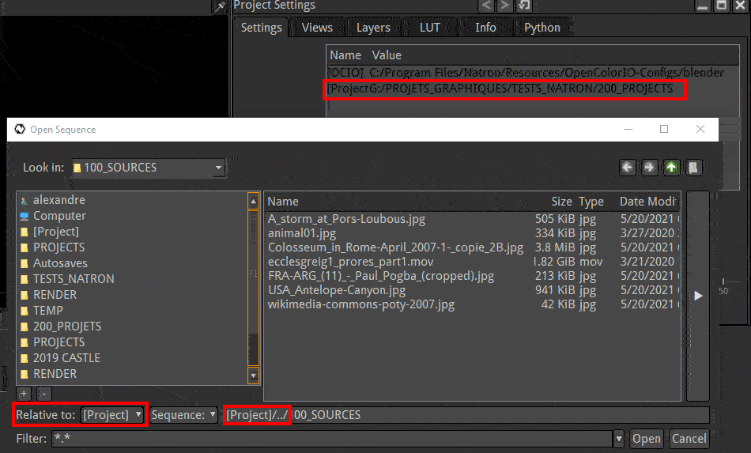
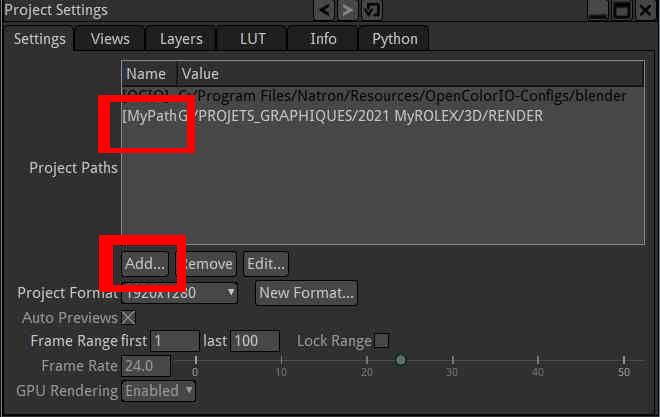
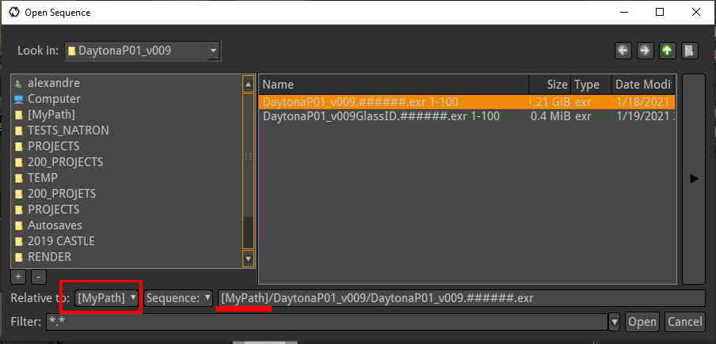
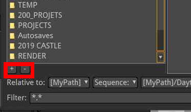

.. for help on writing/extending this file, see the reStructuredText cheatsheet
   http://github.com/ralsina/rst-cheatsheet/raw/master/rst-cheatsheet.pdf
   
Using the file browser
======================

The file browser opens when you click the folder button of a file parameter,
for example the *File* parameter of a Read or Write node.

Relative paths
--------------

A path can be relative to a *project path*, so that you can move a project
and its files, or open it on another computer with a different folder layout,
without breaking the paths.

Paths relative to the project file
::::::::::::::::::::::::::::::::::

1. Save the project in a folder that also contains your images, or a parent
   folder of them. Natron then sets the ``[Project]`` project path to the
   folder of the project file.
2. In the file browser of a Read or Write node, choose ``Project`` in the
   *Relative to:* menu.

Your own project paths
::::::::::::::::::::::

First create a project path:

1. Open the project settings (:kbd:`S`).
2. Under *Project Paths*, click *Add...* and choose a folder.
3. Click the name of the new path to rename it.

Then use it in the file browser:

1. Open the file browser from the Read or Write node.
2. Go to your file.
3. Choose the name of your project path in the *Relative to:* menu.

The path is now relative. If you move the files, select the project path in
the project settings, click *Edit...* and choose the new folder.

Favorites
---------

Favorites give quick access to the folders you use often.

Click ``+`` to add the current folder to the favorites, and ``-`` to remove
the selected favorite.

.. tip::
   Keep your layout files (``.nl``) in one folder and add it to the favorites.

Image sequences
---------------

In Natron, a clip can be a sequence of numbered image files instead of a
single video file::

   image.0001.jpg
   image.0002.jpg
   image.0003.jpg
   ...

.. tip::
   Natron works better with image sequences than with video files (QuickTime,
   MP4, ...): reading them is faster and more reliable, and you can render
   again only part of a sequence. See
   :doc:`tutorials-imagesequence`.

.. warning::
   All the images of a sequence should have the same size.

The file browser groups the numbered files and shows them as a single
sequence, for example ``image.####.jpg 1-3``. To see and pick the individual
files, switch the menu next to the file name from *Sequence:* to *File:*.

In the file name, the number of ``#`` characters, or the ``%04d`` notation,
tells Natron how many digits the frame number has (the *padding*).
``image.####.jpg`` and ``image.%04d.jpg`` both mean four digits, as in
``image.0001.jpg``.

.. tip::
   Put the frame number between two dots, as in ``image.0001.jpg``.

Slash and backslash
-------------------

Linux and macOS separate folders with ``/`` (slash), and Windows with ``\``
(backslash). Natron accepts both in the file browser.
