.. for help on writing/extending this file, see the reStructuredText cheatsheet
   http://github.com/ralsina/rst-cheatsheet/raw/master/rst-cheatsheet.pdf

Using the menus
===============

Natron has a menu bar, and context menus that open with a right-click in most panels. When a command has a keyboard shortcut, the menu shows it. The shortcuts below are the defaults: you can change them in the *Shortcut Editor* tab of the Preferences.

The menu bar
############

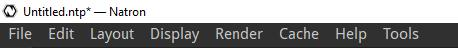
   
File menu
---------

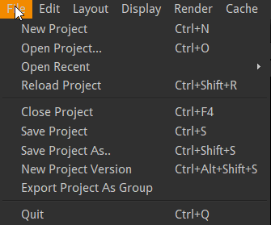

New Project
  Start a new, empty project.
Open Project...
  Open a ``.ntp`` project file. A project file describes the node graph: it
  contains no image data, only the instructions to process the images.
Open Recent
  Open one of the recently opened project files.

If the current project is not empty, the project opens in a new window.

Reload Project
  Reload the current project file from disk, discarding the unsaved changes.
Close Project
  Close the current project. Other open projects stay open.
Save Project
  Save the current project.
Save Project As..
  Save the current project under a new name. The *File format* choice of the
  dialog sets the format of the project file (see below).
New Project Version
  Save the project under a new name with an incremented version number:
  ``shot.ntp`` is saved as ``shot_001.ntp``, ``shot_001.ntp`` as
  ``shot_002.ntp``, and so on. The version number is the group of digits just
  before the ``.ntp`` extension, and it is written with at least three digits.

Project files are small, so it is a good idea to save a new version at each
step of your work: you can then go back to an earlier state, or recover from a
damaged file.

.. note::  Use the ``name_001.ntp`` form. Other forms, such as
   ``name_v01.ntp``, are not handled correctly: increment them yourself with
   *Save Project As..*.

Export Project As Group
  Save the whole project as a PyPlug, a Python script that recreates the graph
  as a single Group node that you can reuse in other projects. Add Input
  nodes, and one Output node, so that Natron knows how to connect the group.
Quit
  Quit Natron (in the :menuselection:`Natron` menu on macOS).

Project files are saved in one of two formats, both with the ``.ntp``
extension:

- *Binary* (the default for new projects): smaller, and faster to load and
  save. Natron 2.5 and earlier cannot open it.
- *Text (Natron 2.5 compatible)*: XML, which Natron 2.5 can open, and which you
  can read or compare with a text tool.

A project keeps its format when it is saved: choose another one with *Save
Project As..*. The *Save projects as binary by default* preference (General
tab) gives the format of new projects.

To convert projects without opening them, for example many of them in a
script, use the ``natron_convert_project`` Python module, which is installed
with Natron, in NatronRenderer (see :ref:`natron-convert-project`). It does
not keep the GUI data of a project (node positions, viewer settings, window
layout), so it only converts projects saved by NatronRenderer or
``Natron -b``; convert the others with *Save Project As..*.

Edit menu
---------

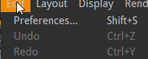

Preferences...
  Open the Preferences window: display, performance, plug-in paths,
  shortcuts and other settings. On macOS, it is in the
  :menuselection:`Natron` menu.

Undo and Redo
  The text of these entries tells you which change will be undone or redone.
  See :doc:`getstarted-environment-undoredo`.

Layout menu
-------------
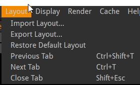

The layout is the arrangement of the panels in the Natron window. This menu lets you save and load layouts.

Useful for:

- keep one layout for each kind of task (a bigger Curve Editor to animate,
  a bigger Viewer for rotoscoping, and so on);
- use your layout on another computer;
- keep a layout with separate windows for a dual-monitor setup.

Import Layout...
  Load a layout file (``.nl``).
Export Layout...
  Save the current layout to a ``.nl`` file.
Restore Default Layout
  Go back to the default layout. In this layout, the Node Graph, the Curve
  Editor and the Dope Sheet share the same pane: click their tabs to switch
  between them.

The following commands act on the pane under the mouse pointer, and are
easier to use with their shortcuts:

Previous Tab
  :kbd:`Ctrl+Shift+T`
Next Tab
  :kbd:`Ctrl+T`
Close Tab
  :kbd:`Shift+Esc`
  
  
Display menu
-------------
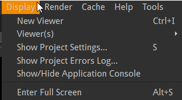

Each Viewer panel belongs to a Viewer node in the Node Graph. A Viewer can
show two of its inputs, called the A side and the B side, to compare them.

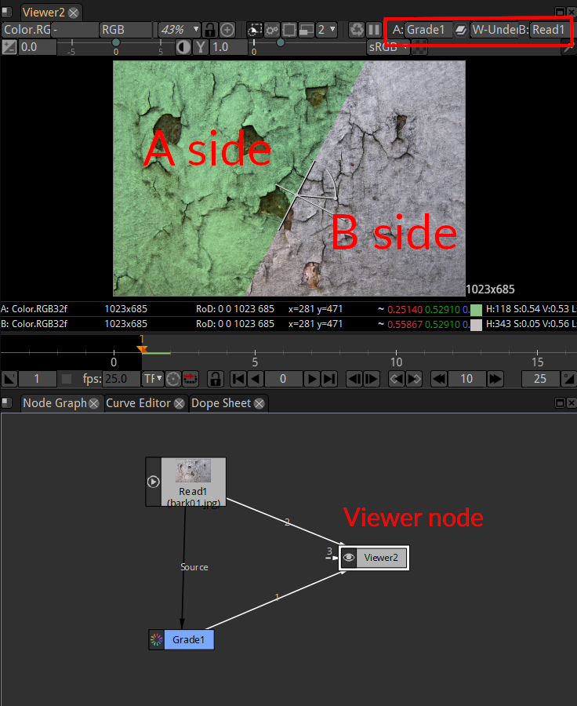
   
A Viewer node has 10 inputs. By default, the Viewer shows only the A side.
Choose a compositing operator in the Viewer toolbar (red box above) to show
the B side as well: *W-Under*, the wipe, is the most common one.

New Viewer
  :kbd:`Ctrl+I`. Add a Viewer node to the Node Graph. Its Viewer panel opens in
  a new tab. Use it, for example, if you deleted the only Viewer node.

Viewer(s) --> Connect to A Side / Connect to B Side
  Show input 1 to 10 of the Viewer on the A (or B) side. If a node is
  selected in the Node Graph, it is first connected to that input. Use the
  shortcuts: :kbd:`1` to :kbd:`9` and :kbd:`0` (input 10) for the A side,
  :kbd:`Shift+1` to :kbd:`Shift+0` for the B side.

Viewer(s) --> View
  Choose the view shown by all Viewers in a multi-view (for example stereo)
  project.

Show Project Settings...
  :kbd:`S`. Open the settings of the project (format, frame range, frame rate,
  project paths, and so on) in the Properties panel.

Show Project Errors Log...
  Show the errors and warnings that nodes reported, for example while
  rendering. GPU rendering errors also appear here.

Show/Hide Application Console
  Windows only: show the console window, where Natron prints its messages.
  On Linux and macOS, start Natron from a terminal to see these messages.

Enter Full Screen
  :kbd:`Alt+S`. Show the Natron window in full screen.

  

Render menu
-------------
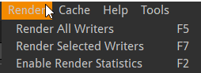

   
Natron writes images to disk only when you render a Write node.

Render All Writers
  :kbd:`F5`. Render all the Write nodes. The frame range comes from the
  settings of each Write node.

Render Selected Writers
  :kbd:`F7`. Render the Write nodes selected in the Node Graph.

Enable Render Statistics
  :kbd:`F2`. Show a window with the time spent rendering each node, to find
  the nodes that slow down your project.

Cache menu
------------
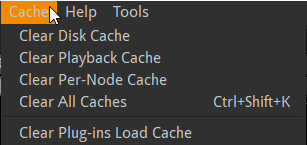

   
To be faster, Natron keeps rendered images in memory and on disk. Clear these
caches to free memory or disk space, for example if Natron slows down or warns
about memory usage.

Clear Disk Cache
  Clear the disk cache, which is kept between Natron sessions, including the
  images stored by DiskCache nodes.
Clear Playback Cache
  Clear the images rendered for the Viewers (in RAM and on disk).
Clear Per-Node Cache
  Clear the intermediate images kept in memory for each node, and the caches
  of the OpenFX plug-ins.
Clear All Caches
  :kbd:`Ctrl+Shift+K`. Clear all the caches above.
Clear Plug-ins Load Cache
  Natron will scan all the plug-ins again the next time it starts.

Help menu
-----------
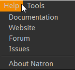

Documentation
  Open this documentation.
Website
  Open the Natron website.
Forum
  Open the Natron forum on pixls.us.
Issues
  Open the Natron issue tracker on GitHub, to report a bug.
About Natron
  Show the version of Natron, its license and the libraries it uses (in the
  :menuselection:`Natron` menu on macOS).

Tools menu
-----------
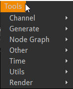

   
This menu only appears when a Python script adds commands to it, for example
the community scripts (see :doc:`getstarted-installation`). Scripts can add
commands to any menu.

Context menus
-------------

Right-click in a panel to open its context menu. Here are the main ones.

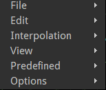

   Context menu of the Curve Editor

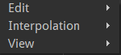

   Context menu of the Dope Sheet

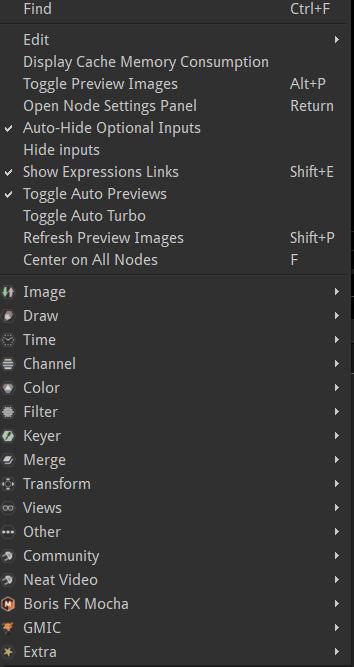

   Context menu of the Node Graph

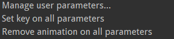

   Context menu of the Properties panel

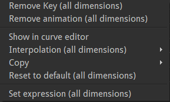

   Context menu of a parameter in the Properties panel

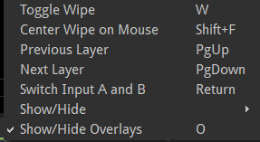

   Context menu of the Viewer
