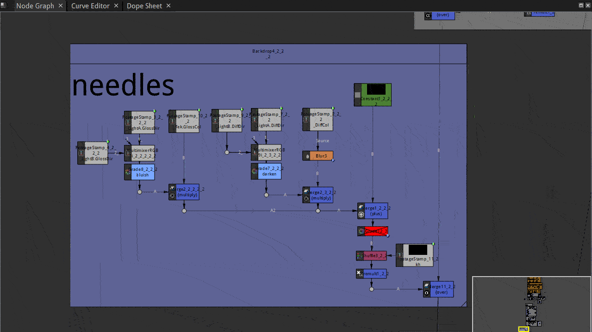
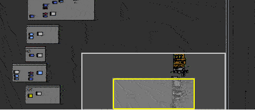
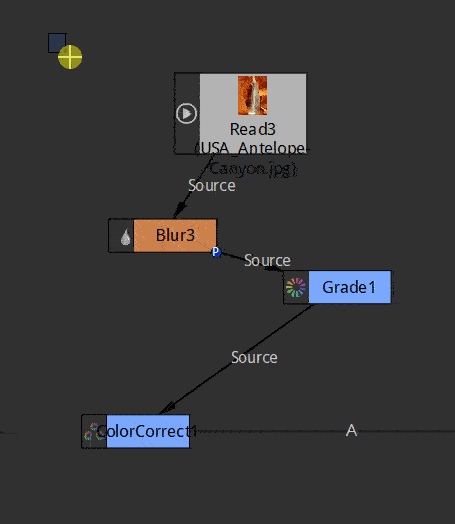
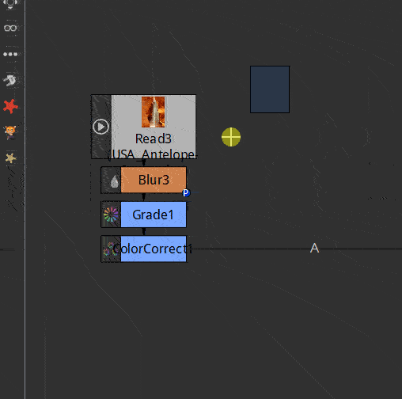
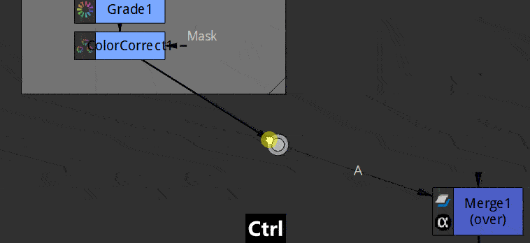
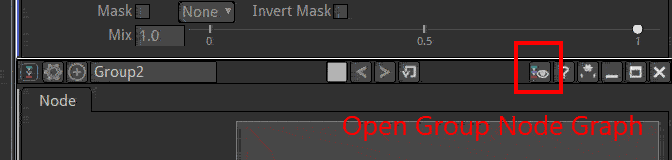
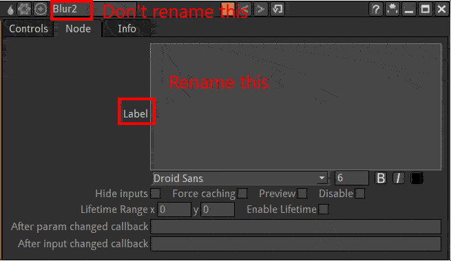
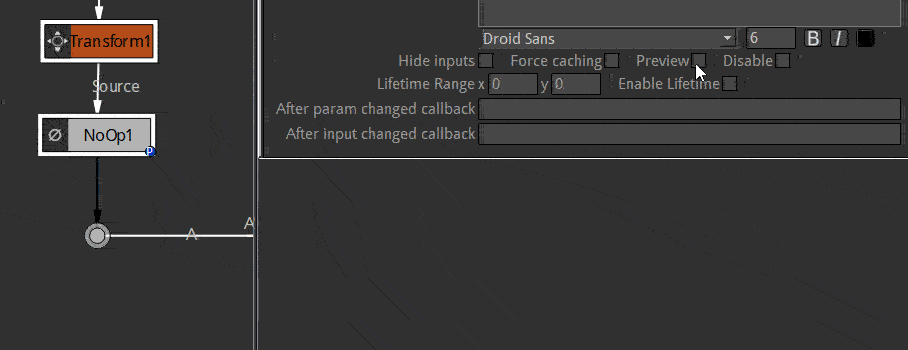
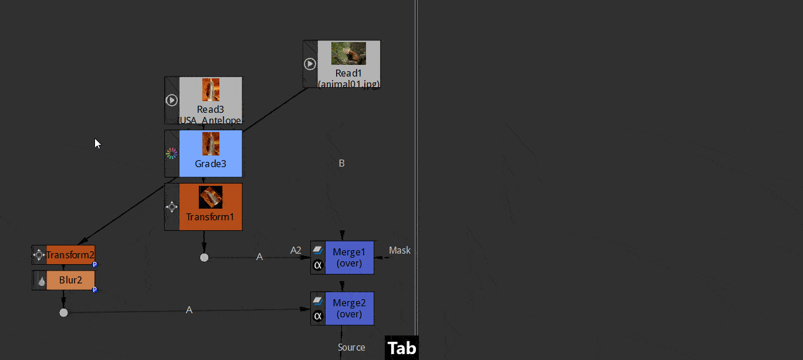

.. for help on writing/extending this file, see the reStructuredText cheatsheet
   http://github.com/ralsina/rst-cheatsheet/raw/master/rst-cheatsheet.pdf
   
Navigating inside the Node Graph
================================

- Pan: drag with the middle mouse button.
- Zoom: turn the mouse wheel, or drag with :kbd:`Alt` and the middle mouse
  button.
- Frame the nodes: press :kbd:`F`. If nodes are selected, the view is framed
  on them, otherwise on all the nodes.
- Find a node by name: :kbd:`Ctrl+F`.

Navigator
   When some nodes are outside the view, a small view of the whole graph
   appears in the bottom right corner of the Node Graph. Click and drag in it
   to change the part of the graph that is displayed.

Node Graph Tidiness
===================

Rearrange Nodes
---------------
Select several nodes connected in a chain and press :kbd:`L`
(*Rearrange Nodes*). The nodes are aligned vertically above the last one,
which does not move.

Natron's Tidy Nodes
-------------------

A few nodes only exist to keep the graph readable.

Backdrop
::::::::

A Backdrop is a colored rectangle placed behind a group of nodes, to make a
complex graph easier to read. Drag its title bar to move it together with all
the nodes on it. Drag its bottom right corner to resize it.

To create a Backdrop, choose :menuselection:`Other --> Backdrop` in the
toolbar, or press :kbd:`Tab` in the Node Graph, type ``bac`` and choose
*Backdrop* in the list.

Give backdrops colors by content, for example gray for mattes, blue for CG
elements and green for live-action footage.

.. note:: A Backdrop can also hold notes: type the text in the *Label*
   parameter of its *Controls* tab.

Dot
:::

A Dot is a small node that only passes its input through. Use Dots to bend
the connections, so that they run vertically or horizontally instead of
diagonally. To add a Dot on a connection, hold :kbd:`Ctrl` (:kbd:`Cmd` on
macOS): a handle appears in the middle of each connection. Click a handle to
insert a Dot there. You can also create a Dot with the :kbd:`.` key.

Group
:::::

Select nodes and press :kbd:`Ctrl+G` to replace them by a single Group node
that contains them. The nodes inside the group are shown in their own Node
Graph tab. To open this tab again later, click the button at the top of the
Group's properties panel (tooltip: *Pressing this button will show the
underlying node graph...*). To put the nodes back in the main graph, select
the Group and press :kbd:`Ctrl+Alt+G` (*Expand group*).

Nodes properties
----------------

Nodes naming
::::::::::::

Name your nodes so that the graph explains itself. To rename a node, select it
and press :kbd:`N` in the Node Graph, or edit the name at the top of its
properties panel. Renaming a node also changes its script name, the name that
expressions and Python scripts use to refer to it. To add a description
without renaming the node, type it in the *Label* parameter of the *Node* tab:
it is shown under the node name.

Previews
::::::::

A node can show a thumbnail of its output: check *Preview* in its *Node* tab,
or select the node and press :kbd:`Alt+P`.

.. note:: If a node graph has many previews it can slow down the display. You can disable the auto refresh of these previews unchecking *Auto Previews* in the project settings (:kbd:`S`). Press :kbd:`Shift+P` to refresh the previews of the selected nodes
   
   .. image:: _images/Environment/environment-nodes-autopreview.gif

Hide input
::::::::::

Long connections make the graph hard to read. To hide the input connections
of a node, check *Hide inputs* in its *Node* tab, or choose *Hide inputs* in
the context menu of the Node Graph. The connections are still shown while the
node is selected. Give such nodes a clear label, or turn on their preview, so
that it is clear where their input comes from.

Nodes placement convention
--------------------------

Lay out the graph in a consistent way, so that you and others can read it
easily.

A common  convention is:

- The main input comes from the top: for a Merge, this is the B input, which
  is passed through when the node is disabled.
- Masks come from the right.
- Secondary image inputs, such as the A input of a Merge, come from the left.
- Use vertical connections for the main branches: the node names do not
  overlap, and the graph takes less room. *Rearrange Nodes* (:kbd:`L`) lays
  out nodes this way.
- Connect branches with horizontal connections rather than diagonal ones,
  using Dots.
- Put related nodes on Backdrops, which also makes it easy to move them
  together.
- Label everything: Backdrops, previews and node labels.
- Name the nodes before you write expressions that refer to them, since
  expressions use the script names. Two nodes cannot have the same script
  name, so Natron gives a new name to the nodes you copy.

For more about nodes, see :doc:`getstarted-environment-nodes`.

See also
--------

- :ref:`evaluating-script-structure`: common bad practices that make a project
  hard to read, fix or hand over.
