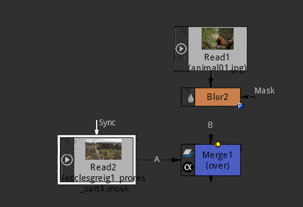
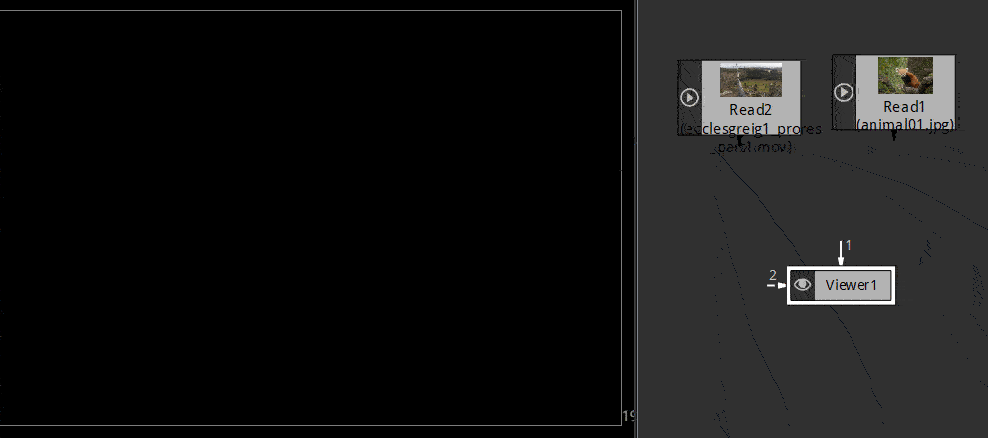
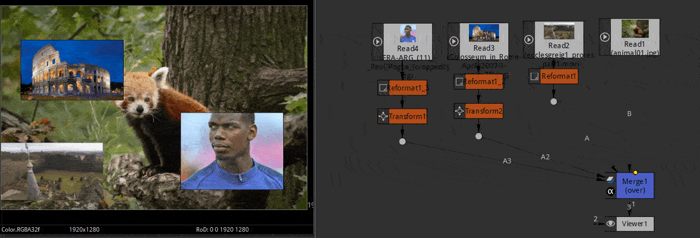
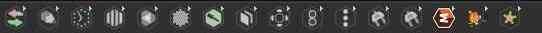
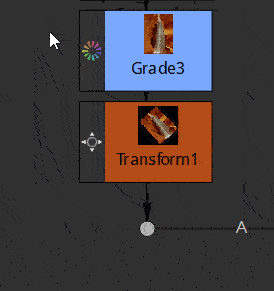
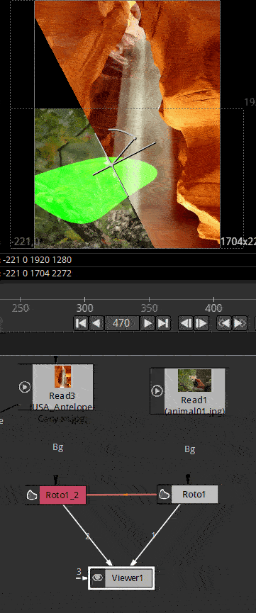
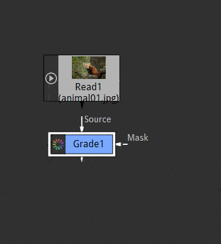
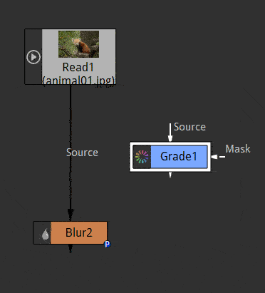
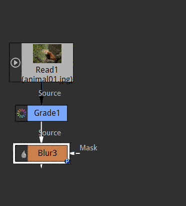
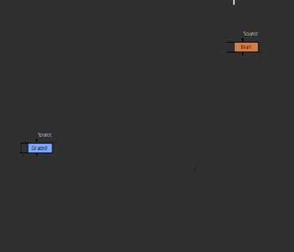

.. for help on writing/extending this file, see the reStructuredText cheatsheet
   http://github.com/ralsina/rst-cheatsheet/raw/master/rst-cheatsheet.pdf
   
Working with nodes
==================

For a brief introduction to the concept of nodes and images in Natron see: :doc:`Main concepts <getstarted-about-mainconcepts>`

Main rules
----------

- Most processing nodes, such as Blur or the color corrections, have one
  image input. Merge nodes have several inputs that they combine into one
  output. Nodes that create images, such as Read or Constant, have no input.
- Many nodes also have a *Mask* input, which limits the effect of the node
  to the white parts of the mask.
- A node has one output, which can be connected to the inputs of several
  nodes: they all receive the same image. The Viewer node has no output: it
  chooses what the Viewer panel shows.

On a Merge node, the B input is the background and the A input is the
foreground. When the node is disabled, the B input is passed through
unchanged. When you connect the A input, a new A input appears, so that one
Merge node can combine many images.

Creating nodes
--------------
There are three ways to create a node:

- Press its shortcut in the Node Graph. These nodes have one by default:

  ========= ============
  Key       Node
  ========= ============
  :kbd:`R`  Read
  :kbd:`W`  Write
  :kbd:`G`  Grade
  :kbd:`C`  ColorCorrect
  :kbd:`B`  Blur
  :kbd:`T`  Transform
  :kbd:`M`  Merge
  :kbd:`O`  Roto
  :kbd:`P`  RotoPaint
  :kbd:`.`  Dot
  ========= ============

  You can give a shortcut to any other node in the *Shortcut Editor* tab of
  the Preferences.
- Choose the node in the :doc:`toolbar <getstarted-environment-toolbar>`.

- Press :kbd:`Tab` in the Node Graph, type a few letters of the node name,
  and choose the node in the list.

Duplicating Nodes
-----------------

To copy nodes, select them and press :kbd:`Ctrl+C`, then :kbd:`Ctrl+V` to
paste them, or press :kbd:`Alt+C` (*Duplicate*). The copies are independent of
the original nodes.

To process different images with the same parameters, clone the node instead
(:kbd:`Alt+K`): the parameters of the clone follow those of the original node,
even when you change them later. The clone is drawn in pink, with an arrow to
the original node. Press :kbd:`Alt+Shift+K` (*Declone*) to make the clone
independent again.

.. note::
   - Group and Roto nodes can be cloned too. Viewers cannot.
   - When you clone a Group, only the parameters of the Group node are
     linked, not the nodes inside the group.

Connections
------------
To connect two nodes, drag the tip of an input arrow and drop it on the node
that should feed it.

To insert a node C in an existing connection from A to B, hold :kbd:`Ctrl`
(:kbd:`Cmd` on macOS) while you drag C onto the connection: the connection is
highlighted, and when you release the mouse button you get A → C → B.

To take a node out of the graph and keep its upstream and downstream nodes
connected, select it and press :kbd:`Ctrl+Shift+X` (*Extract*).

With the community scripts installed (see :doc:`getstarted-installation`),
you can also connect distant nodes: select the upstream node, then the
downstream node, and press :kbd:`Y`.

To organize the Node Graph, see :doc:`getstarted-environment-nodegraph`.