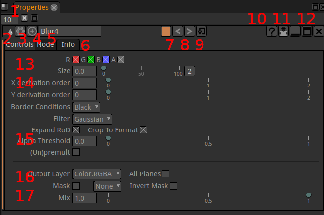
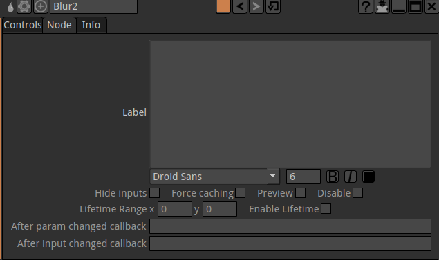
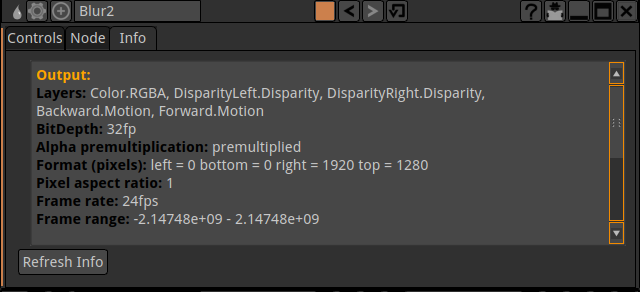
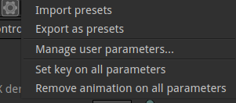

.. for help on writing/extending this file, see the reStructuredText cheatsheet
   http://github.com/ralsina/rst-cheatsheet/raw/master/rst-cheatsheet.pdf
   
Properties panels
=================

The properties panel shows the parameters of a node. Double-click a node in
the Node Graph, or select it and press :kbd:`Return`, to open its panel. As in
the rest of Natron, all changes are non-destructive: you can change any
parameter at any time.

The numbers in the image above show:

1. The maximum number of panels open at the same time in the Properties
   area (0 means no limit).
2. The icon of the node type. Hover over it to see the name and version of
   the plug-in.
3. The *Settings and presets* menu (see :ref:`Presets_menu`).
4. *Center the node graph on this item*: moves the Node Graph view to show
   the node.
5. The node name. Changing it renames the node, which also changes the name
   that expressions use (see :doc:`getstarted-environment-nodegraph`). To add
   a description, use the *Label* parameter of the *Node* tab instead.
6. The tabs of the parameters. Most nodes have a *Controls*, a *Node* and an
   *Info* tab, and some have more. You can add your own tabs with
   *Manage user parameters...* (see :ref:`Presets_menu`).
7. The color of the node in the Node Graph.
8. Undo and redo the changes made to the parameters of this node only.
9. Restore the default values of all the parameters of the node.
10. Open the documentation of the node.
11. Show or hide the parameters that still have their default value.
12. Minimize the panel (flat line), float it in its own window, or close it.
13. to 16. The parameters of the node (see :ref:`proppanel_parameters`).

.. _proppanel_parameters:

Controls tab
------------

The *Controls* tab holds the parameters of the effect. Many nodes share these
parameters, shown here for the Blur node:

RGBA
   The channels that the node processes.
Main parameters
   They define the effect, and are different for each node.
Border Conditions
   How pixels outside the image are computed. *Nearest* repeats the edge
   pixels, which avoids dark edges when you blur an image; *Black* treats
   them as black.
Expand RoD
   Compute pixels outside the image, so that a later node, such as a
   Transform, can bring them back into the frame.
Crop To Format
   Crop the result to the project format, which avoids useless computations.
Output Layer
   The layer that the node writes.
Mask parameters
   How the image connected to the *Mask* input is used. By default, the
   node has an effect only where the alpha channel of the mask is not black.
Mix
   Blend the result with the input image, to reduce the effect.

Node tab
--------

Label
   Text shown under the node name in the Node Graph.
Hide inputs
   Hide the input connections of the node in the Node Graph, which helps when
   the node is far from its inputs.
Force caching
   Keep the output of the node in the cache, so that it is not computed
   again while you work on the nodes downstream.
Preview
   Show a thumbnail of the output of the node in the Node Graph.
Disable
   Turn the node off, to compare the image with and without its effect.
   :kbd:`D` in the Node Graph does the same.
Enable Lifetime and Lifetime Range
   Outside this frame range, the node is disabled and not computed, like
   the in and out points of a clip.
Callbacks
   Python functions that Natron calls at given moments, for example after a
   parameter changes or before a frame is rendered. See the Python
   documentation.

Info tab
--------

Shows information about the inputs and the output of the node, such as their
layers and bit depth. This helps to understand why a project becomes
slow: for example, an image may carry many layers that are not needed.

User tabs
---------

To add your own parameters to a node, for example to drive expressions,
choose *Manage user parameters...* in the *Settings and presets* menu. User
parameters go in their own tabs: Natron asks you to create a tab first.

.. _Presets_menu:

Settings and presets menu
-------------------------

This menu opens from the button next to the node icon.

Import presets and Export as presets
   Save the values of all the parameters of the node to a file, and load them
   again later, on the same node or another node of the same type. See
   :doc:`getstarted-environment-presets`.
Manage user parameters...
   Add, edit and remove user parameters and tabs.
Set key on all parameters
   Set a keyframe on all the parameters at the current frame.
Remove animation on all parameters
   Remove the keyframes of all the parameters. Expressions are kept.
