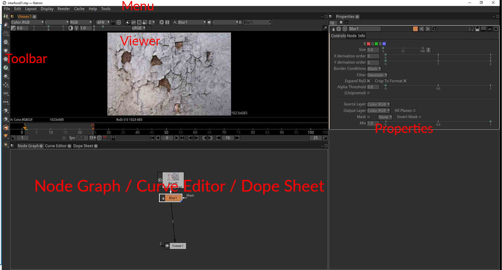
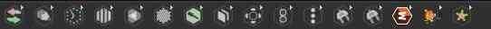
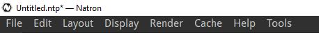
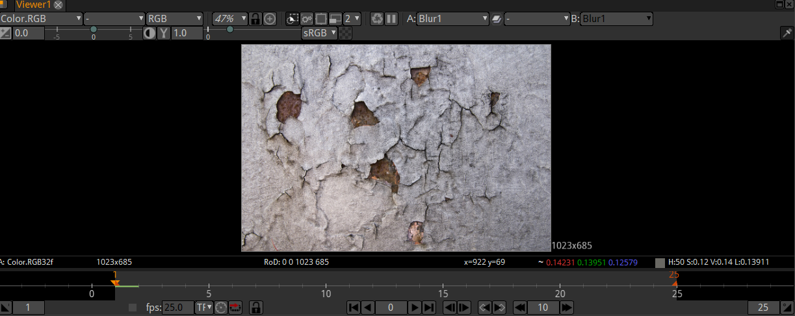
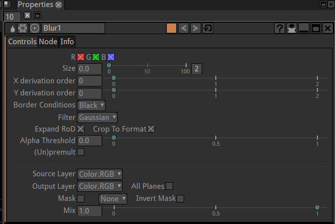
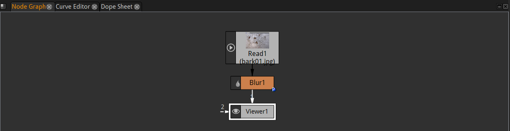
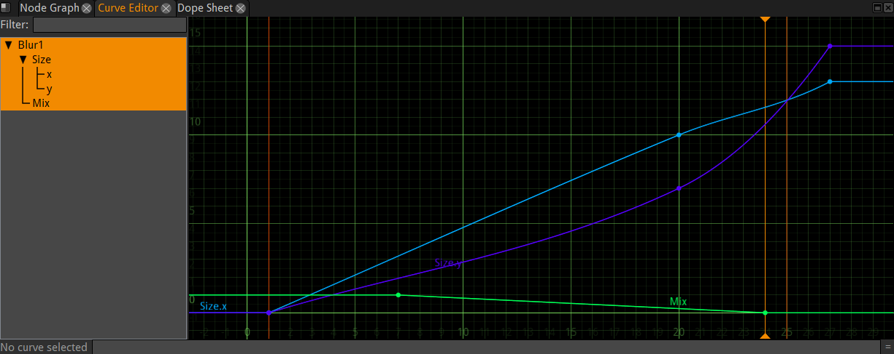
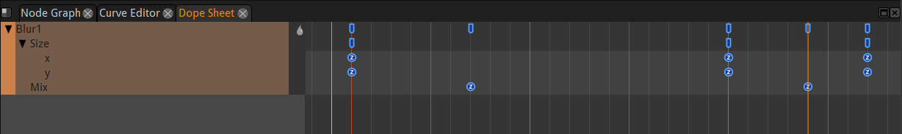
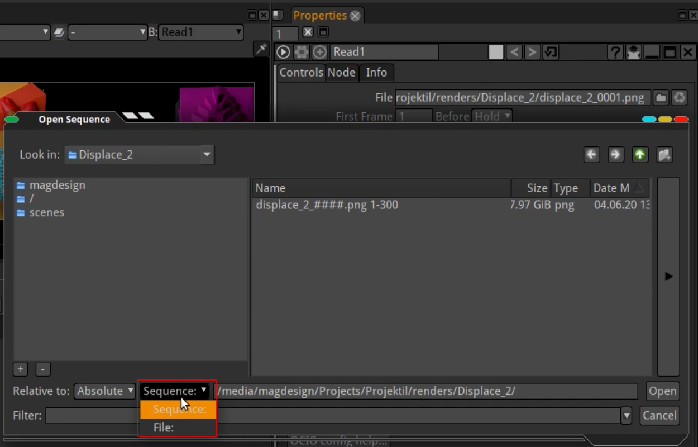

.. for help on writing/extending this file, see the reStructuredText cheatsheet
   http://github.com/ralsina/rst-cheatsheet/raw/master/rst-cheatsheet.pdf

Environment
===========

The Natron window is made of several panels. The image below shows the default layout.

Natron processes images with nodes. Each node applies one effect, and the
nodes are connected in a graph that defines the order of the processing. Each
node has parameters that control its effect. See
:doc:`Main concepts <getstarted-about-mainconcepts>` for an introduction.

The Toolbar
###########

The column of icons on the left side of the window. Each icon opens a menu
with one category of nodes. See :doc:`getstarted-environment-toolbar`.

The Menu bar
############

At the top of the window (at the top of the screen on macOS). It holds the
commands that act on the whole project, such as saving and rendering. See
:doc:`getstarted-environment-menus`.

The Viewer panel
################

Shows the result of the processing. Each Viewer panel belongs to a Viewer
node in the Node Graph, and you choose what it shows by connecting that node
to any point of the graph. See :doc:`getstarted-environment-viewer`.

The Properties editor
#####################

Shows the parameters of one or several nodes. See
:doc:`getstarted-environment-proppanels`.

The Node Graph
##############

Where you create nodes and connect them. See
:doc:`getstarted-environment-nodes` and
:doc:`getstarted-environment-nodegraph`.

The Curve Editor
################

Shows the animation curves of the parameters, that is how their values
change over time, and lets you edit them. See
:doc:`getstarted-environment-anim`.

The Dope Sheet
##############

Shows the keyframes of the nodes over time, without their values, so that
you can change the timing of an animation. Each small box is a keyframe.
See :doc:`getstarted-environment-anim`.

The File Browser
################

The dialog where you choose the files to read or write. It opens from the
properties of a Read or Write node. See
:doc:`getstarted-environment-fileselect`.

.. toctree::
   :maxdepth: 1

   getstarted-environment-menus
   getstarted-environment-toolbar
   getstarted-environment-nodes
   getstarted-environment-nodegraph
   getstarted-environment-proppanels
   getstarted-environment-color
   getstarted-environment-presets
   getstarted-environment-anim
   getstarted-environment-viewer
   getstarted-environment-fileselect
   getstarted-environment-undoredo
   getstarted-environment-progressbar
