.. for help on writing/extending this file, see the reStructuredText cheatsheet
   http://github.com/ralsina/rst-cheatsheet/raw/master/rst-cheatsheet.pdf
   
Linux
=====

This chapter explains how to install and maintain Natron on Linux.

Requirements
------------

The Linux binaries are built on Rocky Linux 8, for x86-64 and aarch64
processors. They run on any 64-bit Linux distribution that has:

* glibc 2.28 or later;
* the X11 client libraries, at least as recent as those of Rocky Linux 8
  (libX11 1.6.8, libxcb 1.13, libxkbcommon 0.9). Natron is an X11
  application: on a Wayland desktop it runs through XWayland;
* an OpenGL driver: see :ref:`system-requirements`.

Natron includes its other libraries (Qt, Python, fontconfig, FreeType, the C++
runtime, …).

For example, these distributions meet the requirements:

* `RHEL <https://www.redhat.com/en/technologies/linux-platforms/enterprise-linux>`_,
  `Rocky Linux <https://rockylinux.org/>`_ and `AlmaLinux <https://almalinux.org/>`_ 8 and later
* `Debian <https://www.debian.org/>`_ 12 "bookworm" and later
* `Ubuntu <https://ubuntu.com/>`_ 22.04 LTS and later
* `Fedora <https://fedoraproject.org/>`_ (all supported releases)

If your graphics driver does not provide the OpenGL features Natron needs, run
Natron with Mesa's software renderer: set the environment variable
``LIBGL_ALWAYS_SOFTWARE=1`` before starting Natron. Software rendering is much
slower.

Download
--------

Go to https://natrongithub.github.io/#download and download the latest version. This page assumes that you downloaded the installer.

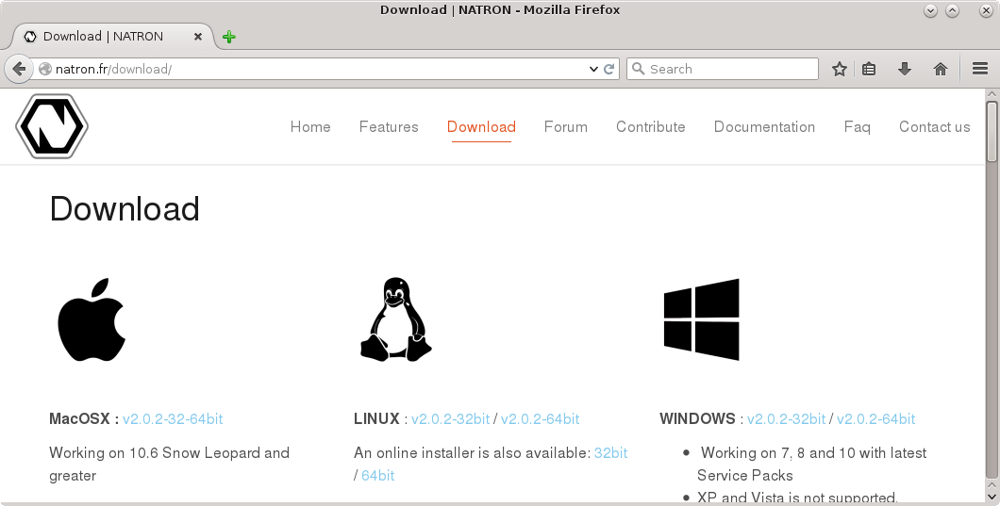

Extract
-------

Extract the downloaded archive. In most file managers, right-click it and select 'Extract Here'.

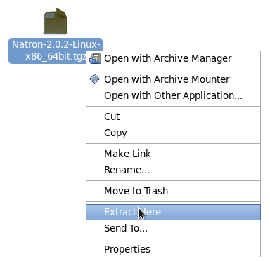

Install
-------

Double-click the extracted file to start the installation.

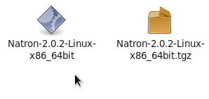

*If the file does not start, make it executable: right-click it, select Properties, and tick 'Allow executing file as program' (the name of this option depends on the desktop environment). In a terminal, you can run* ``chmod +x <filename>`` *instead.*

The installation wizard opens.

Click 'Next'. First choose where to install Natron: the default location is usually fine. If you choose a folder outside your home directory, the installer asks for the root (administrator) password.

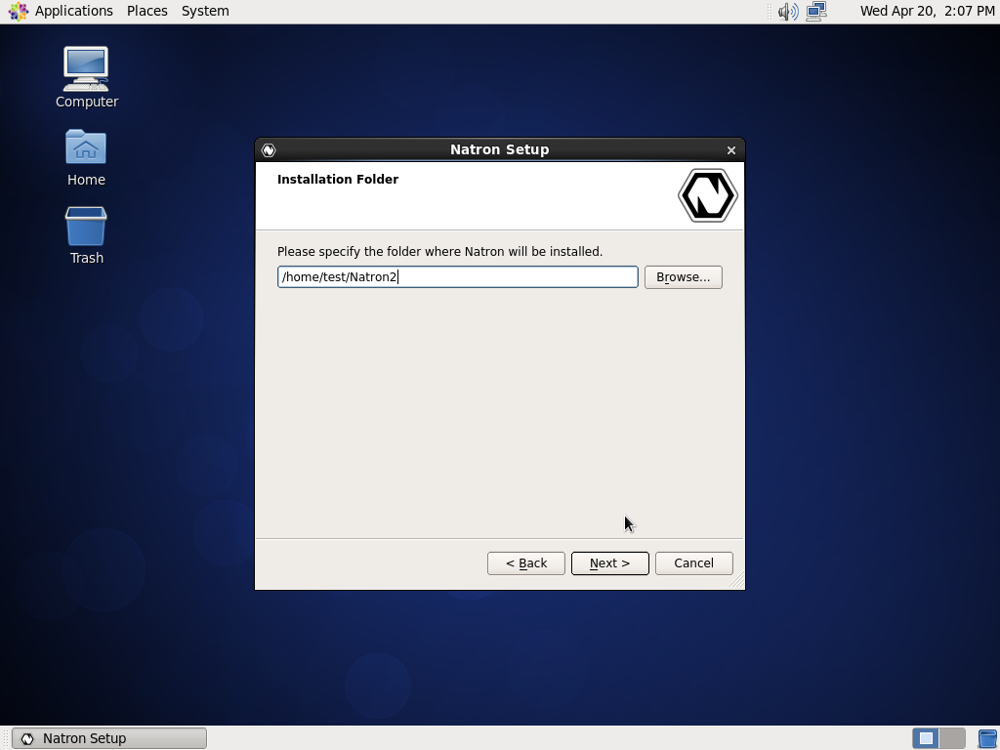

Then select the packages to install. Most users should keep the default selection. Click a package to see its description.

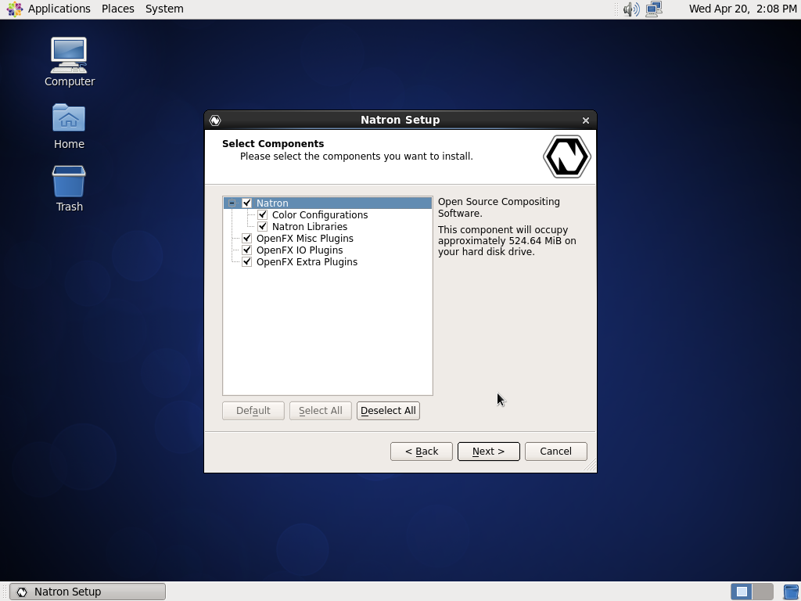

Then accept the license agreement. Natron and its plug-ins are licensed under the GNU GPL version 2. After installation, the licenses of all the components included in Natron are listed in Help → About.

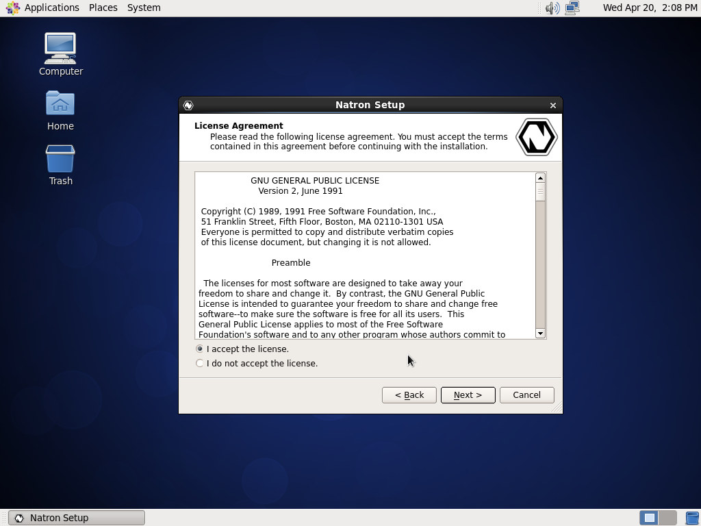

The wizard then installs Natron. This takes a minute or two.

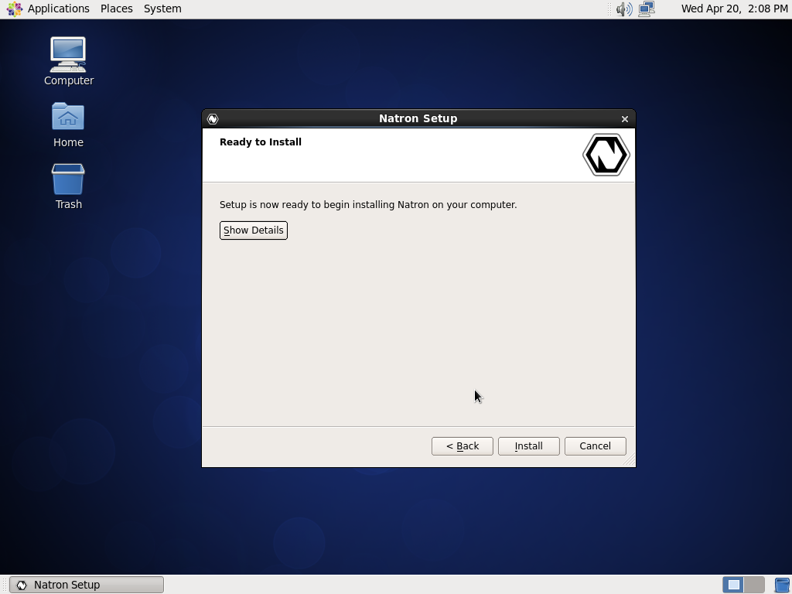

The installation is complete.

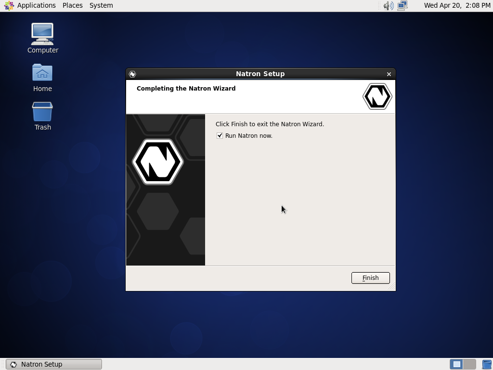

Start Natron from the desktop menu (under Graphics), or run the 'Natron' file in the installation folder.

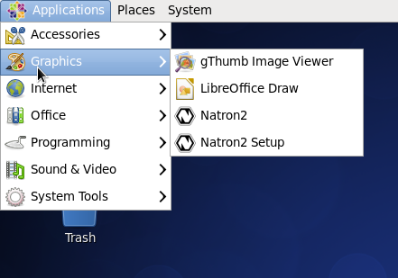
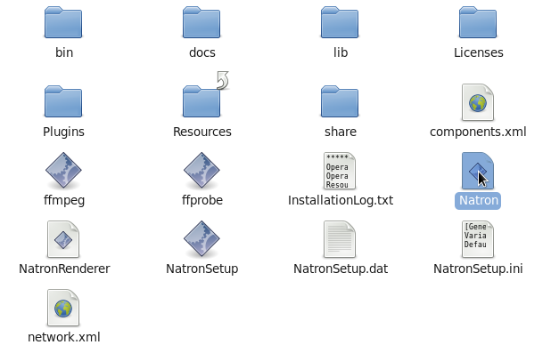

Maintenance
-----------

The installer also installs a maintenance tool called 'NatronSetup'. Use it to update Natron and its components when a new version is available, to add or remove packages, or to uninstall Natron. It is in the 'Graphics' section of the desktop menu, and in the folder where Natron is installed.

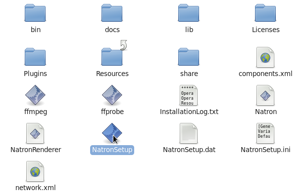

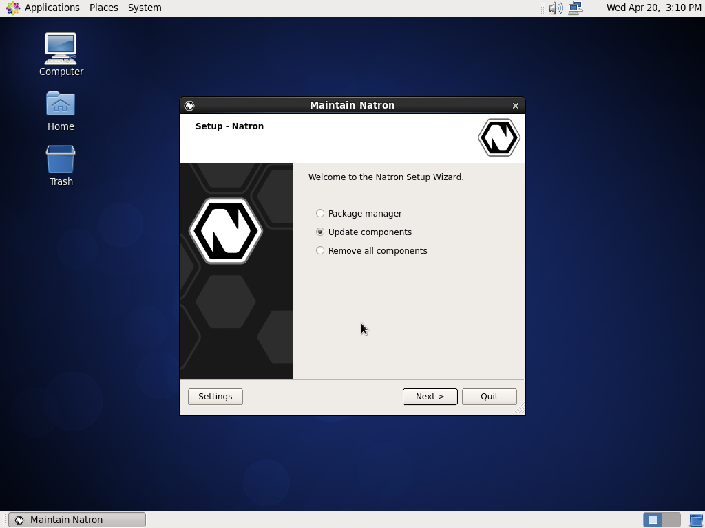

Its settings let you configure a network proxy and other advanced options.

Other ways to install Natron
----------------------------

* The portable archive (``Natron-<version>-Linux-<arch>-no-installer.tar.xz``)
  needs no installation: extract it anywhere and run the ``Natron`` script it
  contains.
* Natron is also available on `Flathub <https://flathub.org/apps/fr.natron.Natron>`_
  (``flatpak install flathub fr.natron.Natron``). This package is maintained
  separately, and may be older than the latest release.
