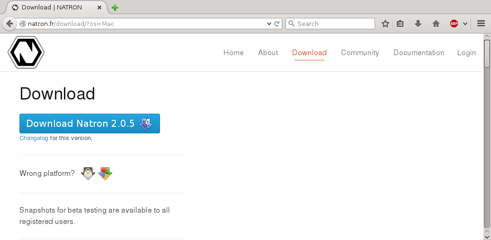
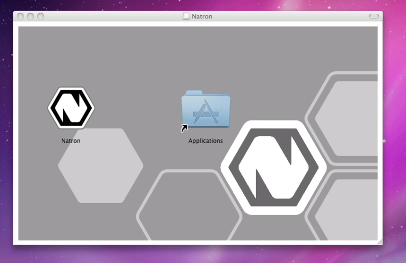

.. for help on writing/extending this file, see the reStructuredText cheatsheet
   http://github.com/ralsina/rst-cheatsheet/raw/master/rst-cheatsheet.pdf
   
macOS
=====

This chapter explains how to install Natron on macOS.

Requirements
------------

Natron 2.6 needs macOS 15 (Sequoia) or later, on a Mac with Apple Silicon
(arm64). The 2.6 binaries do not run on Intel Macs: use Natron 2.5 there, or
build Natron from source. Every Apple Silicon Mac has a GPU with the OpenGL
features Natron needs. See :ref:`system-requirements`.

Download
--------

Go to https://natrongithub.github.io/#download and download the latest version.

Install
-------

Double-click the DMG file and drag Natron to the Applications folder, or to
any other folder.

Run
---

The Natron application is not notarized by Apple, so the first time you open
it, macOS says that it cannot check Natron for malicious software and refuses
to open it. To allow Natron to run:

#. Try to open Natron once, and close the warning.
#. Open System Settings → Privacy & Security. Near the bottom of the page, a
   message says that Natron was blocked. Click "Open Anyway", and confirm with
   your password.

macOS remembers this choice, so you only need to do it once for each
installed copy of Natron.

Alternatively, remove the quarantine attribute that macOS adds to downloaded
files, from the Terminal:

.. code-block:: bash

   xattr -dr com.apple.quarantine /Applications/Natron.app
