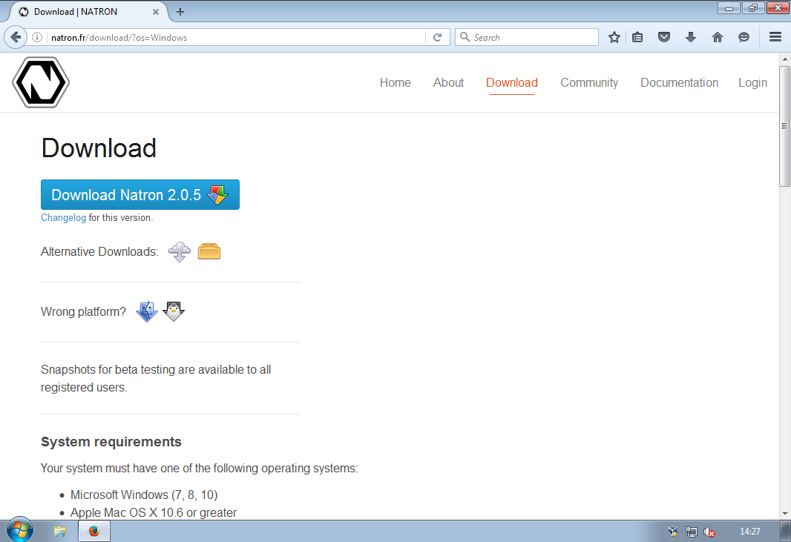
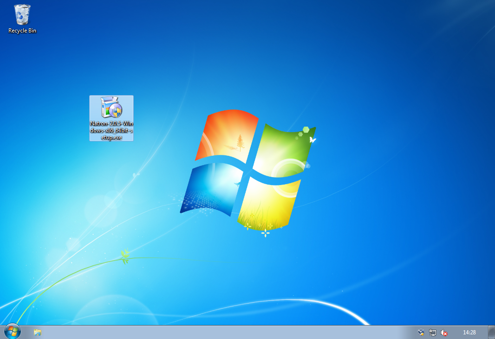
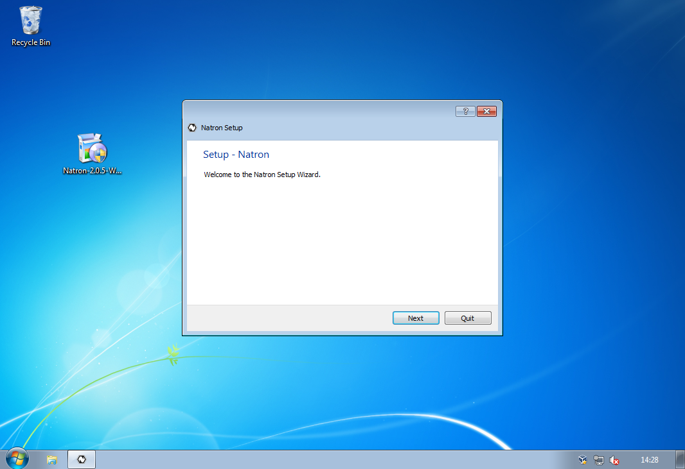
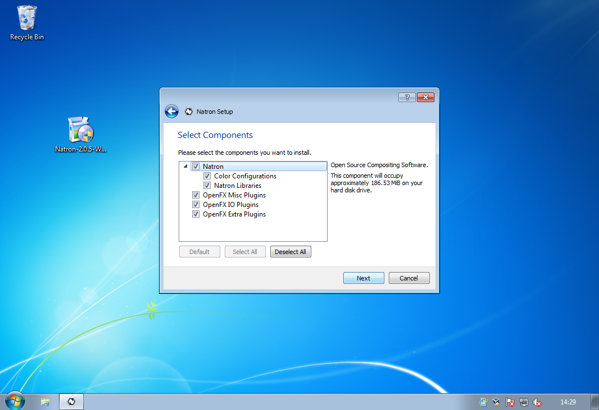
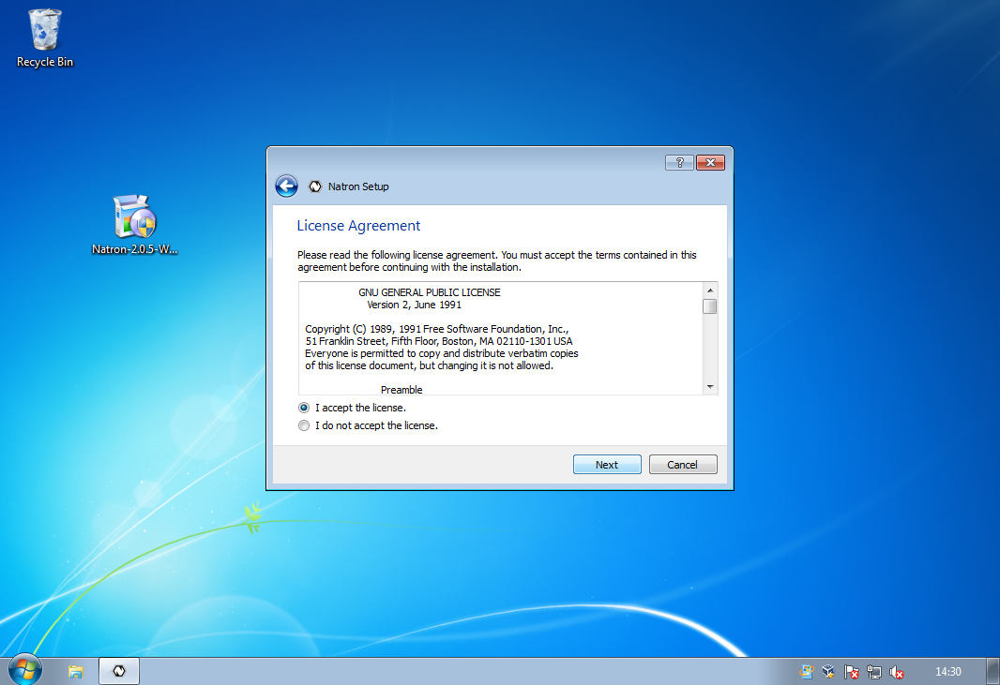
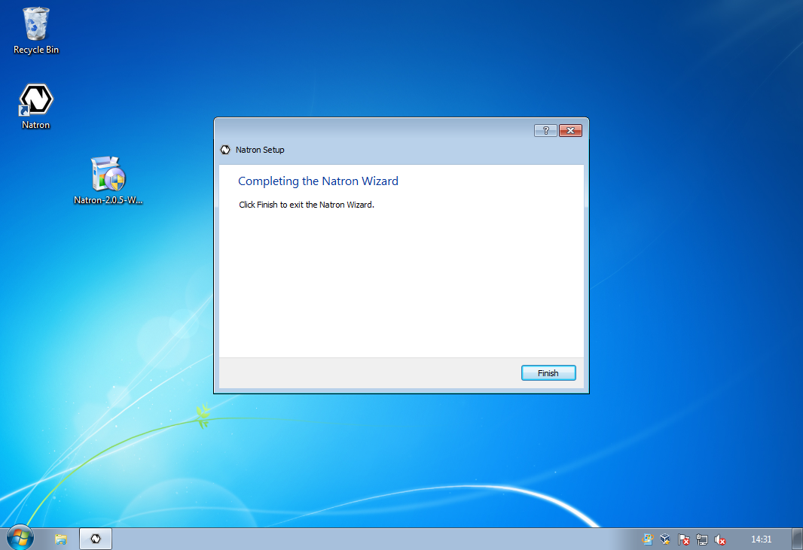
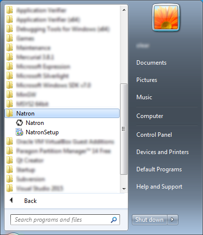
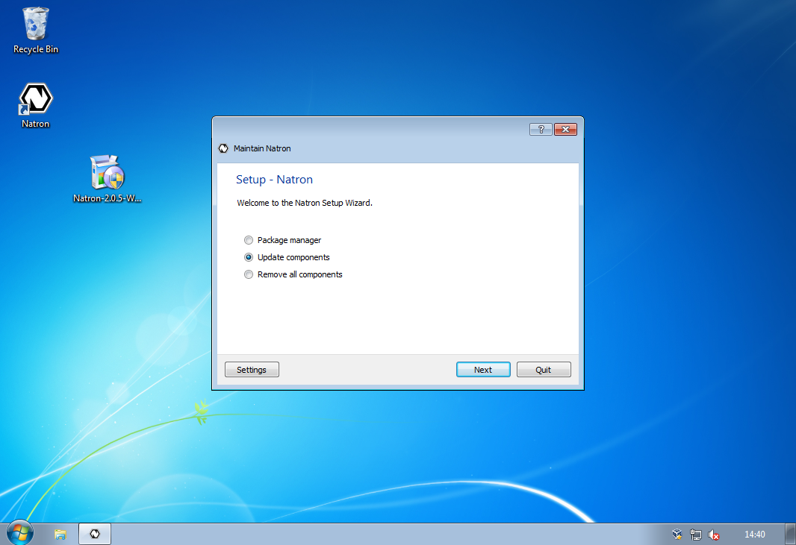
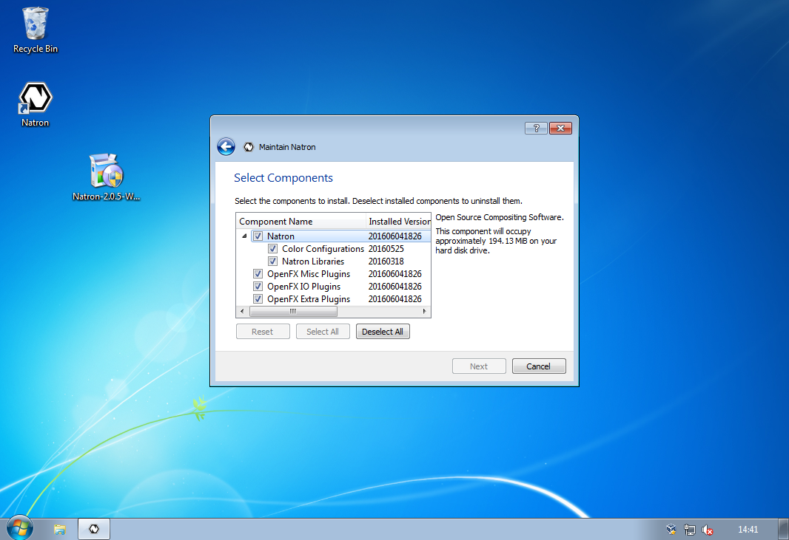

.. for help on writing/extending this file, see the reStructuredText cheatsheet
   http://github.com/ralsina/rst-cheatsheet/raw/master/rst-cheatsheet.pdf
   
Windows
=======

This chapter explains how to install and maintain Natron on Windows.

Requirements
------------

Natron needs 64-bit Windows 10 or later on an x86-64 processor, and a graphics
card with OpenGL 2.0. See :ref:`system-requirements` for the details.

If your graphics driver does not provide the OpenGL features Natron needs, use
the software OpenGL renderer: select the *Legacy hardware support* package in
the installer, or, with the portable ZIP file, copy *bin\\mesa\\opengl32.dll*
to *bin\\*. Software rendering is much slower.

Download
--------

Navigate to https://natrongithub.github.io/#download and download the latest version. This page assumes that you downloaded the installer, which is the recommended choice.

Install
-------

Double-click the setup file to start the installation.

The installation wizard opens.

Click 'Next'. First choose where to install Natron: the default location is recommended.

Then select the packages to install. Most users should keep the default selection. Click a package to see its description.

Then accept the license agreement. Natron and its plug-ins are licensed under the GNU GPL version 2. After installation, the licenses of all the components included in Natron are listed in Help → About.

The wizard then installs Natron. This takes a minute or two.

The installation is complete.

Natron can now be started from the desktop icon or from the start menu.

Maintenance
-----------

The installer also installs a maintenance tool called 'NatronSetup'. Use it to update Natron and its components when a new version is available, to add or remove packages, or to uninstall Natron. It is in the same Start menu folder as Natron, and in the folder where Natron is installed.

Its settings let you configure a network proxy and other advanced options.
