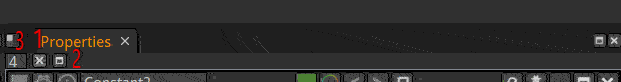
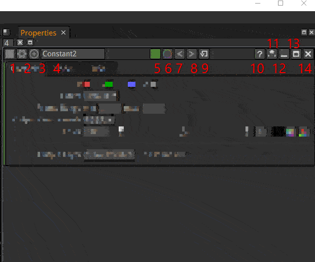

.. for help on writing/extending this file, see the reStructuredText cheatsheet
   http://github.com/ralsina/rst-cheatsheet/raw/master/rst-cheatsheet.pdf

Common Properties
=================

This page describes the properties panel, and the parameters found on many
nodes.

The properties pane
-------------------

1: Close all the panels in the properties pane.

2: Minimize all the panels, so that only their headers are visible, or
maximize them again. You can then close each panel with its own close button
(see 14 below).

3: The maximum number of panels open at the same time in the properties pane.
When you open one more, the oldest one is closed. Too many open panels are hard
to find in the pane, and can slow down the user interface.

The panel header
----------------

1: The node icon, the same as in the Node Graph. Hover over it to see the
plug-in name and version, which tells you what the node is even if it was
renamed.

2: **Settings and presets**: a menu to **Import presets**, **Export as
presets**, **Manage user parameters...**, **Set key on all parameters** and
**Remove animation on all parameters**. Removing the animation keeps the
current values; it complements **Restore defaults** (9). See
:doc:`getstarted-environment-presets` for presets.

3: Center the Node Graph on this node, to check which node you are about to
change.

4: The name of the node, as shown in the Node Graph. Typing a new name here
sets both the label of the node and its script name, the name used in Python
and in expressions (``getScriptName()`` in Python). Natron makes the script
name unique and replaces the characters that are not allowed in it, such as
spaces.

It is often better to keep the name and to type a description in the
**Label** parameter of the **Node** tab instead: it is shown under the name in
the Node Graph, so you can see what the node does by looking at the graph.

5: The color of the node in the Node Graph. Click to change it. It has no
effect on the image.

6: The overlay color: the color of the handles that the node draws in the
Viewer. When several Transform nodes are open, give them different colors to
tell their handles apart.

7 / 8: Undo / Redo the last changes made to this node. Each panel has its own
undo history, separate from the history of the Node Graph.

9: Restore the default value of all the parameters of this node, and remove
their animation.

10: Help: opens the reference documentation of this node.

11: Show or hide all the parameters that have their default value.

.. note::
   **Tip:**
   This button is a quick way to see which parameters were changed in a node.

12 / 13 / 14: Minimize the panel, make it a floating window, or close it.

Layers and masks
----------------

- **Output Layer**: the layer the node processes and writes, **Color.RGBA**
  by default. Nodes that take an input image also have an *input* **Layer**
  menu for each input. Check **All Planes** to process all the layers of the
  input, for example to transform all the passes of a multi-layer EXR at once.
- **R**, **G**, **B**, **A**: the channels to process. The other channels are
  copied from the main input.
- **Mask**: nodes with a **Mask** input apply their effect only where the mask
  is not zero. When a mask is connected, the menu next to the **Mask**
  checkbox selects the channel used as the mask. **Invert Mask** applies the
  effect where the mask is zero instead.
- **Mix**: blends the original image (at 0) and the result of the node (at 1).

Generator parameters
--------------------

Generators (CheckerBoard, Constant, Radial, Rectangle, ...) have parameters
that set the size and the time span of the image:

- **Extent**: **Format** (a format chosen in the **Format** menu), **Size**
  (the **Bottom Left** corner and **Size** given in the parameters),
  **Project** (the project format), or **Default** (the default extent, for
  example the extent of the input if one is connected). **Center** centers the
  image in the input or the project format.
- **Frame Range**: the frames over which the generator produces an image, 1
  to 1 by default (see :doc:`compositing-projects-framerange`).

Transform parameters
--------------------

Nodes that move or resize pixels (Transform, CornerPin, Reformat, ...) share
these parameters:

- **Filter**: the interpolation filter used to compute the new pixels.
- **Clamp**: clamps the result of filters that can overshoot (such as Cubic or
  Lanczos) to the range of the input values.
- **Black outside**: fades the edges of the image to transparent black,
  instead of repeating the edge pixels. It is on by default in Transform and
  CornerPin, and off in Reformat.
- **Motion Blur** and **Shutter**: the motion blur quality and the shutter
  duration, when the transform is animated.

See :doc:`compositing-reformat` for an explanation of the filters and
**Black outside**.

The Node tab
------------

Every node has a **Node** tab with these parameters:

- **Label**: a text shown under the node name in the Node Graph.
- **Hide inputs**: hides the input arrows of the node in the Node Graph.
- **Force caching**: always keeps the output of the node in the RAM cache.
- **Preview**: shows a preview image on the node in the Node Graph.
- **Disable**: the node passes its main input through unchanged.
- **Lifetime Range** and **Enable Lifetime**: when **Enable Lifetime** is
  checked, the node is active only during **Lifetime Range**, and acts as if
  disabled outside of it.
- Python callbacks (**After param changed callback**, **After input changed
  callback**, ...): see the Developers Guide.

The **Info** tab shows information about the inputs and the output of the
node: format, region of definition, frame range, layers, premultiplication.
