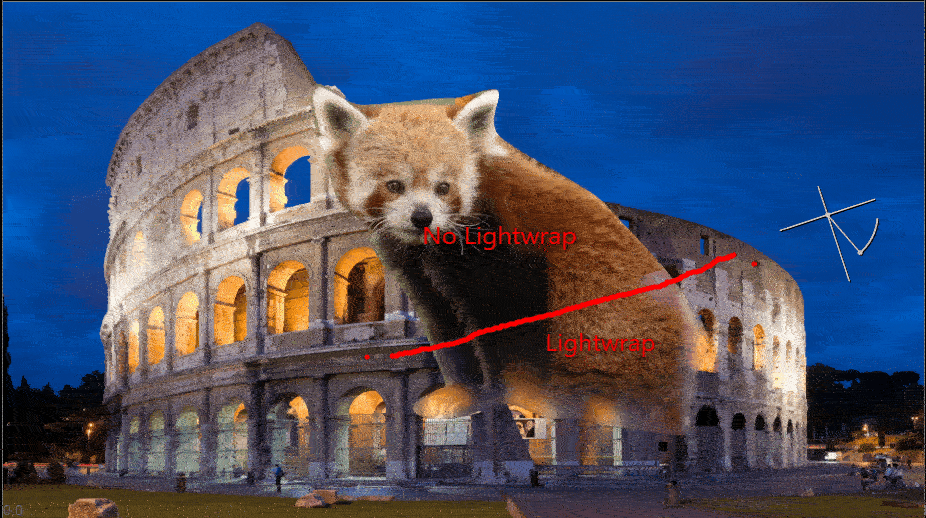
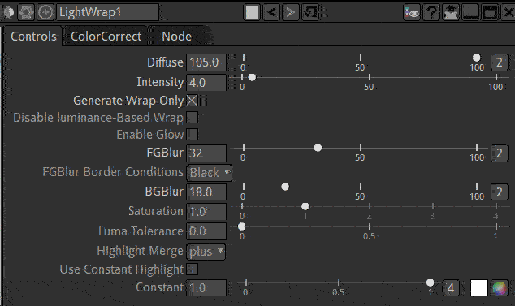
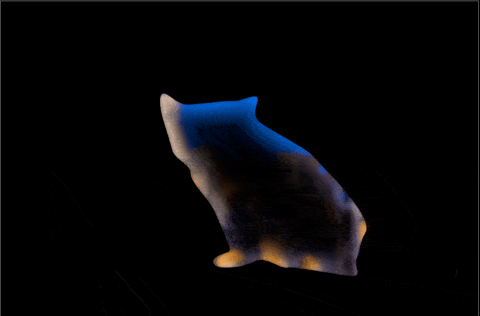
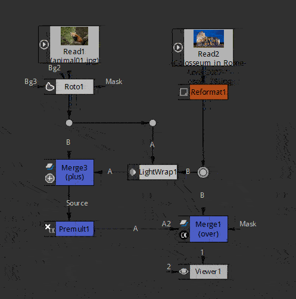

.. for help on writing/extending this file, see the reStructuredText cheatsheet
    http://github.com/ralsina/rst-cheatsheet/raw/master/rst-cheatsheet.pdf

Lightwrap Node
==============

LightWrap helps composite objects onto a bright background by simulating reflections from the background light on the foreground, around its edges. 

Input A is the foreground image and its matte, and input B is the background to use for the wrapping effect.

The output of LightWrap should then be composited over the background to give the final composite.

    

    
Usage
--------

Increase **FGBlur** and **Intensity** to make the light wrap more visible.

Increase **Diffuse** and **BGBlur** to make the light wrap softer, that is, to remove details of the background from it.

The settings are easier to adjust with **Generate Wrap Only** checked.

This also lets you control exactly how the light wrap is composited onto the
foreground: a Merge node with the **plus** operation is often used rather than
**over** (see the Merge3 node in the example below).

Check **Enable Glow** to make the light wrap visible over the background too.

To use a single color for the light wrap, check **Use Constant Highlight** and set the **Constant** color.

.. toctree::
    :maxdepth: 2

