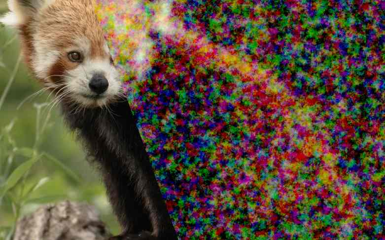
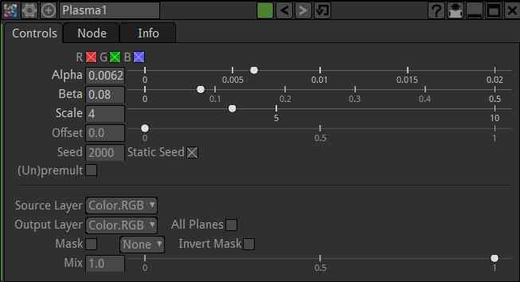
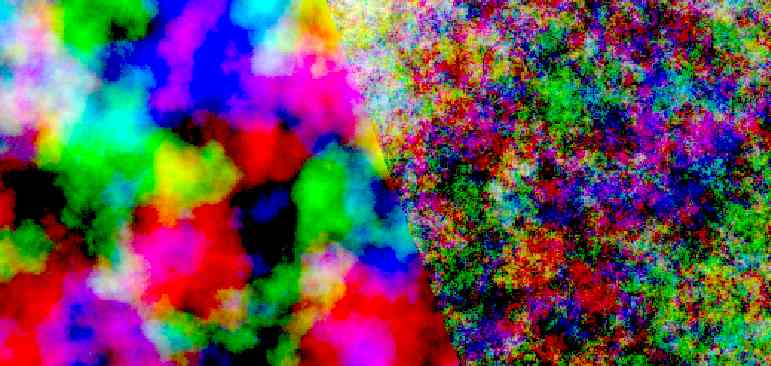

.. for help on writing/extending this file, see the reStructuredText cheatsheet
    http://github.com/ralsina/rst-cheatsheet/raw/master/rst-cheatsheet.pdf

Plasma Node
===========

Plasma draws a cloudy noise texture, and adds it to the source image if one is connected.
    

Usage
--------

**Scale** changes the size of the clouds.

**Static Seed** is checked by default, so the pattern is the same on every frame. Uncheck it to get a new pattern on each frame, or change **Seed** to get another pattern.

Above:
    - a high **Alpha** and a low **Beta** give smooth clouds;

    - a low **Alpha** and a high **Beta** give noisy clouds.

This node alone cannot regrain an image, but with a **Scale** of 1 it can partly simulate the blotchy grain of high-speed film stocks.

.. toctree::
    :maxdepth: 2
