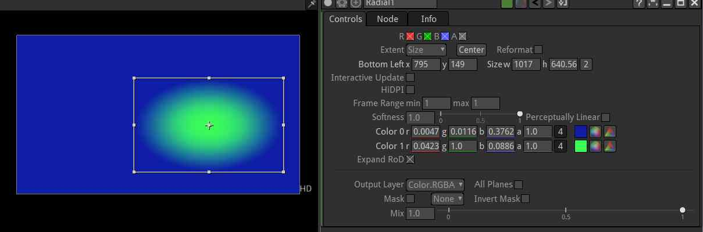

.. for help on writing/extending this file, see the reStructuredText cheatsheet
    http://github.com/ralsina/rst-cheatsheet/raw/master/rst-cheatsheet.pdf

Radial Node
===========

Radial creates a radial gradient. 

It is useful as a mask for a color correction or another effect, especially over soft, loosely defined areas: its **Softness** can be changed without changing the edge much.

It is faster to set up and to render than a Roto or RotoPaint node.
    

    
Usage
--------

While the node's properties are open, drag the rectangle handle in the Viewer
to change the shape.
For an exact circle, give the same width and height to **Size**: the button
next to it switches between one value for both dimensions and one value per
dimension.
To center the shape in the image, click **Center**.

For a hard-edged circle, set **Softness** to 0 (the default is 1).

**Color 0** is the color outside the shape and **Color 1** the color inside.

To fill the whole image, set **Extent** to **Project**.

Check **Perceptually Linear** for a falloff that looks linear to the eye,
rather than a linear one.

.. toctree::
    :maxdepth: 2

