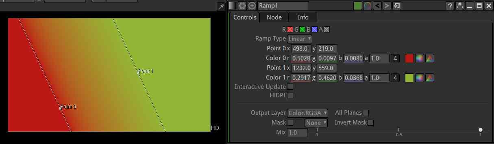

.. for help on writing/extending this file, see the reStructuredText cheatsheet
   http://github.com/ralsina/rst-cheatsheet/raw/master/rst-cheatsheet.pdf

Ramp Node
=========

        
The Ramp node draws a linear gradient between two points. It is often used as a mask for color corrections.
    

    
Usage
-----
    
**Color 0** and **Color 1** are the colors at the two ends. While the node's
properties are open, drag the **Point 0** and **Point 1** handles in the Viewer
to move the ends.

**Ramp Type** sets how the color changes between the two points: **Linear**,
**PLinear** (perceptually linear), **Ease-in**, **Ease-out**, **Smooth**, or
**None**. The gradient always follows a straight line; for a radial gradient,
use the Radial node.

.. toctree::
    :maxdepth: 2
