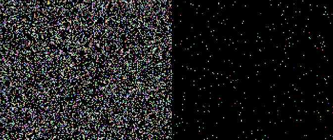
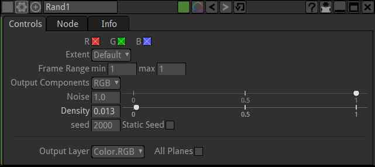
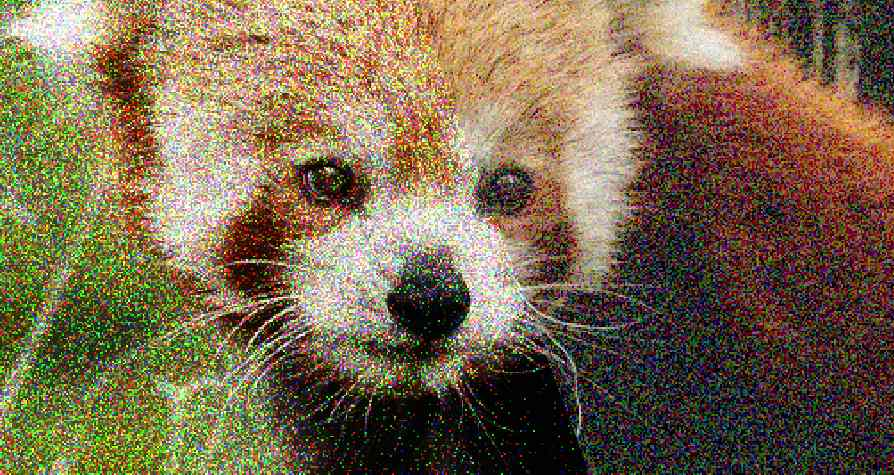
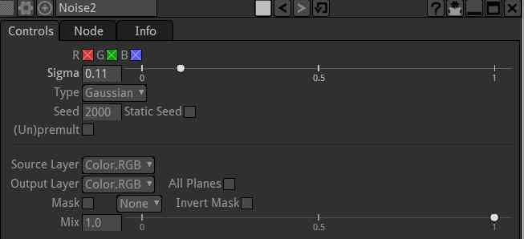

.. for help on writing/extending this file, see the reStructuredText cheatsheet
    http://github.com/ralsina/rst-cheatsheet/raw/master/rst-cheatsheet.pdf

Rand Node
=========

Rand draws a field of random pixels. This node alone cannot regrain an image.

Two Rand nodes with different **Density** values.

Usage
--------

**Density**, from 0 to 1, sets the proportion of random pixels: a lower density gives fewer of them. **Noise** sets how strong the noise is.

Check **Static Seed** to get the same noise on every frame.

Noise Node
==========

Noise adds noise to the source image.

Two noise types: Poisson on the left, Gaussian on the right.

Usage
--------

**Sigma** controls the amount of noise.

**Type** chooses the noise: **Gaussian** (the default), **Uniform**, **Salt &
Pepper**, **Poisson** or **Rice**. Poisson noise depends on the source image,
like the noise of a camera sensor, and gives a black image when there is no
source. Gaussian noise is the same everywhere and does not depend on the
source image.

Check **Static Seed** to get the same noise on every frame.

.. toctree::
    :maxdepth: 2
