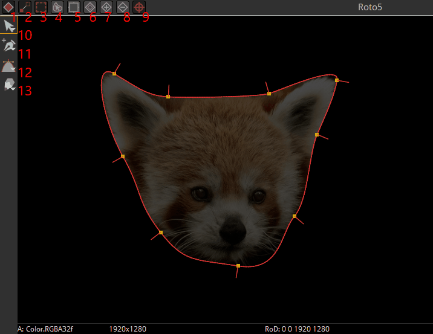
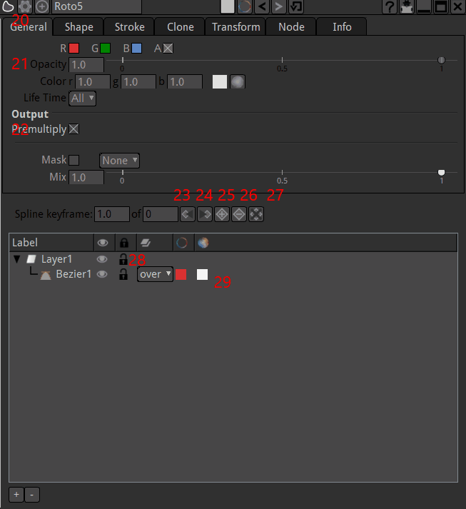

.. for help on writing/extending this file, see the reStructuredText cheatsheet
    http://github.com/ralsina/rst-cheatsheet/raw/master/rst-cheatsheet.pdf

Roto Node
=========

The Roto node draws vector shapes, like the pen tool in Photoshop or Illustrator. It has two main uses:

    - To make a mask: for example, when a Multiply node darkens an image, a Roto shape connected to its Mask input limits the effect to the shape.
    - To make an alpha channel: a Roto shape can add to, remove from or replace the alpha of an image.

It can also hide or reveal one image over another, for example to cover glitches with a "clean plate".

The Roto node has many parameters, but the first two tabs cover most everyday work.
    

Usage
--------

Basic usage:
    - create a Roto node with :kbd:`O` in the Node Graph (:kbd:`P` creates a RotoPaint node)
    - click in the Viewer to add points; click and drag to add a smooth point
    - click the first point to close the shape
    - for soft edges, drag the feather points out from the shape: the dotted line shows the outer limit of the soft edge
    - the shape is drawn in the alpha channel by default

    .. image:: _images/TheNodes-Draw/nodes_draw_roto03_feather.jpg

To edit the shape you have tools in the viewer window:

In the viewer the tools to create or edit shapes are:
    - 1: **Auto-keying**: sets a keyframe on the shape each time you move any part of it. When it is off, click the "+" button (25) to set a keyframe
    - 2: **Feather-link**: when you move a point of the shape, its feather point follows
    - 3: **Display feather**: shows or hides the feather points (dotted line)
    - 4: **Sticky selection**: clicking outside of any shape does not clear the selection
    - 5: **Sticky bounding box**: you can click anywhere in the bounding box of the selection to move it
    - 6: **Ripple edit**: applies the same offset to the shape on all keyframes
    - 7-8: add / remove a keyframe on the selected shape (like 25/26 in the properties)
    - 9: **Show transform**: moves, rotates and scales the whole shape at once. This is good for rigid objects, whose shape changes little over time
    - 10: selection tools (the arrow). Choose them after drawing the shape
    - 11: point editing tools: add, remove, cusp and smooth points, open or close the shape, remove the feather
    - 12: shape tools. Click and hold to choose between Bezier, rectangle and ellipse
    - 13: paint tools (RotoPaint only)

.. note::
    Layers have no geometric properties. They only group shapes and strokes, so that you can enable or disable them with a single click.

See :doc:`The Rotopaint <compositing-rotopaint>` section for more information.

.. toctree::
    :maxdepth: 2
