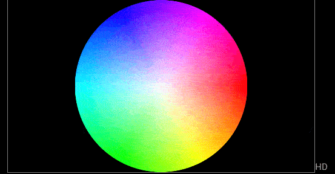
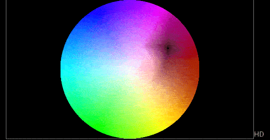
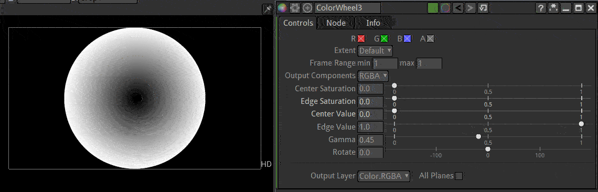

.. for help on writing/extending this file, see the reStructuredText cheatsheet
   http://github.com/ralsina/rst-cheatsheet/raw/master/rst-cheatsheet.pdf
   
ColorWheel Node
===============
    
.. toctree::
    :maxdepth: 2
    
The ColorWheel node draws a color wheel: a disc where the hue changes around
the center and the saturation from the center to the edge.

Usage
--------

**Center Saturation**, **Edge Saturation**, **Center Value**, **Edge Value**,
**Gamma** and **Rotate** change its colors, and **Extent** its size.

Use it to check a color correction: below, it shows what an HSVTool that
darkens the reds does.

With the saturation set to 0, the color wheel becomes a gray disc pattern.

