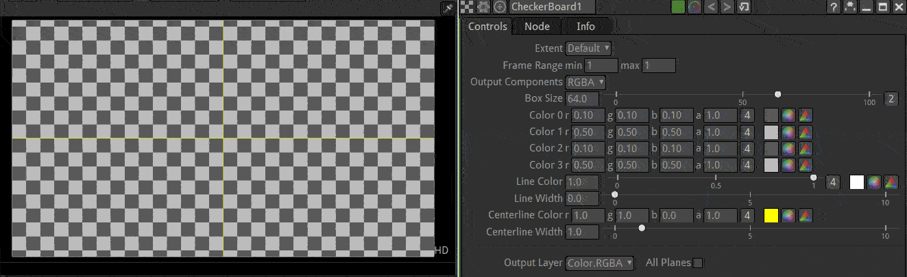
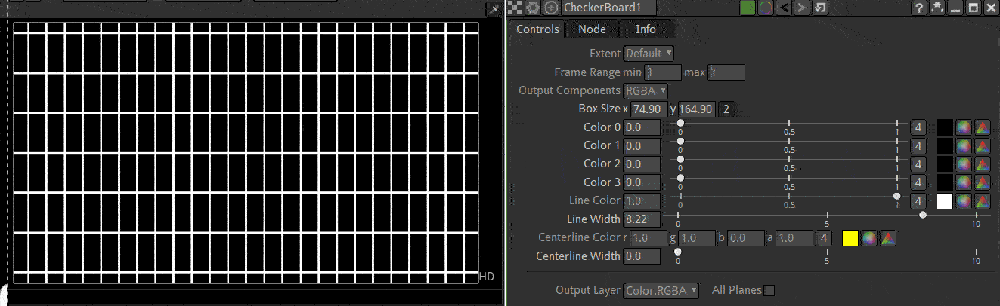
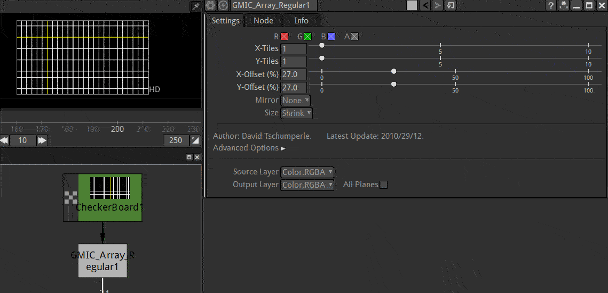

.. for help on writing/extending this file, see the reStructuredText cheatsheet
   http://github.com/ralsina/rst-cheatsheet/raw/master/rst-cheatsheet.pdf
   
Checkerboard Node
=================
   
.. toctree::
    :maxdepth: 2
   
The CheckerBoard node draws a checkerboard. It can also draw grids and other
regular patterns.

 
Usage
--------

**Box Size** sets the size of the boxes, in pixels, and the four **Color**
parameters set their colors.

To draw a grid, set the **Line Color** and **Line Width** (and
**Centerline Color** and **Centerline Width** for the two lines through the
center).

The pattern is centered on the center of the image. To move the lines, you
can add a G'MIC Array Regular node (:ref:`eu.gmic.ArrayRegular`) with
**X-Offset** and **Y-Offset**, keeping **X-Tiles** and **Y-Tiles** at 1. To
make the pattern tileable, set **Extent** to **Size** and use a **Size** that
is a multiple of **Box Size**.

