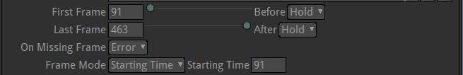
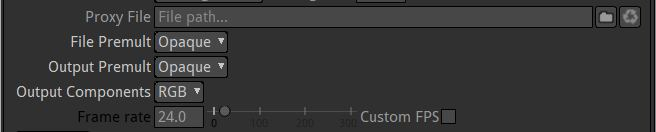
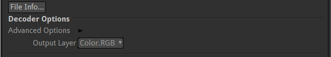
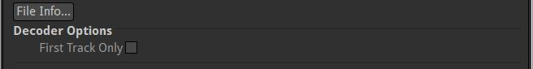
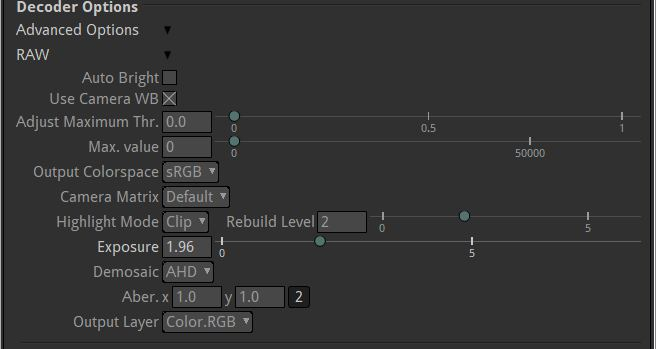
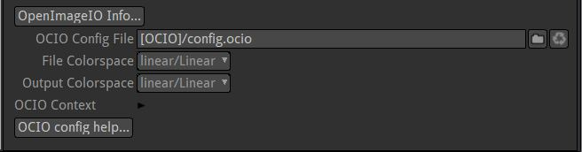

.. for help on writing/extending this file, see the reStructuredText cheatsheet
   http://github.com/ralsina/rst-cheatsheet/raw/master/rst-cheatsheet.pdf

Read Node
=========

The Read node reads movies, still images and image sequences into the project.
When you create it (**Image > Read**, or :kbd:`R` in the Node Graph), a file
browser opens to choose the file.

You can also drag files from your file manager onto the Node Graph: Natron
creates a Read node for each file or image sequence. If you drop a folder,
Natron looks for files and sequences in it and in all its subfolders.

File
----
| Click the folder icon next to **File** to open the file browser and choose
  the file to read.
| See :doc:`The File Browser <getstarted-environment-fileselect>` section for
  more information.

Timing
------

The Read node can change the timing of a movie file or an image sequence.

Main settings

* **First Frame** and **Last Frame**: by default, the first and last frames
  found on disk. Change them to trim the start or the end of the clip.
* **Frame Mode**: moves the clip in time. With **Time Offset**, an offset of
  -100 moves the clip 100 frames earlier. With **Starting Time**, you set the
  output frame at which the first frame of the clip is shown.

Other settings

* **Before** and **After**: what the node outputs before the first frame and
  after the last one. The default is **Hold** (repeat the first or last
  frame). **Loop** and **Bounce** repeat the clip, which is useful for looping
  animations such as a tree swaying in the wind. **Black** outputs a black,
  transparent image, and **Error** reports an error, which stops a render.
* **On Missing Frame**: what to do when a frame of the sequence is missing:
  **Hold previous**, **Load next** or **Load nearest** frame, **Error**, or
  **Black**. This lets you use a test render in which only every other frame
  was rendered, or a sequence with a broken frame that you removed.

.. note::
   **Tip:**
   Natron works better with image sequences (numbered files) than with movie
   files (QuickTime, MP4, ...): they are more reliable, faster to access, and
   you can re-render only part of a sequence.

Interpretation
--------------

These settings change how the image is interpreted.

Main settings

- **Frame rate** defaults to the frame rate found in the file. Override it
  with **Custom FPS** if the file was encoded with the wrong value.

.. note::
   An image sequence has no frame rate of its own, so Natron cannot read it
   from the files: set it here. As explained below, this does not change how
   Natron processes the frames.

.. note::
   Natron processes frames, not time: one input frame always gives one
   output frame, and the frame rate is mostly metadata. To convert the frame
   rate, use a node in the graph: for example, a Retime node with a
   **Speed** of 0.96 converts 24 fps to 25 fps.

- **File Premult** and **Output Premult**: if the image has transparent
  areas, you need to know whether the file stores premultiplied or
  unpremultiplied colors. Natron can work in both modes, and the Premult and
  Unpremult nodes convert from one to the other.

   For a video, leave both set to **Opaque**. For most images from painting
   programs, use **PreMultiplied** for both. Some 3D render passes need
   **UnPreMultiplied** for both.
   If both values are the same, the image is not changed, and the value is
   passed down the graph as metadata.
   If they are different, the node premultiplies or unpremultiplies the image.

.. note::
   Most programs write premultiplied images, but some 3D renderers do not.

Other settings

- **Output Components** chooses whether to keep the alpha channel of the file
  (**RGBA**) or to drop it (**RGB**). It can also output only the alpha
  channel (**Alpha**), or two channels (**RG**).

Decoding
--------

The decoder options depend on the type of file being read.

JPEG options:

QuickTime and other video options:

In a multi-view (stereo) project, each video track of the file is read as a
view. Check **First Track Only** if the file has several video tracks that are
not views.

RAW file options:

PDF file options:

Natron can read multi-page PDF documents: each page is a layer. To show
another page, choose its layer in the Viewer's layer menu, or add a Shuffle
node after the Read node to pick that layer.

Color
-----

The Read node converts the colors of the image.

The image is converted from **File Colorspace** to **Output Colorspace**.

.. note::
   **Tips:**
     * Leave **Output Colorspace** set to the linear colorspace (the default):
       Natron is designed to work on linear images.
     * When the two colorspaces are the same, no conversion is done.

See :doc:`The readers <compositing-projects-readers>` section for more
information.
