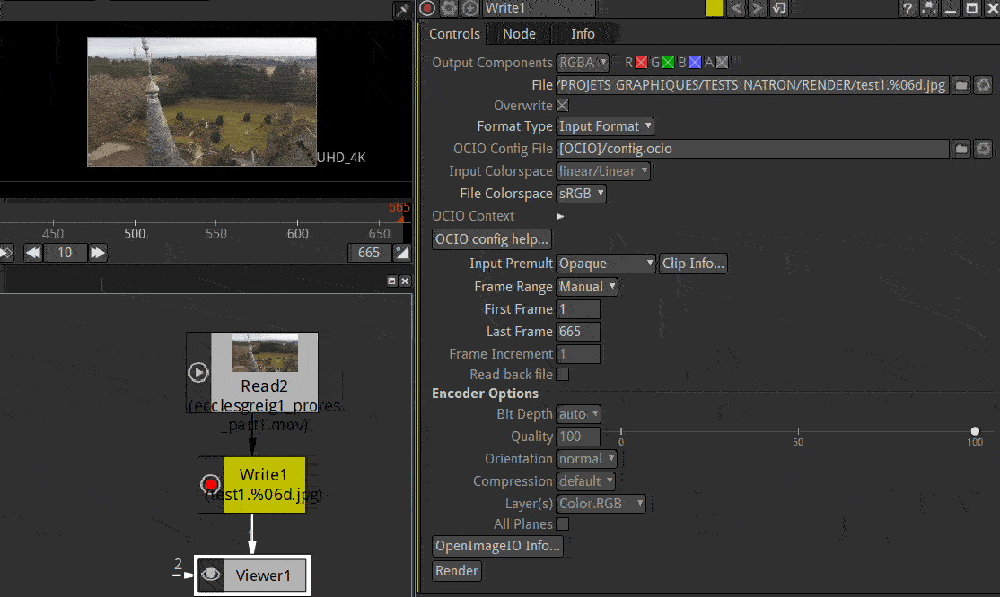
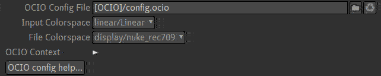
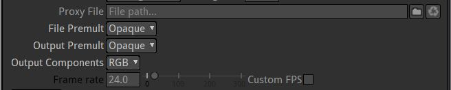
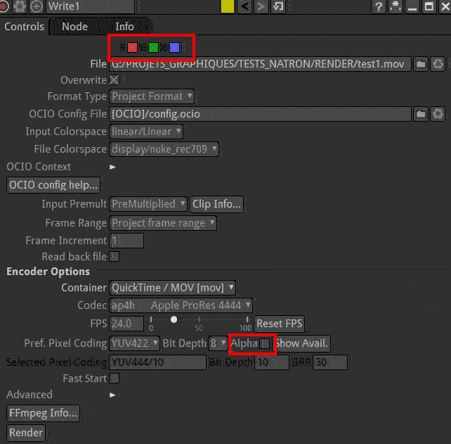
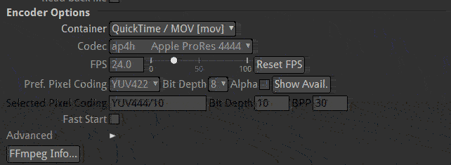

.. for help on writing/extending this file, see the reStructuredText cheatsheet
   http://github.com/ralsina/rst-cheatsheet/raw/master/rst-cheatsheet.pdf

Write Node
==========

The Write node renders the result of the graph to disk, as a movie file or as
an image sequence.

- Create a Write node (**Image > Write**, or :kbd:`W` in the Node Graph).
- Connect it to the last node of your graph.
- Click the folder icon next to **File**, then choose where to write the
  result and type the file name.

See :doc:`The File Browser <getstarted-environment-fileselect>` section for
more information.

- The file name must end with the extension of the format (``.mov``,
  ``.exr``, ``.tif``, ``.png``, ...). Natron picks the writer from the
  extension, and the Write node then shows the parameters of that format.
  For an image sequence, put ``#`` characters where the frame number goes,
  one per digit: ``render.####.exr`` writes ``render.0001.exr``,
  ``render.0002.exr``, and so on.
- Choose the frames to render with **Frame Range**: **Union of input
  ranges**, **Project frame range**, or **Manual** with **First Frame** and
  **Last Frame**. In the screenshot below, the range is 1 to 665.

- Start the render:

   * click the **Render** button in the node's properties,

   .. image:: _images/TheNodes-Image/node_image_write_render.gif

   * or select the Write node and choose **Render > Render Selected Writers**.

See :doc:`Rendering projects <compositing-projects-render>` for the other ways
to render, including from the command line.

Format Type
-----------

**Format Type** sets the size of the output image in pixels:

- **Input Format**: the format of the Write node's input;
- **Project Format**: the project format;
- **Fixed Format**: the format chosen in the **Format** parameter.

The proxy mode of the Viewer does not change the size of the rendered files.

Color
-----

The Write node converts the colors of the image before writing it.

The image is converted from **Input Colorspace** to **File Colorspace**.

.. note::
   **Tips:**
     * Leave **Input Colorspace** set to the linear colorspace (the default):
       Natron is designed to work on linear images.
     * When the two colorspaces are the same, no conversion is done.
     * **File Colorspace** is often set to the colorspace of the main Read
       node, so that the written image matches the original footage.

Interpretation
--------------

These settings change how the image is written to disk.

- **Input Premult**

   If the image has transparent areas and the graph keeps track of
   premultiplication correctly, Natron sets **Input Premult** for you. If
   the result is wrong, set it by hand.

   When writing an RGBA image to a format that has no alpha channel, the
   Write node drops the alpha channel and does not premultiply the colors.
   Since Natron 2.4, this makes the written file look the same as in the
   Viewer.

- **Output Components**

   Chooses whether to write the alpha channel. **RGBA** is not available if
   the format has no alpha channel.

.. note::
   For QuickTime and other movie files, alpha is also an encoder option
   (**Alpha**). Most codecs cannot store an alpha channel: among those
   Natron can write, ProRes 4444 and Hap Alpha can, but DNxHD and DNxHR
   cannot.

Encoding
--------

The encoder options depend on the file format.

QuickTime and other movie options:

* **FPS**
   defaults to the frame rate of the input; **Reset FPS** sets it back to
   that value. Image sequences have no frame rate.

.. note::
   **Tip:**
   Natron works better with image sequences (numbered files) than with movie
   files (QuickTime, MP4, ...): they are more reliable, faster to access, and
   you can re-render only part of a sequence.

See also
--------

- :ref:`tutorials-ffmpeg-di`: producing ProRes, DNxHR and other digital
  intermediates.
- :ref:`tutorials-ffmpeg-hevc`: encoding HEVC (H.265) from Natron or with
  ffmpeg.
- :ref:`tutorials-ffmpeg-audio`: adding sound to the videos written by Natron.
