.. for help on writing/extending this file, see the reStructuredText cheatsheet
   http://github.com/ralsina/rst-cheatsheet/raw/master/rst-cheatsheet.pdf

.. _tutorials-hsvtool:

HSVTool
=======

The :ref:`HSVTool <net.sf.openfx.HSVToolPlugin>` node adjusts the hue,
saturation and brightness of an image. It converts each pixel from RGB to HSV
(hue, saturation, value), applies the adjustments, and converts the result
back to RGB:

- **Hue** is the color itself (red, green, blue…), measured in degrees around
  the color wheel: red is 0, green is 120 and blue is 240.
- **Saturation** is the purity of the color: gray has zero saturation.
- **Brightness** (the "value" of HSV) is how light the color is.

Each of the three groups of parameters has a **Range** that limits the
adjustment to the colors inside it, and a **Range Rolloff** that softens the
limit.

Common uses of HSVTool are:

#. secondary color correction, or replacing one color with another, with the
   **Src Color** and **Dst Color** color pickers;
#. pulling a key (a matte) from a range of hues, saturations and brightnesses;
#. shifting all the colors of the image, with **Hue Rotation**.

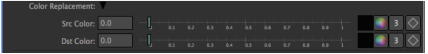

The screenshots below were made with a single pixel picked as **Src Color**,
without changing the ranges by hand. The **Output Alpha** parameter controls
what is written to the alpha channel, so the matte changes with it.

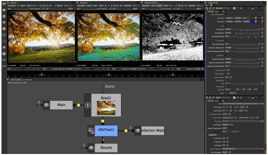

   A color replacement: one pixel was picked as **Src Color**, and a blue
   **Dst Color** was chosen.

Adjusting the ranges
--------------------

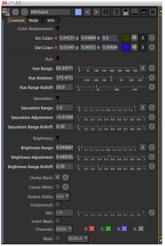

Picking **Src Color** sets the **Hue Range**, **Saturation Range** and
**Brightness Range** around that color, and resets the rolloffs to their
default values. You can then widen or narrow each range to limit the
effect. The viewer on the right of the screenshot shows the alpha channel,
with **Output Alpha** set to **Hue**.

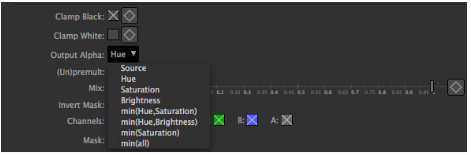

The following screenshots show the alpha channel for different **Output
Alpha** settings, with the same **Src Color**.

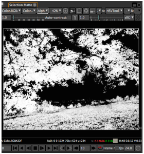
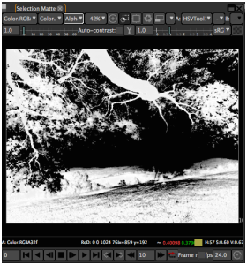

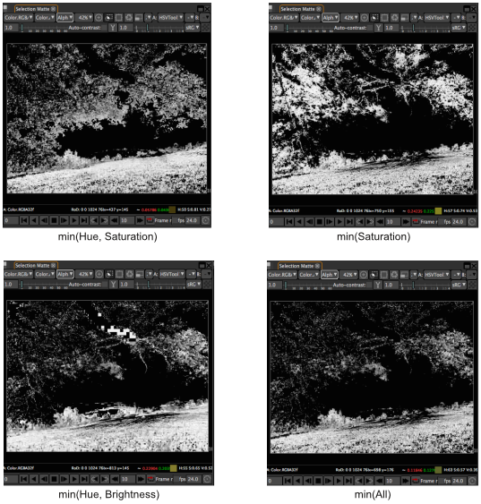

Low-resolution or heavily compressed footage gives a noisy matte, which
makes color replacement and secondary corrections harder. The blue channel is
usually the noisiest. Blurring it by one or two pixels before HSVTool, with
:ref:`CImgBlur <net.sf.cimg.CImgBlur>` or :ref:`CImgDenoise <net.sf.cimg.CImgDenoise>`,
can help, but not always. Saturation and brightness can only be pushed so far
before the image breaks up. HSVTool also needs color in its input: it can
output a grayscale image or a matte, but it can't select anything in a
grayscale input.

Using HSVTool as a keyer
------------------------

HSVTool can pull a key, like :ref:`ChromaKeyer <net.sf.openfx.ChromaKeyerPlugin>`
and :ref:`Keyer <net.sf.openfx.KeyerPlugin>`, but its matte is the other way
around: the selected color is white (opaque) in the alpha channel, while a
keyer makes the key color black (transparent). It also selects colors in HSV,
while ChromaKeyer works in Y'CbCr.

For comparison, here is a ChromaKeyer pulling a key from a green screen:

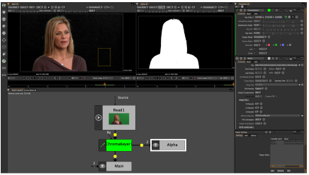

The ChromaKeyer properties below: the **Key Color** was picked on the green
screen. The **Acceptance Angle** is large because the source is compressed.

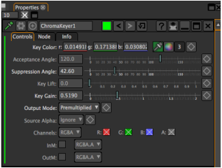

ChromaKeyer removes the green and makes it black and transparent. **Key
Lift** and **Key Gain** clamp the blacks and whites of the matte. The matte
can also be used, inverted, as a holdout matte, or as a mask for other
effects.

.. note::

   A holdout matte is a part of the image that the keyer must not key. It is
   often used for areas of the foreground with colors close to the key color.

The same green screen, keyed with HSVTool. The selected color (the green
screen) is white in the alpha channel:

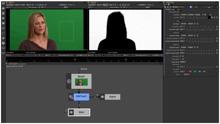

The HSVTool properties: **Src Color** was picked on the green screen, which
set the **Hue**, **Saturation** and **Brightness** ranges.

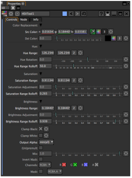

To use HSVTool as a keyer, set **Output Alpha** to **min(all)** (the default
is **Hue**), view the alpha channel, and adjust the hue ranges first, then
the saturation and brightness ranges, with their rolloffs.

**Output Alpha** has eight settings: **Source** (the alpha of the input is
kept), **Hue**, **Saturation**, **Brightness**, **min(Hue,Saturation)**,
**min(Hue,Brightness)**, **min(Saturation,Brightness)** and **min(all)**.
Only **Source** does not make a matte; color replacement and corrections
still work with it.

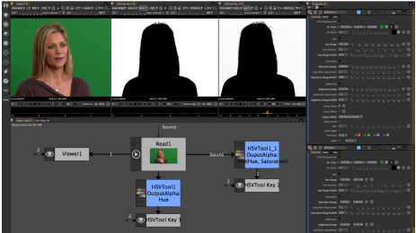

Two HSVTool nodes keying the same input with different **Output Alpha**
settings: **Hue** in the middle viewer, **min(Hue,Saturation)** in the right
viewer. With compressed footage, the settings give quite different results.

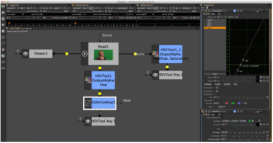

.. note::

   To refine the edges of the matte, add a
   :ref:`ColorLookup <net.sf.openfx.ColorLookupPlugin>` node after HSVTool
   (see :doc:`tutorials-keying-colorlookup`). To key a range of hues with
   curves, see also :ref:`HueKeyer <net.sf.openfx.HueKeyer>` and the
   :doc:`Hue Keyer tutorial <tutorials-keying-huekeyer>`.
