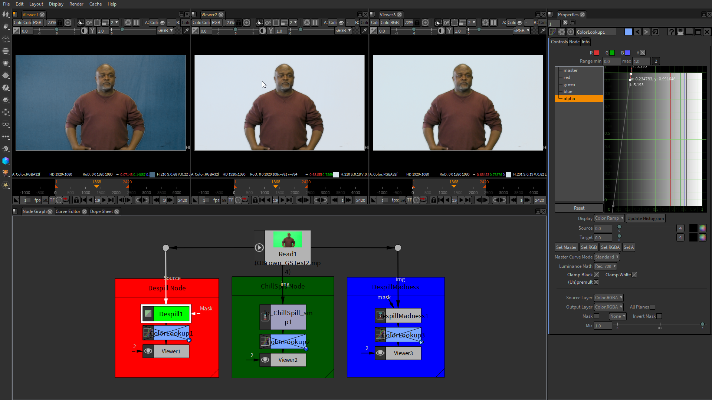
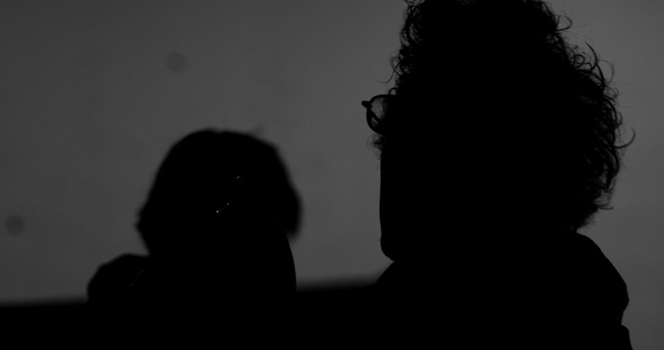
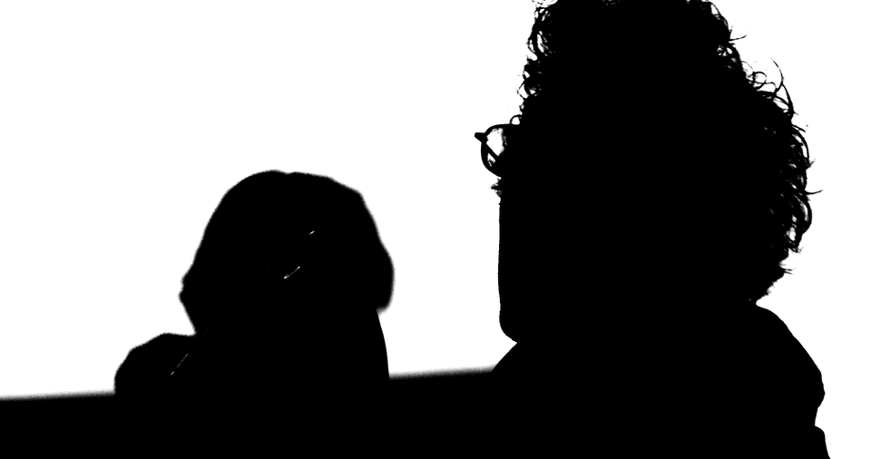
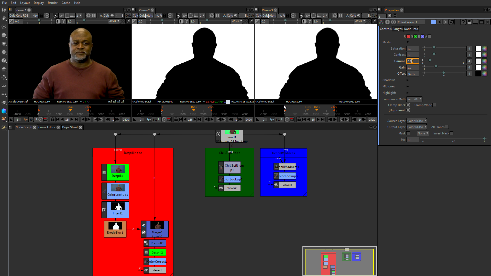

.. for help on writing/extending this file, see the reStructuredText cheatsheet
   http://github.com/ralsina/rst-cheatsheet/raw/master/rst-cheatsheet.pdf

Green Screen Despilling Tips
============================

This tutorial uses footage filmed at the One Button Studio of the University at
Buffalo, NY. It shows how the despill nodes of Natron can produce a matte, in
addition to removing the green spill from the foreground.

Three despill nodes are available, from Natron and from the community:

- :ref:`Despill <net.sf.openfx.Despill>`, with the **Spillmap to Alpha**
  option;
- **lp_ChillSpill**, with **Shuffle Spillmatte to Alpha**;
- **DespillMadness**, with **Output Spill Matte in Alpha**.

lp_ChillSpill and DespillMadness are community PyPlugs from the
`natron-plugins <https://github.com/NatronGitHub/natron-plugins>`_
collection. The three options do the same thing: they output the spill map
(the amount of spill removed from each pixel) in the alpha channel.

The three despill nodes side by side
------------------------------------

Here, the three despill nodes are connected to the same source, each one with
its own Viewer, so that their results can be compared.

   Despill, lp_ChillSpill and DespillMadness side by side.

Each node suppresses the spill a little differently, but the spill mattes they
produce are very similar. The spill map depends on how the node compares the
green channel with the other two channels. In Despill, the **Spillmap Mix**
parameter sets how red and blue are combined (the default, 0.5, uses their
average); the community PyPlugs may use other formulas.

Turning the spill map into a matte
----------------------------------

The raw spill map has low contrast. A :ref:`ColorLookup
<net.sf.openfx.ColorLookupPlugin>` node after the despill node can crush the
blacks and expand the whites. Here is the spill matte of lp_ChillSpill before
and after ColorLookup:

   The spill matte of lp_ChillSpill.

   The same matte after ColorLookup.

.. note::

   When you crush and expand a matte with ColorLookup, enable **Clamp Black**
   and **Clamp White** in ColorLookup, or add a :ref:`Clamp
   <net.sf.openfx.Clamp>` node after it. Otherwise steep curves can produce
   values below 0 or above 1 in the matte.

Below, the spill mattes of the three despill nodes are all adjusted with
ColorLookup. In the spill matte the screen is white and the person is black:
use an :ref:`Invert <net.sf.openfx.Invert>` node to get a matte where the
screen is black and the person is white.

.. figure:: _images/tutorials-keying/despill-mattes.png
   :width: 650px
   :align: center
   :alt: Three Viewers showing black silhouettes on white, one per despill node

   The three spill mattes after ColorLookup.

The despill nodes are used here as alternative keyers.

This workflow doesn't replace color-difference keyers, chroma keyers or other
dedicated keyers. It complements them, and it can help keep the edges of the
matte smooth.

Building the composite
----------------------

In the node graph below, the spill matte from Despill1 is adjusted with
ColorLookup, inverted (:ref:`Invert <net.sf.openfx.Invert>`) and softened at
the edges (:ref:`ErodeBlur <eu.cimg.ErodeBlur>`). It is then connected to the
**A** input of a :ref:`Merge <net.sf.openfx.MergePlugin>` node set to the
**mask** operation, with the original plate in **B**. The **mask** operation
multiplies B by the alpha of A, so its output is already premultiplied by the
matte. The result is then despilled by a second Despill node (Despill2),
because Despill1 is only used to make the matte: its color output is not used.
Finally, ColorCorrect adjusts the colors.

   The finished shot (left Viewer) and its node graph.

.. note::

   The node graph above also has a Premult node after the Merge. Since the
   **mask** operation already premultiplies the image, this premultiplies it a
   second time and darkens the semi-transparent edges: remove it. Better
   still, despill the plate first, then copy the matte into its alpha channel
   (with Shuffle, or the **Copy** operation of Merge) and premultiply once
   with Premult, so that the despill works on unpremultiplied colors.

Footage credits: the footage was filmed at the One Button Studio of the
University at Buffalo, NY. The screenshots were provided by the author of this
tutorial, @blackearth2014.
