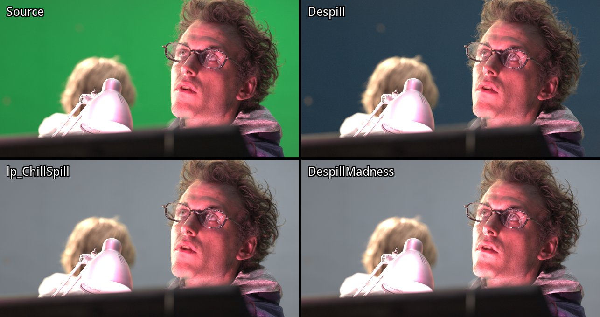
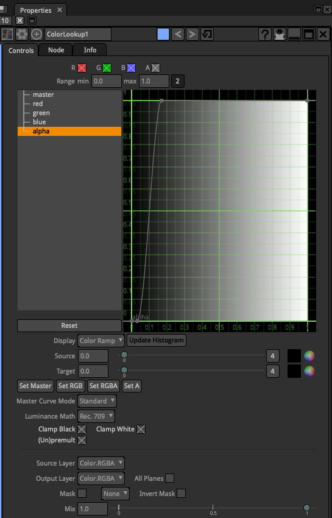
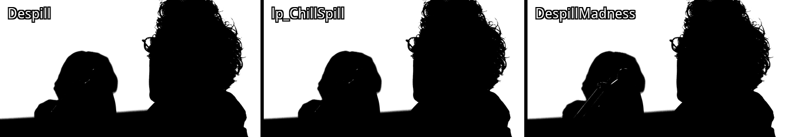
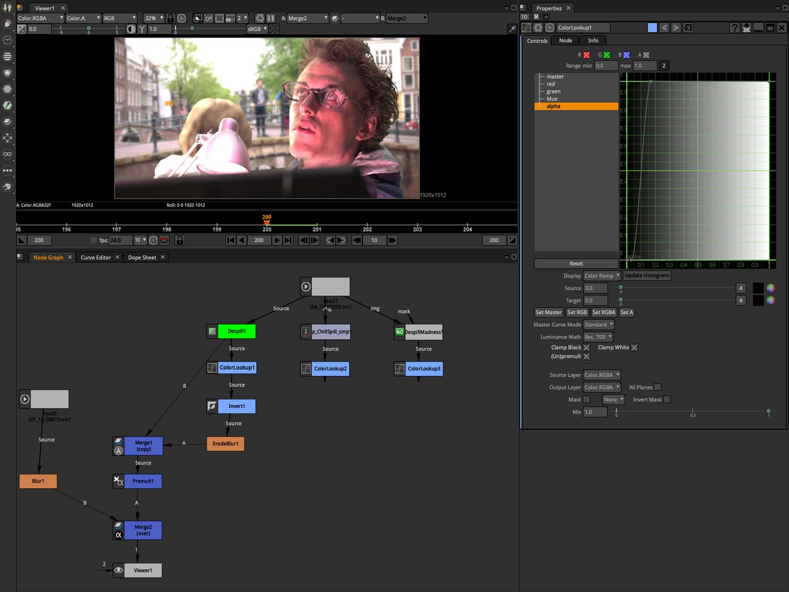
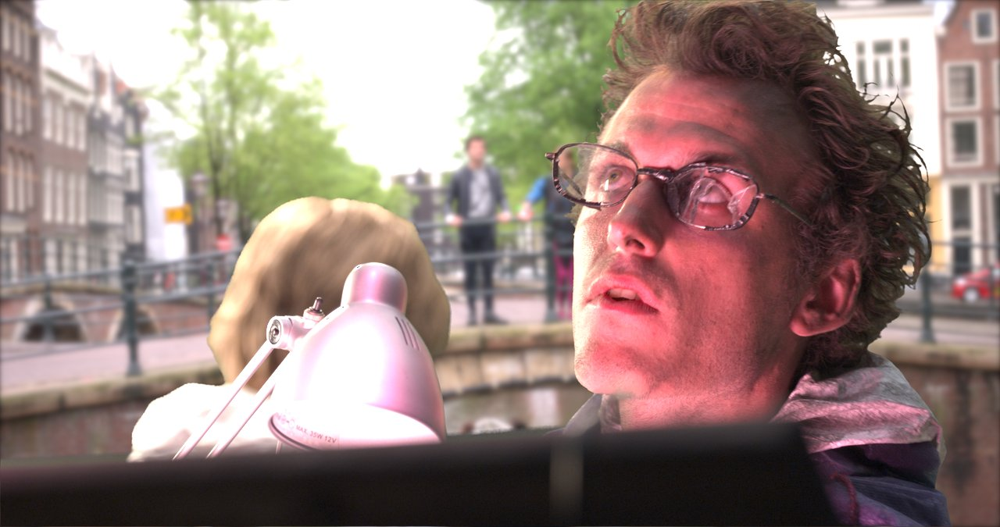

.. for help on writing/extending this file, see the reStructuredText cheatsheet
   http://github.com/ralsina/rst-cheatsheet/raw/master/rst-cheatsheet.pdf

Green Screen Despilling Tips
============================

This tutorial uses a green screen plate from the open movie *Tears of Steel*
(see the credits below). It shows how the despill nodes of Natron can produce a
matte, in addition to removing the green spill from the foreground.

Three despill nodes are available, from Natron and from the community:

- :ref:`Despill <net.sf.openfx.Despill>`, with the **Spillmap to Alpha**
  option;
- **lp_ChillSpill**, with **shuffle spillmatte to alpha**;
- **DespillMadness**, with **output spill matte in alpha**.

lp_ChillSpill and DespillMadness are community PyPlugs from the
`natron-plugins <https://github.com/NatronGitHub/natron-plugins>`_
collection (lp_ChillSpill shows up as **lp_ChillSpill_smp** in the node
graph). The three options do the same thing: they output the spill map (the
amount of spill removed from each pixel) in the alpha channel.

The three despill nodes side by side
------------------------------------

Connect the three despill nodes to the same Read node, and look at their
outputs in the Viewer. Here they all have their default settings: green
screen, and the **average** algorithm in the two PyPlugs.

   The source plate, and the outputs of Despill, lp_ChillSpill and
   DespillMadness.

Each node suppresses the spill a little differently. Despill lowers the green
channel to the average of red and blue wherever it is higher, so the screen
turns dark blue-gray. lp_ChillSpill (with its default **luma restore** method)
and DespillMadness (with **restore source luminance** at 1) also restore the
luminance of the removed spill, so the screen turns light gray.

The spill maps they produce are very similar, because they all compare the
green channel with the other two channels. In Despill, the **Spillmap Mix**
parameter sets how red and blue are combined (the default, 0.5, uses their
average). On this plate, the spill maps of Despill and lp_ChillSpill are
identical, and the one of DespillMadness only differs on the arm of the lamp.

Turning on **Spillmap to Alpha** in Despill or **output spill matte in alpha**
in DespillMadness (it is on by default) doesn't change their color output.
**shuffle spillmatte to alpha** in lp_ChillSpill also multiplies its color
output by the spill map, so use only the alpha channel of that output.

Turning the spill map into a matte
----------------------------------

The raw spill map has low contrast: on this plate, it is between about 0.17
and 0.37 on the screen, and 0 on most of the foreground. A :ref:`ColorLookup
<net.sf.openfx.ColorLookupPlugin>` node after the despill node can crush the
blacks and expand the whites. Select the **alpha** curve of ColorLookup and
move its points: here, the curve goes through (0, 0), (0.03, 0), (0.17, 1)
and (1, 1), so that everything below 0.03 becomes 0 and everything above 0.17
becomes 1. Here is the spill map of Despill before and after ColorLookup:

.. figure:: _images/tutorials-keying/despill-spillmatte-before.jpg
   :width: 650px
   :align: center
   :alt: Dark gray spill map, with the black silhouettes of the two people and the lamp

   The spill map of Despill (alpha channel).

.. figure:: _images/tutorials-keying/despill-spillmatte-after.png
   :width: 650px
   :align: center
   :alt: Clean black and white spill matte

   The same matte after ColorLookup.

   The alpha curve of ColorLookup1, with **Clamp Black** and **Clamp White**
   enabled.

.. note::

   When you crush and expand a matte with ColorLookup, enable **Clamp Black**
   and **Clamp White** in ColorLookup, or add a :ref:`Clamp
   <net.sf.openfx.Clamp>` node after it. The curve is smooth, so steep
   segments can overshoot and produce values below 0 or above 1 in the matte.

Below, the spill maps of the three despill nodes are all adjusted with the
same ColorLookup curve. In the spill matte the screen is white and the people
are black: use an :ref:`Invert <net.sf.openfx.Invert>` node to get a matte
where the screen is black and the people are white.

   The three spill mattes after ColorLookup.

The despill nodes are used here as alternative keyers. This workflow doesn't
replace color-difference keyers, chroma keyers or other dedicated keyers. It
complements them, and it can help keep the edges of the matte smooth.

Building the composite
----------------------

The composite uses the color output of Despill1 and the matte made from its
spill map:

1. The spill matte of Despill1 goes through ColorLookup1 (above), then
   through Invert1, with only its **A** channel checked, so that the people
   are white.
2. :ref:`ErodeBlur <eu.cimg.ErodeBlur>` (**Size** 1, **Blur** 1) shrinks the
   matte by one pixel and softens its edges.
3. A :ref:`Merge <net.sf.openfx.MergePlugin>` node (Merge1) set to **copy**,
   with only the **A** output channel checked, copies the matte into the
   alpha channel of the despilled plate: Despill1 goes to the **B** input and
   ErodeBlur1 to the **A** input. The R, G and B channels come from B.
4. :ref:`Premult <net.sf.openfx.Premult>` premultiplies the despilled colors
   by the matte. The despill works on unpremultiplied colors, and the image is
   premultiplied only once.
5. A second Merge node (Merge2, **over**) puts the result over the new
   background. Here the background is another *Tears of Steel* plate, blurred
   with :ref:`Blur <net.sf.cimg.CImgBlur>` (**Size** 12) to fake a shallow
   depth of field.

   The node graph: the three despill nodes and their ColorLookup nodes at the
   top, the composite at the bottom left.

   The finished shot.

See also
--------

- :doc:`compositing-keying`: the keyer nodes, and how spill is removed.

Image credits
-------------

- Footage: green screen plate 04_5k (frame 200) and background plate 01_1a
  (frame 819) from `Tears of Steel <https://mango.blender.org/>`_, (CC)
  Blender Foundation | mango.blender.org, licensed under `CC BY 3.0
  <https://creativecommons.org/licenses/by/3.0/>`_. The plates were
  downloaded from the `Xiph.org mirror
  <https://media.xiph.org/tearsofsteel/tearsofsteel-footage-exr/>`_ (linear
  HD OpenEXR). The images above were rendered from them with Natron and
  resized; the screenshots were taken in Natron.
