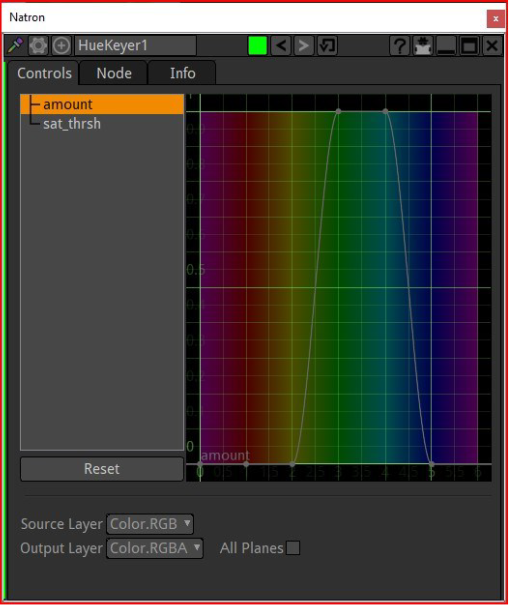

.. for help on writing/extending this file, see the reStructuredText cheatsheet
   http://github.com/ralsina/rst-cheatsheet/raw/master/rst-cheatsheet.pdf

Hue Keyer
=========

The :ref:`HueKeyer <net.sf.openfx.HueKeyer>` node pulls a key (a mask) from
the hue of the image: you choose a range of hues, and the node makes those
colors transparent.

Hue and saturation are computed from the RGB values of the source image. For
each hue, two curves control the result:

amount
   The output transparency for that hue: ``amount = 1`` gives ``alpha = 0``.

sat_thrsh
   If the saturation of a pixel is below this value, its transparency is
   gradually reduced. This keeps grays and nearly gray colors opaque.

   The HueKeyer properties: the ``amount`` and ``sat_thrsh`` curves are drawn
   over the hue spectrum.

HueKeyer has no mask input, only a Source input and the Source and Output
layer choices: its job is to make the mask. It has few parameters, but they
give precise control. As with any keyer, start from the best image you can
get: compression artifacts in the source give a worse key. In most cases you
only need to adjust two or three points.

Selecting the hue
-----------------

First select the hue you want to key. In the Viewer, move the mouse over that
color, hold :kbd:`Ctrl` (:kbd:`Cmd` on macOS) and click. A vertical bar
appears in the hue graph of HueKeyer at the hue you picked, and stays there.

.. figure:: _images/tutorials-keying/huekeyer-hue-selection.png
   :width: 400px
   :align: center
   :alt: HueKeyer hue graph with a vertical bar marking the picked hue

   The vertical bar marks the hue picked in the Viewer.

The bar is only an indicator: the ``amount`` curve does not move to it. By
default, the ``amount`` curve is 1 for green and cyan, so HueKeyer keys those
hues. To key another hue, move the control points so that the curve is 1
around the bar and 0 elsewhere. The slopes on each side of the bar control how
gradually the key falls off: move the control points to tighten or widen the
selection, and double-click on the curve to add control points for finer
control. You will mostly edit the ``amount`` curve. Change it carefully: a
small move of a control point can change the key a lot.

Example: a desaturated rose
---------------------------

In this example, the rose is desaturated by
:ref:`HueCorrect <net.sf.openfx.HueCorrect>`, and HueKeyer makes a mask of the
rose that limits other effects to it, or to the rest of the image. The hue
picked in the Viewer is the green of a leaf, and the ``amount`` curve keeps its
default shape, so HueKeyer keys the green leaves: they become transparent
(alpha 0), and the rose stays opaque (alpha 1).

.. figure:: _images/tutorials-keying/huekeyer-demo-source.jpg
   :width: 600px
   :align: center
   :alt: A bright pink rose surrounded by green leaves

   The source image.

.. figure:: _images/tutorials-keying/huekeyer-demo-result.jpg
   :width: 600px
   :align: center
   :alt: The same rose, desaturated to gray and glowing, in front of blurred green leaves

   The result: the rose is gray, sharp and glowing, the leaves are blurred.

The node graph is a chain Read1, HueCorrect1,
:ref:`Blur1 <net.sf.cimg.CImgBlur>`, :ref:`Glow1 <fr.inria.Glow>` and
:ref:`ColorCorrect1 <net.sf.openfx.ColorCorrectPlugin>`. HueKeyer1 takes its
Source from Read1, and its output is connected to the Mask inputs of Blur1 and
Glow1 (the Mask input of ColorCorrect1 is not connected). The settings are:

- HueCorrect1: the ``sat`` curve has control points at 0 and 1.3 with value 0,
  at 2 and 4.4 with value 1, and at 5.1 with value 0. On the hue axis, 1 is
  red, 2 yellow, 3 green, 4 cyan, 5 blue, and 0 (or 6) magenta, so the curve
  is 0 from violet through magenta and pink to red, and 1 from yellow to cyan.
  This desaturates the rose and keeps the leaves green. The curve is periodic:
  6 is the same hue as 0, so don't add control points at both 0 and 6 (with
  both, HueCorrect outputs invalid values for pure magenta pixels, such as
  clipped pink highlights).
- Blur1: **Size** 12, with **Invert Mask** enabled.
- Glow1 and HueKeyer1: default settings.
- ColorCorrect1: master **Gamma** 0.9, **Gain** 1.1, **Offset** -0.01.

.. Screenshots wanted here (not made yet, the previous ones showed a photo that
   could not be redistributed): the whole Natron window with this project
   (Viewer on ColorCorrect1, node graph, HueKeyer1 and ColorCorrect1
   properties), and a close-up of the node graph.

A masked effect applies where the mask is opaque (alpha 1), that is, outside
the keyed hues: here, on the rose. This is why Glow1 makes the rose glow. In
Blur1, **Invert Mask** is enabled, so the blur applies to the leaves instead,
and the rose stays sharp.

.. figure:: _images/tutorials-keying/huekeyer-demo-mask.png
   :width: 600px
   :align: center
   :alt: Black and white mask: the rose is white, the leaves are black, the dark background is noisy gray

   The mask computed by HueKeyer: white where it is opaque (the rose), black
   where the green hues are keyed. The dark, nearly gray background is only
   partly keyed: the ``sat_thrsh`` curve keeps low-saturation colors opaque.

The final image below only uses HueCorrect: Blur1, Glow1 and ColorCorrect1 are
disabled, and the Mask input of HueCorrect1 is not used.

.. figure:: _images/tutorials-keying/huekeyer-demo-final.jpg
   :width: 600px
   :align: center
   :alt: The rose in gray, the leaves in green

   The final image.

.. figure:: _images/tutorials-keying/huecorrect-properties.png
   :width: 320px
   :align: center
   :alt: HueCorrect properties, with the hue curves drawn over the hue spectrum

   The HueCorrect properties: lowering the ``sat`` curve for a range of hues
   desaturates them.

HueKeyer and HueCorrect
-----------------------

HueKeyer and HueCorrect use the same kind of hue graph, which makes them a
good combination: HueKeyer selects the hues, HueCorrect changes them. Unlike
HueKeyer, HueCorrect has a mask input, so the HueKeyer mask can limit its
effect, for precise color effects.

.. note::

   HueCorrect is also very useful for spill suppression. If colored fringes
   remain around the edges of a key, and the despill nodes don't remove them,
   lower the saturation (``sat``) or the suppression curves (``r_sup``,
   ``g_sup``, ``b_sup``) of HueCorrect for the hue of the fringes.

See also
--------

- :doc:`compositing-keying`: the other keyer nodes, and how to combine mattes.
- :doc:`compositing-color`: the color correction nodes, including HueCorrect.

Image credits
-------------

- Rose photograph: `Rose, Hot Pink
  <https://commons.wikimedia.org/wiki/File:Rose,_Hot_Pink_(52127660426).jpg>`_
  by Angelos @ Ottawa, from `Flickr
  <https://www.flickr.com/photos/194609185@N08/52127660426/>`_, dedicated to
  the public domain (`Public Domain Mark 1.0
  <https://creativecommons.org/publicdomain/mark/1.0/>`_). Resized; the result
  and mask images were rendered from it with Natron.
- Screenshots of Natron: @blackearth2014, the author of this tutorial.
