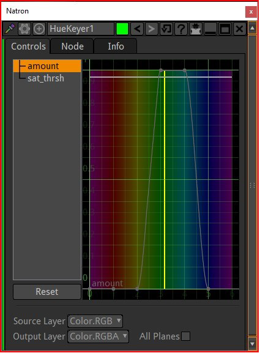
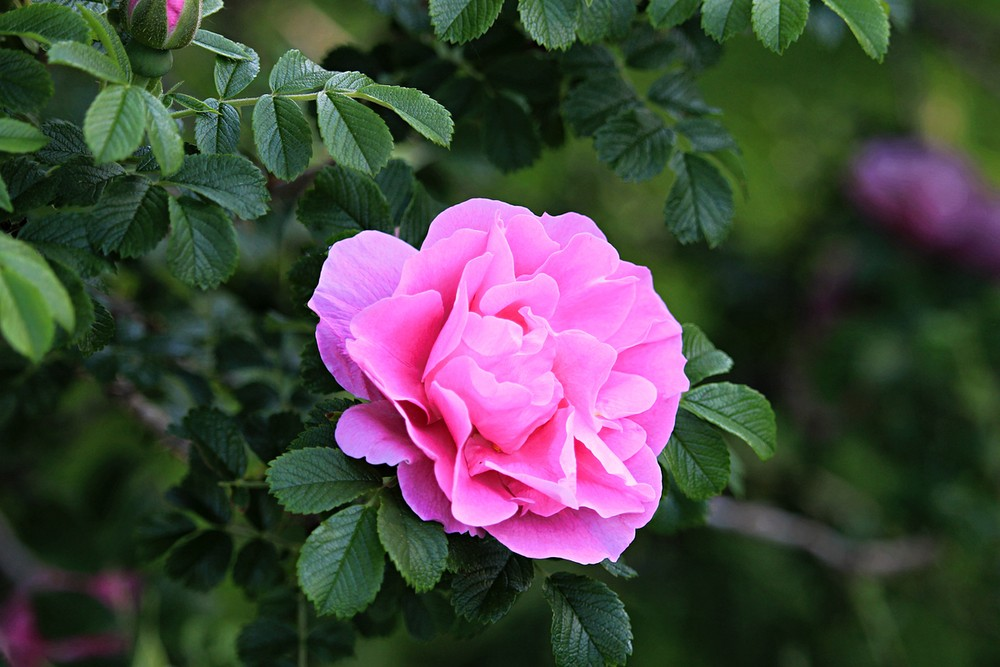
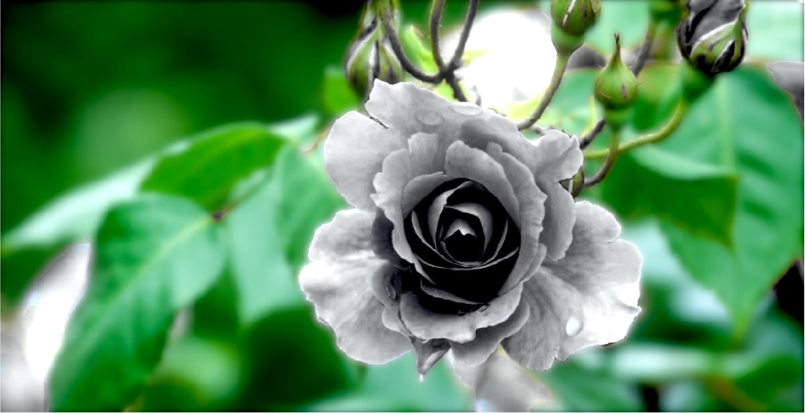
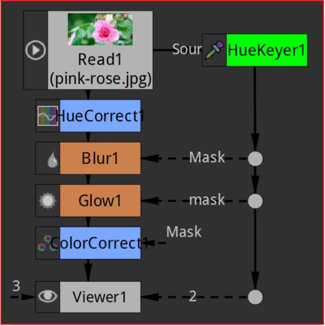
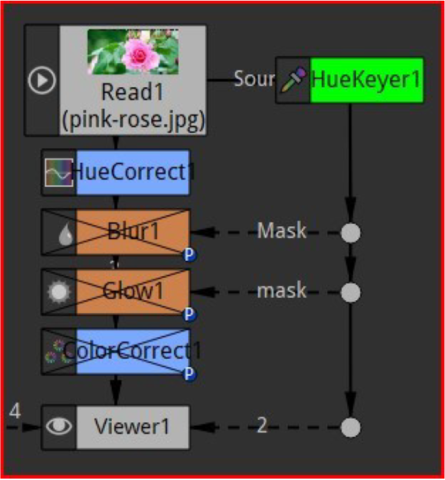

.. for help on writing/extending this file, see the reStructuredText cheatsheet
   http://github.com/ralsina/rst-cheatsheet/raw/master/rst-cheatsheet.pdf

Hue Keyer
=========

The :ref:`HueKeyer <net.sf.openfx.HueKeyer>` node pulls a key (a mask) from
the hue of the image: you choose a range of hues, and the node makes those
colors transparent.

Hue and saturation are computed from the RGB values of the source image. For
each hue, two curves control the result:

amount
   The output transparency for that hue: ``amount = 1`` gives ``alpha = 0``.

sat_thrsh
   If the saturation of a pixel is below this value, its transparency is
   gradually reduced. This keeps grays and nearly gray colors opaque.

.. figure:: _images/tutorials-keying/huekeyer-properties.png
   :width: 400px
   :align: center
   :alt: HueKeyer properties panel, with the amount curve drawn over a hue spectrum

   The HueKeyer properties: the ``amount`` and ``sat_thrsh`` curves are drawn
   over the hue spectrum.

HueKeyer has no mask input, only a Source input and the Source and Output
layer choices: its job is to make the mask. It has few parameters, but they
give precise control. As with any keyer, start from the best image you can
get: compression artifacts in the source give a worse key. In most cases you
only need to adjust two or three points.

Selecting the hue
-----------------

First select the hue you want to key. In the Viewer, move the mouse over that
color, hold :kbd:`Ctrl` (:kbd:`Cmd` on macOS) and click. A vertical bar
appears in the hue graph of HueKeyer at the hue you picked, and stays there.

   The vertical bar marks the hue picked in the Viewer.

The bar is only an indicator: the ``amount`` curve does not move to it. By
default, the ``amount`` curve is 1 for green and cyan, so HueKeyer keys those
hues. To key another hue, move the control points so that the curve is 1
around the bar and 0 elsewhere. The slopes on each side of the bar control how
gradually the key falls off: move the control points to tighten or widen the
selection, and double-click on the curve to add control points for finer
control. You will mostly edit the ``amount`` curve. Change it carefully: a
small move of a control point can change the key a lot.

Example: a desaturated rose
---------------------------

In this example, the rose is desaturated by
:ref:`HueCorrect <net.sf.openfx.HueCorrect>`, and HueKeyer makes a mask of the
rose that can limit other effects to it, or to the rest of the image. The hue
picked in the Viewer is the green of a leaf, and the ``amount`` curve keeps its
default shape, so HueKeyer keys the green leaves: they become transparent
(alpha 0), and the rose stays opaque (alpha 1).

   The source image.

   The result.

The node graph contains HueKeyer, HueCorrect,
:ref:`Blur <net.sf.cimg.CImgBlur>`, :ref:`Glow <fr.inria.Glow>` and
:ref:`ColorCorrect <net.sf.openfx.ColorCorrectPlugin>`. The output of HueKeyer
is connected to the Mask inputs of Blur and Glow (in this project the Mask
input of ColorCorrect is not connected).

.. figure:: _images/tutorials-keying/huekeyer-demo-ui.png
   :width: 650px
   :align: center
   :alt: Natron window with the Viewer, the node graph and the HueKeyer and ColorCorrect properties

   The whole project in Natron.

   The node graph.

A masked effect applies where the mask is opaque (alpha 1), that is, outside
the keyed hues: here, on the rose. For the blur to apply to the leaves instead
of the rose, enable **Invert Mask** in the Blur node.

.. figure:: _images/tutorials-keying/huekeyer-demo-mask.png
   :width: 600px
   :align: center
   :alt: Black and white mask: the rose is white, most of the leaves are black

   The mask computed by HueKeyer: white where it is opaque (the rose), black
   where the green hues are keyed.

The final image below only uses HueCorrect: its ``sat`` curve desaturates the
pink hues, and its own Mask is not used. Blur, Glow and ColorCorrect are
disabled. With them enabled, the HueKeyer mask limits their effect to the
opaque part of the mask.

   The final image.

   The node graph for the final image: Blur, Glow and ColorCorrect are disabled.

.. figure:: _images/tutorials-keying/huecorrect-properties.png
   :width: 320px
   :align: center
   :alt: HueCorrect properties, with the sat and lum curves

   The HueCorrect settings used for the desaturation.

HueKeyer and HueCorrect
-----------------------

HueKeyer and HueCorrect use the same kind of hue graph, which makes them a
good combination: HueKeyer selects the hues, HueCorrect changes them. Unlike
HueKeyer, HueCorrect has a mask input, so the HueKeyer mask can limit its
effect, for precise color effects.

.. note::

   HueCorrect is also very useful for spill suppression. If colored fringes
   remain around the edges of a key, and the despill nodes don't remove them,
   lower the saturation (``sat``) or the suppression curves (``r_sup``,
   ``g_sup``, ``b_sup``) of HueCorrect for the hue of the fringes.

Footage credits: the rose photograph and the screenshots were provided by the
author of this tutorial, @blackearth2014.
