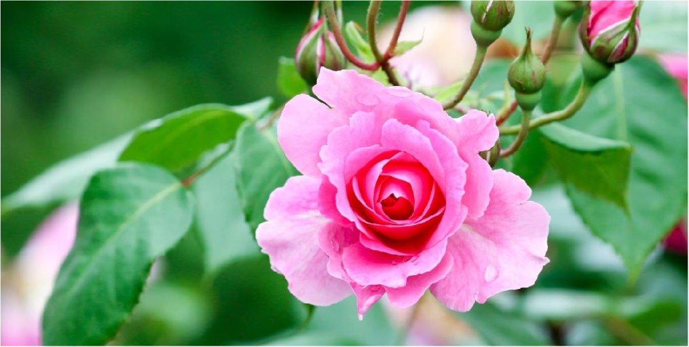
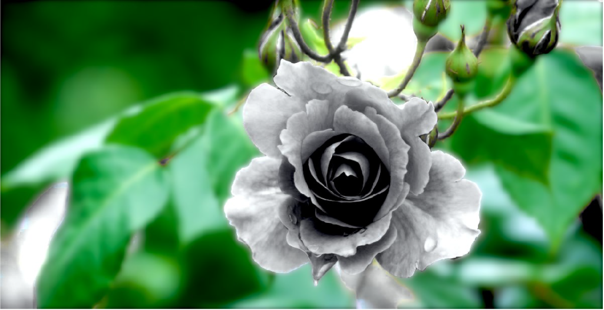
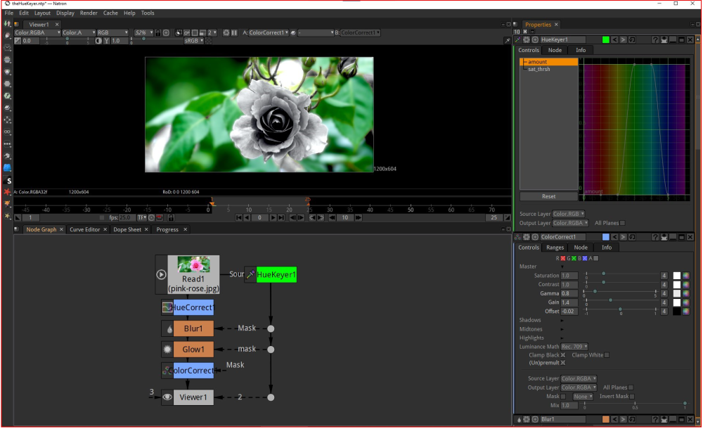
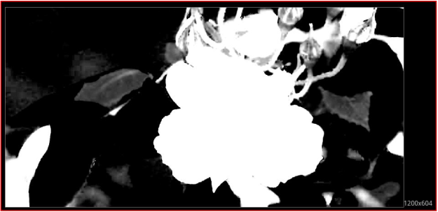
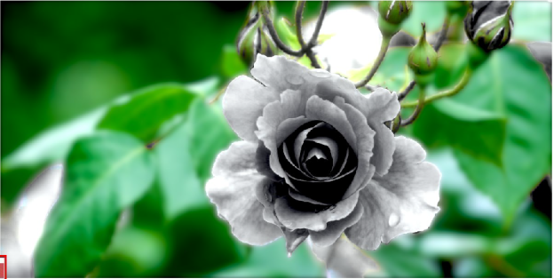
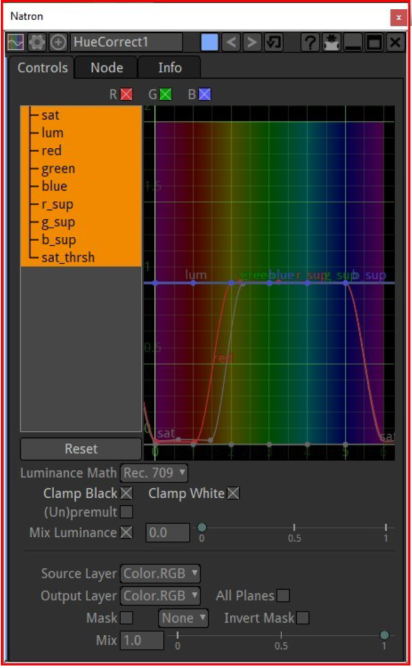
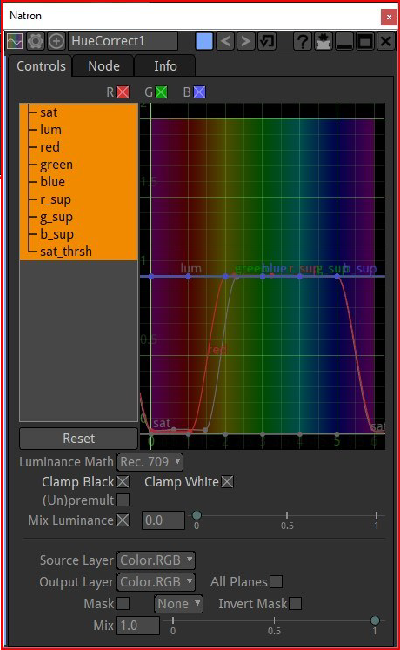

.. for help on writing/extending this file, see the reStructuredText cheatsheet
   http://github.com/ralsina/rst-cheatsheet/raw/master/rst-cheatsheet.pdf

Hue Keyer
=========

The :ref:`HueKeyer <net.sf.openfx.HueKeyer>` node pulls a key (a mask) from
the hue of the image: you choose a range of hues, and the node makes those
colours transparent.

Hue and saturation are computed from the RGB values of the source image. For
each hue, two curves control the result:

amount
   The output transparency for that hue: ``amount = 1`` gives ``alpha = 0``.

sat_thrsh
   If the saturation of a pixel is below this value, its transparency is
   gradually reduced. This keeps greys and nearly grey colours opaque.

.. figure:: _images/tutorials-keying/huekeyer-properties.png
   :width: 400px
   :align: center
   :alt: HueKeyer properties panel, with the amount curve drawn over a hue spectrum

   The HueKeyer properties: the ``amount`` and ``sat_thrsh`` curves are drawn
   over the hue spectrum.

HueKeyer has no mask input, only a Source input and the Source and Output
layer choices: its job is to make the mask. It has few parameters, but they
give precise control. As with any keyer, start from the best image you can
get: compression artifacts in the source give a worse key. In most cases you
only need to adjust two or three points.

Selecting the hue
-----------------

First select the hue you want to key. In the Viewer, move the mouse over that
colour, hold :kbd:`Ctrl` and click. A vertical bar appears in the hue graph of
HueKeyer at the hue you picked, and stays there.

.. figure:: _images/tutorials-keying/huekeyer-hue-selection.png
   :width: 400px
   :align: center
   :alt: HueKeyer hue graph with a vertical bar marking the picked hue

   The vertical bar marks the hue picked in the Viewer.

The ``amount`` curve rises before the selected hue and falls after it. Its
slopes control how gradually the key falls off on each side: move the control
points to tighten or widen the selection. Double-click on the curve to add
control points for finer control. You will mostly edit the ``amount`` curve.
Change it carefully: a small move of a control point can change the key a lot.

Example: a desaturated rose
---------------------------

In this example, HueKeyer keys the pink of a rose, and
:ref:`HueCorrect <net.sf.openfx.HueCorrect>` desaturates it.

   The source image.

   The result, with HueKeyer and HueCorrect.

The node graph contains HueKeyer, HueCorrect,
:ref:`Blur <net.sf.cimg.CImgBlur>`, :ref:`Glow <fr.inria.Glow>` and
:ref:`ColorCorrect <net.sf.openfx.ColorCorrectPlugin>`. The output of HueKeyer
is connected to the Mask input of Blur, Glow and ColorCorrect.

   The whole project in Natron.

.. figure:: _images/tutorials-keying/huekeyer-demo-graph.png
   :width: 400px
   :align: center
   :alt: Node graph: Read, HueCorrect, Blur, Glow, ColorCorrect and Viewer, with HueKeyer feeding the masks

   The node graph.

The mask computed by HueKeyer is used to blur a region of the image. For the
blur to apply outside the rose rather than inside, enable **Invert Mask** in
the Blur node.

   The mask computed by HueKeyer.

The final image below only uses HueKeyer and HueCorrect, for the
desaturation: Blur, Glow and ColorCorrect are disabled. With them enabled, the
HueKeyer mask limits their effect to the keyed area.

   The final image.

.. figure:: _images/tutorials-keying/huekeyer-demo-graph-final.png
   :width: 350px
   :align: center
   :alt: Node graph with Blur, Glow and ColorCorrect disabled

   The node graph for the final image: Blur, Glow and ColorCorrect are disabled.

   The HueCorrect settings used for the desaturation.

HueKeyer and HueCorrect
-----------------------

HueKeyer and HueCorrect use the same kind of hue graph, which makes them a
good combination: HueKeyer selects the hues, HueCorrect changes them. Unlike
HueKeyer, HueCorrect has a mask input, so the two can be combined into
precise colour effects.

   The HueCorrect hue graph.

.. note::

   HueCorrect is also very useful for spill suppression. If coloured fringes
   remain around the edges of a key, and the despill nodes don't remove them,
   lower the saturation (``sat``) or the suppression curves (``r_sup``,
   ``g_sup``, ``b_sup``) of HueCorrect for the hue of the fringes.
