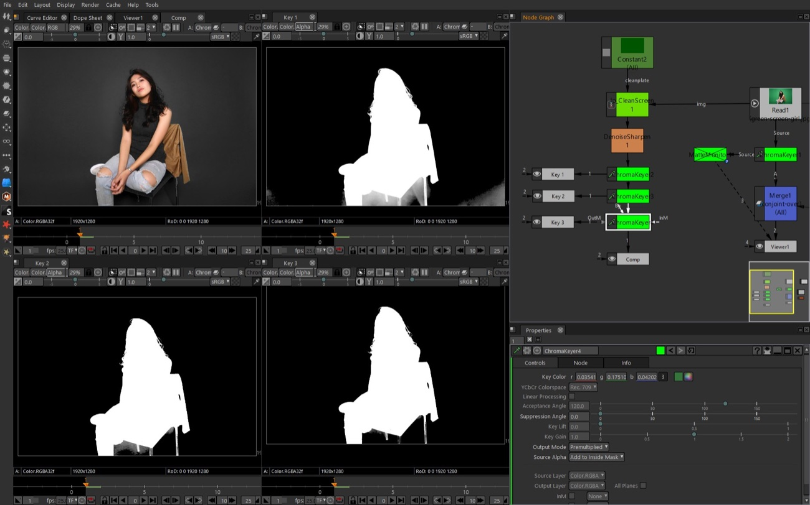

.. for help on writing/extending this file, see the reStructuredText cheatsheet
   http://github.com/ralsina/rst-cheatsheet/raw/master/rst-cheatsheet.pdf

Multipass Keying
================

Most problems when pulling a key come from the lighting and from noise in the
image. Noise is usually strongest in the red and blue channels. Before keying,
clean up the plate:

- A screen-cleaning node such as **lp_CleanScreen** or **PxF_ScreenClean**
  (community PyPlugs from the `natron-plugins
  <https://github.com/NatronGitHub/natron-plugins>`_ collection) evens out
  the color of the green screen.
- If the screen is noisy because of poor lighting,
  :ref:`DenoiseSharpen <net.sf.openfx.DenoiseSharpen>` smooths the channels
  enough to get a decent key.

Then key with several :ref:`ChromaKeyer <net.sf.openfx.ChromaKeyerPlugin>`
nodes in a chain, each one refining the matte of the previous one. Key the
cleaned and denoised plate, but apply the final matte to the original plate:
the cleanup is only there to help the keyers, and its colors should not end up
in the composite.

   
   Multipass keying: lp_CleanScreen and DenoiseSharpen, then three chained
   ChromaKeyer nodes (ChromaKeyer2 to ChromaKeyer4), whose mattes are shown in
   the Viewers Key 1 to Key 3. The properties of the last one are shown on the
   right. The separate branch on the right (ChromaKeyer1, a disabled
   MatteMonitor and a Merge) is a single-keyer comparison and is not part of
   the chain.

Setting up the chain
--------------------

The first keyer makes the core matte: the hard, solid inside of the
foreground. Use settings that make the inside fully opaque, even if the edges
are too hard. Each following keyer refines the edges, the hair and the
semi-transparent areas: between passes, pick the **Key Color** near the area
you are refining, and adjust the **Acceptance Angle**, **Key Lift** and
**Key Gain** for that area. Set the **Output Mode** and **Source Alpha**
parameters of each ChromaKeyer as follows:

+-----------------------+---------------------+-------------------------+
| ChromaKeyer           | Output Mode         | Source Alpha            |
+=======================+=====================+=========================+
| First (core matte)    | Intermediate        | Ignore                  |
+-----------------------+---------------------+-------------------------+
| Each following one    | Intermediate        | Add to Inside Mask      |
+-----------------------+---------------------+-------------------------+

With **Intermediate**, the color is passed through unchanged and the alpha
holds the key, which is what the next keyer needs. **Add to Inside Mask** adds
the alpha of the previous keyer to the inside mask (holdout matte) of this
one. With more than three keyers the chain gets harder to follow, so keep it
short.

Applying the matte to the original plate
----------------------------------------

The output of the last keyer has the colors of the cleaned and denoised plate.
To get the original colors with the new matte, copy the alpha of the last
keyer into the original plate with a :ref:`Shuffle <net.sf.openfx.ShufflePlugin>`
node (or the **Copy** operation of a Merge node), then premultiply the result
with a :ref:`Premult <net.sf.openfx.Premult>` node.

In the screenshot, the last keyer is set to **Premultiplied**: this gives a
premultiplied image directly, but with the colors of the cleaned plate.

Footage credits: the sample photograph and the screenshot were provided by the
author of this tutorial, @blackearth2014.
