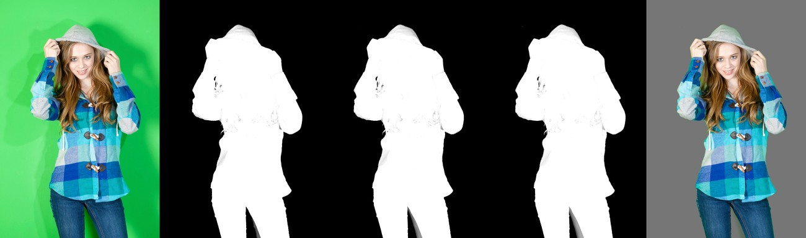

.. for help on writing/extending this file, see the reStructuredText cheatsheet
   http://github.com/ralsina/rst-cheatsheet/raw/master/rst-cheatsheet.pdf

Multipass Keying
================

Most problems when pulling a key come from the lighting and from noise in the
image. Noise is usually strongest in the red and blue channels. Before keying,
clean up the plate:

- A screen-cleaning node such as **lp_CleanScreen** or **PxF_ScreenClean**
  (community PyPlugs from the `natron-plugins
  <https://github.com/NatronGitHub/natron-plugins>`_ collection) evens out
  the color of the green screen.
- If the screen is noisy because of poor lighting,
  :ref:`DenoiseSharpen <net.sf.openfx.DenoiseSharpen>` smooths the channels
  enough to get a decent key.

Then key with several :ref:`ChromaKeyer <net.sf.openfx.ChromaKeyerPlugin>`
nodes in a chain, each one refining the matte of the previous one. Key the
cleaned and denoised plate, but apply the final matte to the original plate:
the cleanup is only there to help the keyers, and its colors should not end up
in the composite.

   Multipass keying. From left to right: the source image, the mattes of the
   three chained keyers (ChromaKeyer1 to ChromaKeyer3), and the result, with
   the matte applied to the original plate, over a gray background.

.. Screenshot wanted here (the previous one showed a photo that could not be
   redistributed): the Natron window with this project, showing the node graph
   described below, Viewers on the three ChromaKeyer nodes (alpha channel) and
   on Premult1, and the properties of ChromaKeyer3.

Setting up the chain
--------------------

The first keyer makes the core matte: the hard, solid inside of the
foreground. Use settings that make the inside fully opaque, even if the edges
are too hard. Each following keyer refines the edges, the hair and the
semi-transparent areas: between passes, pick the **Key Color** near the area
you are refining, and adjust the **Acceptance Angle**, **Key Lift** and
**Key Gain** for that area. Set the **Output Mode** and **Source Alpha**
parameters of each ChromaKeyer as follows:

+-----------------------+---------------------+-------------------------+
| ChromaKeyer           | Output Mode         | Source Alpha            |
+=======================+=====================+=========================+
| First (core matte)    | Intermediate        | Ignore                  |
+-----------------------+---------------------+-------------------------+
| Each following one    | Intermediate        | Add to Inside Mask      |
+-----------------------+---------------------+-------------------------+

With **Intermediate**, the color is passed through unchanged and the alpha
holds the key, which is what the next keyer needs. **Add to Inside Mask** adds
the alpha of the previous keyer to the inside mask (holdout matte) of this
one. With more than three keyers the chain gets harder to follow, so keep it
short.

In the example above, the node graph is Read1, DenoiseSharpen1, then
ChromaKeyer1, ChromaKeyer2 and ChromaKeyer3 in a chain. The screen is clean, so
no screen-cleaning node is needed. The noise levels of DenoiseSharpen1 were
analyzed on a plain area of the screen, with **Analyze Noise Levels**. The
shirt has cyan squares, close to the green of the screen, so the core matte
uses a narrow **Acceptance Angle**, which keeps the shirt opaque, and a low
**Key Gain**, which makes the whole screen transparent. The next two keyers use
a wider angle: on their own they would make holes in the shirt, but the core
matte, added to their inside mask, keeps it opaque.

+--------------+-------------------------------+------------------+----------+
| ChromaKeyer  | Key Color (linear RGB)        | Acceptance Angle | Key Gain |
+==============+===============================+==================+==========+
| ChromaKeyer1 | 0.08, 0.65, 0.14 (screen)     | 70               | 0.5      |
+--------------+-------------------------------+------------------+----------+
| ChromaKeyer2 | 0.01, 0.45, 0.07 (shadow)     | 120              | 0.6      |
+--------------+-------------------------------+------------------+----------+
| ChromaKeyer3 | 0.11, 0.79, 0.18 (lit screen) | 120              | 0.8      |
+--------------+-------------------------------+------------------+----------+

**Key Lift** is 0 in the three keyers.

Applying the matte to the original plate
----------------------------------------

The output of the last keyer has the colors of the cleaned and denoised plate.
To get the original colors with the new matte, copy the alpha of the last
keyer into the original plate with a :ref:`Shuffle <net.sf.openfx.ShufflePlugin>`
node (or the **Copy** operation of a Merge node), then premultiply the result
with a :ref:`Premult <net.sf.openfx.Premult>` node.

In the example, Shuffle1 takes the color channels from Read1 (its **B** input)
and the alpha channel from ChromaKeyer3 (its **A** input), and Premult1
follows it. Setting the last keyer to **Premultiplied** instead would give a
premultiplied image directly, but with the colors of the cleaned plate.

Some green spill remains on the hair: see the :doc:`despilling tips
<tutorials-keying-despill>`.

See also
--------

- :doc:`compositing-keying`: the keyer nodes, and how to combine mattes.

Image credits
-------------

- Source photograph: `Girl in front of a green background
  <https://commons.wikimedia.org/wiki/File:Girl_in_front_of_a_green_background.jpg>`_
  by PictureYouth (originally on Flickr, no longer online), licensed under
  `CC BY 2.0 <https://creativecommons.org/licenses/by/2.0/>`_. The mattes and
  the result were rendered from it with Natron.
