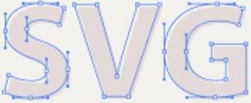
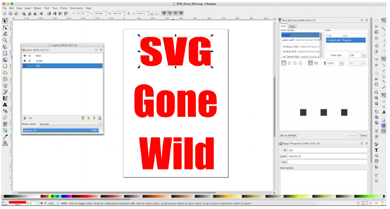
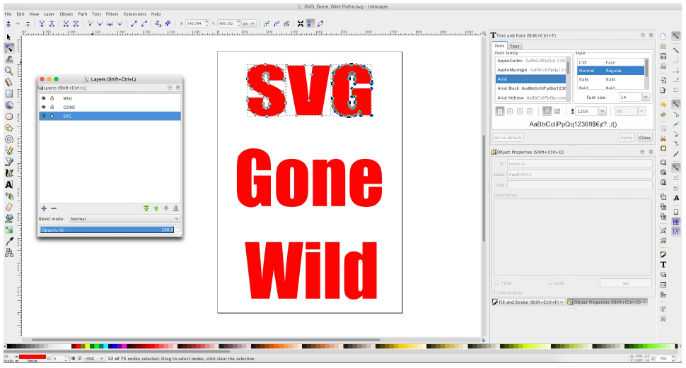
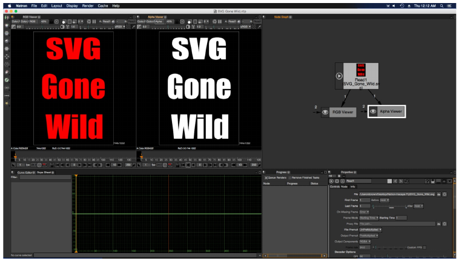
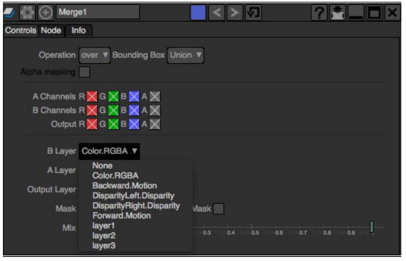
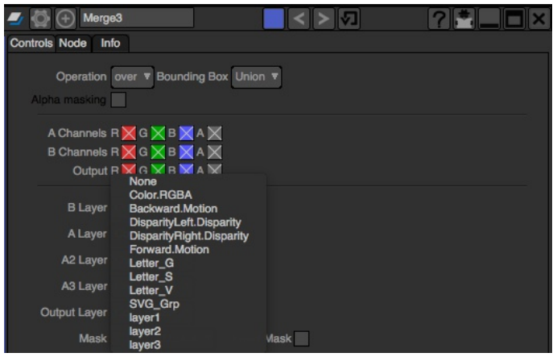
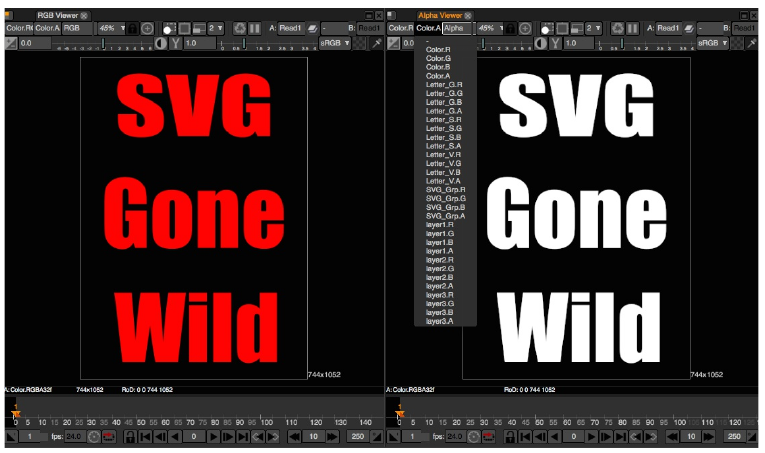
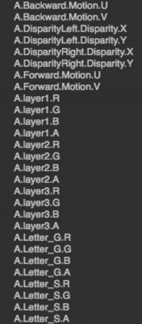
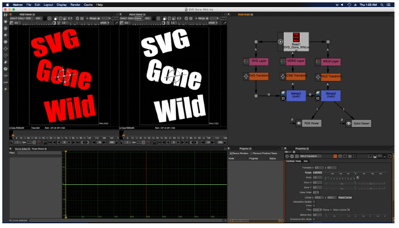
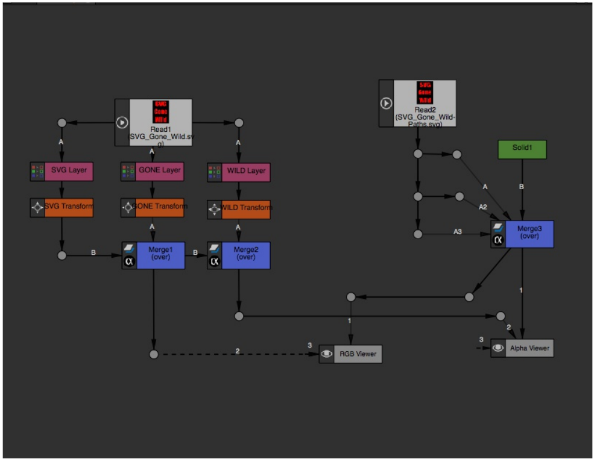

.. for help on writing/extending this file, see the reStructuredText cheatsheet
   http://github.com/ralsina/rst-cheatsheet/raw/master/rst-cheatsheet.pdf

.. _tutorials-svgworkflow:

Vector graphics workflow
========================

SVG (Scalable Vector Graphics) files describe shapes, paths and text rather
than pixels, so they can be rendered at any resolution without blur or
compression artifacts. Inkscape and many other drawing programs save SVG.

Most compositing programs read an SVG file as a single flat image. Natron's
:ref:`ReadSVG <net.fxarena.openfx.ReadSVG>` node also reads each layer, group
and path of the file as a separate image layer, with its own color and alpha
channels. You can then animate, color correct or mask each element of the
drawing separately in Natron.

This tutorial shows how to prepare a drawing in Inkscape and use its
elements in Natron.

Preparing the file in Inkscape
------------------------------

Set the size of the document first (**File > Document Properties**), then
draw on one or more layers, and save the file as SVG (Inkscape SVG or plain
SVG both work).

ReadSVG makes one image layer for each layer, group (``<g>`` element) and path
(``<path>`` element) that has an ``id``, and names it after that ``id``. Other
objects, such as rectangles, ellipses and text, don't get their own image
layer: they only appear in the image layers of the layer or group that
contains them, and in the main Color layer.

So:

- convert the objects you want to use separately to paths
  (**Path > Object to Path**). Converting a text gives a group with one path
  per letter;
- group the objects you want to animate together (**Object > Group**): each
  group gets its own image layer;
- give each object a meaningful ``id`` in **Object > Object Properties**. The
  name shown in the Inkscape **Layers and Objects** dialog is a label, not the
  ``id``: Inkscape layers keep ids such as ``layer1`` unless you change them,
  for example in the **XML Editor** (**Edit > XML Editor**).

The screenshot above shows letters converted to paths and grouped by word;
the one below shows the same letters ungrouped, so that each letter gets its
own image layer in Natron.

.. note::

   ReadSVG renders the SVG at 90 DPI by default (the **DPI** parameter),
   while Inkscape uses 96 DPI: a document set in millimeters is a little
   smaller in Natron than in an Inkscape PNG export. If the exact size in
   pixels matters, set the document size in pixels (``px``) in Inkscape.

Reading the file in Natron
--------------------------

Read the SVG file with a Read node (the ReadSVG reader is chosen for ``.svg``
files). The screenshot below shows two viewers, displaying the color and the
alpha of the file.

The layer menu at the top left of the viewer, and the layer menus of the
nodes connected to the Read node, list the image layers found in the file.
The next screenshots show these menus in a Merge and a Shuffle node.

In the second screenshot, the letters were converted to paths and each path
was given the name of its letter, so each letter has its own image layer.

Using the image layers
----------------------

Several nodes can use the image layers of the SVG file:

- :ref:`Shuffle <net.sf.openfx.ShufflePlugin>` builds its output from any
  channel of any image layer of its A and B inputs. Use it to extract one
  element of the drawing to the main Color layer, or to copy one of its
  channels, for example the alpha of a letter, into another image.
- :ref:`Merge <net.sf.openfx.MergePlugin>` has an **A Layer** and a
  **B Layer** menu that choose which image layer of each input is merged, and
  its **Mask** input can use any channel of any image layer, for example
  ``letterA.A``.
- Most other nodes can process a single image layer, and use any channel of
  an image layer as a mask. The **Output Layer** menu is on their main
  (usually **Controls**) tab. The input menu, named after the input (for
  example **Source Layer**), is hidden by default: it appears when that input
  is connected and **All Planes** is unchecked.

The node graph below extracts individual elements with Shuffle and Merge
nodes.

Plan the drawing before you start: give the layers, groups and paths
consistent, meaningful names, so that they are easy to find in Natron.
