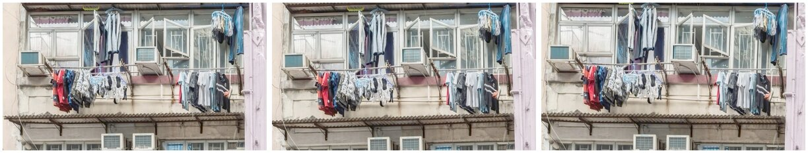

.. for help on writing/extending this file, see the reStructuredText cheatsheet
   http://github.com/ralsina/rst-cheatsheet/raw/master/rst-cheatsheet.pdf

Tracking, stabilizing and match-moving
======================================

.. note::

   This tutorial is based on the tutorial `Natron VFX compositor: Tracker node
   <https://colorgrade13.wordpress.com/2016/12/14/natron-vfx-compositor-tracker-node/>`_
   by blackearth2014 (https://github.com/blackearth2014), written for Natron
   2.1 in 2016. It follows the same workflow, rewritten and updated for Natron
   2.6, with new footage and screenshots. See :ref:`tutorials-tracking-credits`.

This tutorial walks through a complete shot with the
:ref:`Tracker <fr.inria.built-in.Tracker>` node:

1. track four points of a building facade filmed with a moving camera;
2. check and fix the tracks;
3. **stabilize** the shot, so that the facade stays still;
4. **match-move** an image onto the facade, so that it follows the camera
   motion as if it were glued to the wall.

The reference for every button and parameter of the Tracker is the
:doc:`Tracking and stabilizing <compositing-tracking>` page of this guide.
This tutorial uses the same names, and only explains what is needed for each
step.

The footage
-----------

The shot is 48 frames long, 960x540 pixels. It was made in Natron from a
photograph of a building in Hong Kong: an animated CornerPin moves the
photograph as a hand-held camera would (a slow push-in, some drift, a little
roll and a change of perspective). Every point of the facade follows the same
perspective transform, so the tracks can be checked against each other.

   Frames 1, 24 and 48 of the shot. The camera moves and turns slightly, and
   the facade gets bigger.

You can follow the tutorial with any shot of your own. Good shots for a first
try have a flat, textured surface (a wall, a sign, the ground) that stays in
view during the whole shot.

Setting up the Tracker
----------------------

1. Read the image sequence with a :ref:`Read <fr.inria.built-in.Read>` node.
   When it is the first Read of a new project, Natron sets the project format
   and frame range from it. Check them in the project settings (:kbd:`S` in
   the Node Graph): the Tracker computes its results in the project format.
2. Select the Read node and create a Tracker from the **Transform** group of
   the toolbar, or press :kbd:`Tab` in the Node Graph and type "Tracker". The
   Tracker is connected to the selected node.
3. Connect the Viewer to the Tracker, and double-click the Tracker to open its
   Properties panel. The Tracker tools appear in a toolbar at the top of the
   Viewer only while this panel is open.
4. In the **Transform** tab, leave **Motion Type** to **None** for now: the
   Tracker then shows its input image unchanged, which is what you need while
   tracking.

.. PENDING SCREENSHOT (not made yet): _images/tutorials-tracking/viewer-toolbar.png
      :width: 100%
      :align: center
      :alt: The Tracker toolbar at the top of the Viewer

      The Tracker toolbar of the Viewer.

From left to right, the toolbar has:

- **Add Track**: when on, each click in the Viewer adds a track.
- The tracking buttons: **Track Backward**, **Track Previous**, **Stop
  Tracking**, **Track Next**, **Track Forward**, **Track Range**, **Track All
  Keyframes** and **Track Current Keyframe**.
- **Set Keyframe On Pattern** and **Remove Keyframe On Pattern**.
- **Clear Animation**, **Clear Animation Backward** and **Clear Animation
  Forward**, which delete the tracked positions of the selected tracks.
- **Refresh Viewer**, **Center Viewer**, **Create Keyframe On Move** and
  **Show Error**, which change how the Viewer behaves during tracking.
- **Reset Offset** and **Reset Track**.
- **Default Pattern Size** (21 pixels), **Default Search Area Size** (71
  pixels) and **Default Motion Model**: the settings of the next tracks you
  add. They are only shown in this toolbar.

Hover over a button to see its tooltip and its keyboard shortcut. The
:doc:`Tracking and stabilizing <compositing-tracking>` page describes each of
them.

Placing the tracks
------------------

Go to the first frame. Look for small features that are contrasted in two
directions, such as corners and dots, and that stay visible during the whole
shot. A point on a straight edge is a bad choice: the tracker cannot tell where
it is along the edge. Avoid reflections, moving objects (here, the laundry
would be a bad choice in a real shot) and features hidden for part of the shot.

To stabilize or match-move a flat surface, choose at least four features on
that surface, spread over it: here, a corner of each of three air conditioners
and the bracket of the awning on the right.

To add each track, hold :kbd:`Ctrl` + :kbd:`Alt` (:kbd:`Cmd` + :kbd:`Alt` on
macOS) and click on the feature. You can also turn on **Add Track** and click,
or press the **+** button below the track table of the Properties panel.

.. PENDING SCREENSHOT (not made yet): _images/tutorials-tracking/tracks-added.png
      :width: 100%
      :align: center
      :alt: Four tracks placed on corners of the facade at frame 1

      Four tracks at frame 1. The selected track shows its pattern (the inner
      square) and its search window (the outer square).

The **pattern** is the part of the image that the tracker looks for in the
other frames. The **search window** is the area where it looks for it, around
the previous position. Drag the corners of the squares to resize them: make
the pattern big enough to include the whole feature, and the search window
bigger when the image moves fast. A larger search window is slower to track.

Each track is a row of the track table, in the **Tracking** tab of the
Properties panel. Double-click its label to give it a name, and uncheck
**Enabled** to ignore a track without deleting it.

Tracking
--------

Select the tracks (:kbd:`Ctrl` + :kbd:`A`, :kbd:`Cmd` + :kbd:`A` on macOS,
selects all of them, with the mouse over the Viewer), then press **Track
Forward** (:kbd:`V`). The tracker follows each feature frame by frame, up to
the last frame of the timeline. It stops earlier if all the tracks are lost.
Press **Stop Tracking** (:kbd:`Esc`) to stop it yourself.

Other ways to track:

- **Track Backward** (:kbd:`Z`) tracks towards the first frame. This is
  useful when the feature is clearer at the end of the shot, or when it
  enters the frame during the shot: place the track on the last frame where
  it is visible and track backward. Tracking the same track in both
  directions from a frame in the middle of the shot is often more reliable
  than tracking it from one end.
- **Track Next** (:kbd:`C`) and **Track Previous** (:kbd:`X`) track one frame
  at a time, so that you can watch a difficult part of the shot and correct
  the track at each frame.
- **Track Range** asks for a first frame, a last frame and a step, for
  example to track only frames 150 to 240 of a long shot.

Turn on **Show Error** to color the path of each track by how well its pattern
matched at each frame: green is a good match, red a bad one. Turn off
**Refresh Viewer** to track faster: the Viewer then only redraws the tracks,
not the image.

.. PENDING SCREENSHOT (not made yet): _images/tutorials-tracking/tracks-tracked.png
      :width: 100%
      :align: center
      :alt: The paths of the four tracks over the 48 frames, drawn in green

      After tracking, with Show Error on: the paths of the tracks are green, so
      the patterns were found at every frame.

Checking and fixing the tracks
------------------------------

Play the shot and watch each track: it must stay on its feature. A track that
drifts or jumps must be fixed before its data is used.

- **Fix it with a pattern keyframe.** Go to the frame where the track starts
  to drift, and drag the track back onto the feature. With **Create Keyframe
  On Move** on (the default), this sets a pattern keyframe: the tracker now
  uses the pattern as it looks at this frame. Track again from there, or use
  **Track All Keyframes** (:kbd:`Ctrl` + :kbd:`V`) to track between the
  pattern keyframes. The pattern keyframes of the selected track are shown on
  the timeline and as thumbnails in the Viewer.
- **Clear the bad frames.** **Clear Animation Forward** or **Clear Animation
  Backward** delete the tracked positions after or before the current frame,
  and **Clear Animation** deletes all of them.
- **Track something else with an offset.** When the feature you need is
  hidden for part of the shot, or leaves the frame, you can track a nearby
  feature on the same surface instead. Drag the center of the track with
  :kbd:`Ctrl` (:kbd:`Cmd` on macOS) held: only the pattern and the search
  window move, and a line links them to the center, which stays on the point
  you need. **Reset Offset** brings them back.
- **Change the tracking settings.** In the **Tracking** tab, you can track
  with only one of the **Track Red**, **Track Green** and **Track Blue**
  channels, when it has more contrast; check **Normalize Intensities** when
  the lighting changes during the shot; increase **Pre-blur Sigma** for noisy
  footage. **Max. Error** sets how bad a match can be before the track is
  considered lost. **Animate Enabled** turns off the **Enabled** parameter of
  a track at the frames where it was lost, so that these frames are not used
  in the next steps.

.. PENDING SCREENSHOT (not made yet): _images/tutorials-tracking/tracking-tab.png
      :width: 500px
      :align: center
      :alt: The Tracking tab of the Tracker properties, with four tracks in the track table

      The Tracking tab: the tracking settings and the track table.

Below the track table, **Average** creates a new track whose position is the
average of the selected tracks. It can replace several noisy tracks of the same
feature by a single, smoother one.

The tracked positions are animation curves. To look at them, open the Curve
Editor, unfold the Tracker and the track, and select the curves of its
**Center**. A sudden step in a curve is usually a frame where the track
jumped.

.. PENDING SCREENSHOT (not made yet): _images/tutorials-tracking/curve-editor.png
      :width: 100%
      :align: center
      :alt: The Curve Editor showing the x and y curves of the center of a track

      The Curve Editor shows the x and y position of the center of a track at
      each frame.

Stabilizing the shot
--------------------

The tracking is done: now use the tracks. In the **Transform** tab:

1. Set **Motion Type** to **Stabilize**.
2. Set **Transform Type**. **Transform** keeps the facade still in position,
   rotation and size. **CornerPin** also removes the change of perspective,
   since it can deform the image. With at least four tracks on a flat
   surface, as here, CornerPin gives the stillest result; with fewer tracks,
   or tracks that are not on one plane, use Transform.
3. Go to the frame that must not move, and press **Set to Current Frame** to
   make it the **Reference Frame**. The other frames are transformed to match
   it. Here, frame 1 is the reference.

With **Compute Transform Automatically** checked (the default), the transform
is computed at once; otherwise press **Compute**. The Tracker now outputs the
stabilized image.

.. PENDING SCREENSHOT (not made yet): _images/tutorials-tracking/transform-tab.png
      :width: 500px
      :align: center
      :alt: The Transform tab of the Tracker properties, with Motion Type set to Stabilize

      The Transform tab, set to stabilize the shot with a CornerPin.

.. PENDING SCREENSHOT (not made yet): _images/tutorials-tracking/stabilized-frames.jpg
      :width: 100%
      :align: center
      :alt: Frames 1, 24 and 48 of the stabilized shot: the facade is at the same place in all three

      Frames 1, 24 and 48 after stabilization: the facade stays still, and the
      edges of the moving frame become visible.

The stabilized image does not cover the whole frame anymore: the parts that
were outside the original image are black. Scale the result up a little (for
example with a :ref:`Transform <net.sf.openfx.TransformPlugin>` node after
the Tracker), or crop it.

**Fitting Error (px)** shows how far, in pixels, the tracks are from the
computed transform at each frame. If it is large at some frames, a track is
probably wrong there: fix it, or disable it at these frames. Check **Robust
Model** (the default) to ignore the tracks that do not agree with the others.
The :doc:`Tracking and stabilizing <compositing-tracking>` page explains how
the transform is computed.

To keep the motion of the camera but remove its shake, use **Remove Jitter**
instead of Stabilize: the transform removes only the fast motion, averaged over
**Jitter Period** frames. **Add Jitter** does the opposite, and applies only the
shake. **Smooth** averages the computed transform over a few frames, to remove
the noise of the tracks.

Match-moving an image onto the facade
-------------------------------------

Now place an image on the facade, between the two lines of laundry, as if it
were a poster glued to the wall. The Tracker computes the motion of the wall,
and an exported CornerPin applies it to the poster.

.. PENDING SCREENSHOT (not made yet): _images/tutorials-tracking/matchmove-graph.png
      :width: 600px
      :align: center
      :alt: Node graph: the poster goes through two CornerPin nodes and is merged over the plate

      The node graph of the match-move.

1. Read the poster image with a second Read node, and add a
   :ref:`CornerPin <net.sf.openfx.CornerPinPlugin>` after it (here called
   PlacePoster). Merge its output over the plate with a
   :ref:`Merge <net.sf.openfx.MergePlugin>` node: the poster is the A input,
   the plate the B input.
2. Go to the reference frame (frame 1), view the Merge, and move the four
   **to** points of PlacePoster so that the poster sits where it should be on
   the wall. This CornerPin is not animated: it only places the poster at the
   reference frame.
3. In the Tracker, set **Motion Type** to **Match-Move**, **Transform Type**
   to **CornerPin**, and the **Reference Frame** to frame 1.
4. Check **Link**, and press **Export**. A new CornerPin node appears next to
   the Tracker, not connected. Its parameters are linked to the Tracker, so it
   follows any later change of the tracks or of the Transform tab.
5. Insert this CornerPin between PlacePoster and the Merge.

Play the shot: the poster now follows the wall. At the reference frame, the
exported CornerPin does nothing, and the poster is where you placed it. At the
other frames, it moves the poster as the wall moved since the reference frame.

.. PENDING SCREENSHOT (not made yet): _images/tutorials-tracking/matchmove-frames.jpg
      :width: 100%
      :align: center
      :alt: Frames 1, 24 and 48 of the result: a picture of a rose stays at the same place on the wall

      Frames 1, 24 and 48 of the match-move: the poster stays on the wall while
      the camera moves.

To make the poster look like part of the shot, grade it to match the plate,
and add a little blur or grain if the plate has them.

The same exported node can move other things than an image: connect a Roto
node to it to make a mask follow the wall, for example to limit a color
correction to one window. The :doc:`Tracking and stabilizing
<compositing-tracking>` page shows how to set the **From** points of the
CornerPin to the bounding box of a Roto shape instead of using a second
CornerPin.

Where to go from here
---------------------

- Track a feature that leaves the frame, using an offset, and follow it with
  a Transform instead of a CornerPin.
- Try **Remove Jitter** on a real hand-held shot.
- Automate tracking with Python: see :doc:`/devel/tracker`.

See also
--------

- :doc:`compositing-tracking`: all the parameters of the Tracker, and how the
  transform is computed.
- :ref:`Tracker <fr.inria.built-in.Tracker>`,
  :ref:`CornerPin <net.sf.openfx.CornerPinPlugin>` and
  :ref:`Transform <net.sf.openfx.TransformPlugin>`: the node reference pages.
- :doc:`/devel/tracker` and the :ref:`Tracker <Tracker>` and :ref:`Track <Track>`
  classes of the Python API: creating tracks, tracking and reading the tracked
  data from a script.

.. _tutorials-tracking-credits:

Credits
-------

- Tutorial: based on the tutorial `Natron VFX compositor: Tracker node
  <https://colorgrade13.wordpress.com/2016/12/14/natron-vfx-compositor-tracker-node/>`_
  by blackearth2014 (https://github.com/blackearth2014), published on the
  *Dreaming Of Rivers* blog on 14 December 2016. The text and the images of
  this page are new: they follow the workflow of that tutorial, updated for
  Natron 2.6.
- Footage: made in Natron from `Building Facade in Hong Kong
  <https://commons.wikimedia.org/wiki/File:Building_Facade_in_Hong_Kong.jpg>`_
  by Wilfredor, from Wikimedia Commons, dedicated to the public domain (`CC0
  1.0 <https://creativecommons.org/publicdomain/zero/1.0/>`_). Resized,
  animated with a CornerPin and cropped.
- Poster: `Rose, Hot Pink
  <https://commons.wikimedia.org/wiki/File:Rose,_Hot_Pink_(52127660426).jpg>`_
  by Angelos @ Ottawa, dedicated to the public domain (`Public Domain Mark 1.0
  <https://creativecommons.org/publicdomain/mark/1.0/>`_), the image of the
  :doc:`Hue Keyer tutorial <tutorials-keying-huekeyer>`.
- Screenshots and renders: made with Natron 2.6.
